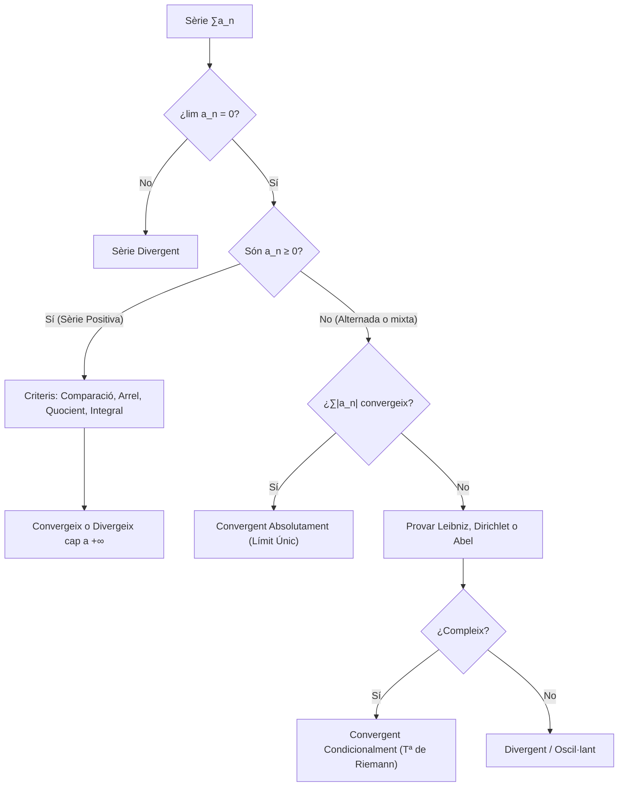

# Sèries numèriques
## 1. Conceptes Fonamentals i Convergència

Donada una successió de nombres reals $(a_n)_{n \in \mathbb{N}}$, definim la **successió de sumes parcials** $(S_N)$ com:
$$S_N = \sum_{n=1}^N a_n = a_1 + a_2 + \dots + a_N$$

> [!IMPORTANT] Definició de Sèrie i Convergència
> Una **sèrie** és el límit formal d'aquesta successió de sumes parcials. Direm que la sèrie $\sum_{n=1}^{\infty} a_n$ és **convergent** si existeix el límit finit:
> $$S = \lim_{N \to \infty} S_N = \lim_{N \to \infty} \sum_{n=1}^N a_n \in \mathbb{R}$$
> En aquest cas, $S$ rep el nom de *suma de la sèrie*.
> Si el límit no existeix o és $\pm\infty$, direm que la sèrie és **divergent**.

> [!NOTE] Proposició (Condició necessària de convergència)
> Si una sèrie $\sum a_n$ és convergent, aleshores el seu terme general tendeix a zero:
> $$\sum_{n=1}^\infty a_n < \infty \implies \lim_{n \to \infty} a_n = 0$$
> 
> *Demostració:* Si la sèrie convergeix a $S$, la successió de sumes parcials compleix $S_N \to S$ i $S_{N-1} \to S$. Com que $a_N = S_N - S_{N-1}$, prenent límits tenim $\lim a_N = \lim S_N - \lim S_{N-1} = S - S = 0$. $\blacksquare$
> 
> *Advertència:* L'invers és fals. La **sèrie harmònica** ($\sum \frac{1}{n}$) compleix $\lim \frac{1}{n} = 0$, però és divergent.

### Criteri de Cauchy per a Sèries
> [!IMPORTANT] Teorema (Condició de Cauchy)
> La sèrie $\sum a_n$ convergeix si i només si la seva successió de sumes parcials és de Cauchy. És a dir, per a tot $\varepsilon > 0$, existeix $n_0 \in \mathbb{N}$ tal que per a qualssevol $M \ge N \ge n_0$:
> $$\left| \sum_{n=N}^M a_n \right| < \varepsilon$$

---

## 2. Sèries de Referència

### 2.1 Sèrie Geomètrica
Té la forma $\sum_{n=0}^{\infty} r^n$, on $r$ és la raó.
La suma parcial $N$-èsima es pot calcular multiplicant per $r$ i restant:
$$S_N = 1 + r + r^2 + \dots + r^N \implies rS_N = r + r^2 + \dots + r^{N+1}$$
$$(1-r)S_N = 1 - r^{N+1} \implies S_N = \frac{1-r^{N+1}}{1-r} \quad (\text{si } r \neq 1)$$
Prenent el límit quan $N \to \infty$:
- Si $|r| < 1$, $r^{N+1} \to 0$, i la sèrie **convergeix** a $S = \frac{1}{1-r}$.
- Si $|r| \ge 1$, el límit no existeix (o divergeix), i la sèrie **divergeix**.

### 2.2 Sèrie Telescòpica
Es presenta en la forma $\sum_{n=1}^{\infty} (b_n - b_{n+1})$.
Les sumes parcials col·lapsen internament:
$$S_N = (b_1 - b_2) + (b_2 - b_3) + \dots + (b_N - b_{N+1}) = b_1 - b_{N+1}$$
Aquesta sèrie convergeix si i només si existeix el límit de la successió $b_n$, i la seva suma és $S = b_1 - \lim_{n\to\infty} b_n$.

### 2.3 Sèrie P (o Harmònica Generalitzada)
Té la forma $\sum_{n=1}^{\infty} \frac{1}{n^\alpha}$ amb $\alpha \in \mathbb{R}$.
- **Convergeix** si i només si $\alpha > 1$.
- **Divergeix** si $\alpha \le 1$.

---

## 3. Sèries de Termes No-Negatius

Quan $a_n \ge 0$, la successió de sumes parcials $S_N$ és monòtona creixent. 

> [!IMPORTANT] Teorema de Fita per a Termes Positius
> Una sèrie de termes no-negatius $\sum a_n$ convergeix si i només si la seva successió de sumes parcials $(S_N)$ està acotada superiorment.

### Criteris de Comparació
> [!NOTE] Criteri de Comparació per Desigualtat
> Siguin $a_n, b_n \ge 0$. Suposem que existeix $C > 0$ tal que $a_n \le C b_n$ per a tot $n \ge n_0$.
> - Si $\sum b_n$ convergeix $\implies \sum a_n$ convergeix.
> - Si $\sum a_n$ divergeix $\implies \sum b_n$ divergeix.

> [!NOTE] Criteri de Comparació per Pas al Límit
> Siguin $a_n, b_n > 0$. Definim el límit $L = \lim_{n\to\infty} \frac{a_n}{b_n}$.
> - Si $0 < L < \infty$, ambdues sèries tenen el **mateix caràcter** (totes dues convergeixen o totes dues divergeixen).
> - Si $L = 0$ i $\sum b_n < \infty \implies \sum a_n < \infty$.
> - Si $L = \infty$ i $\sum b_n = \infty \implies \sum a_n = \infty$.

### Criteris Operatius de Convergència
Sigui una sèrie $\sum a_n$ amb $a_n > 0$:

1. **Criteri de l'Arrel (Cauchy):** Sigui $L = \limsup_{n\to\infty} \sqrt[n]{a_n}$.
   - Si $L < 1 \implies$ Convergeix.
   - Si $L > 1 \implies$ Divergeix.
   - *(Si $L = 1$, el cas és dubtós).*
2. **Criteri del Quocient (D'Alembert):** Sigui $L = \lim_{n\to\infty} \frac{a_{n+1}}{a_n}$.
   - Si $L < 1 \implies$ Convergeix.
   - Si $L > 1 \implies$ Divergeix.
3. **Criteri de Raabe:** *(Útil quan el Quocient dóna 1)*. Sigui $L = \lim_{n\to\infty} n\left(1 - \frac{a_{n+1}}{a_n}\right)$.
   - Si $L > 1 \implies$ Convergeix.
   - Si $L < 1 \implies$ Divergeix.
4. **Criteri Integral (Maclaurin-Cauchy):** Sigui $f: [1, \infty) \to (0, \infty)$ una funció contínua i monòtona decreixent tal que $f(n) = a_n$.
   $$\sum_{n=1}^\infty a_n \text{ convergeix } \iff \int_1^\infty f(x) \, dx \text{ convergeix (és finita)}$$
5. **Criteri de Condensació de Cauchy:** Sigui $(a_n)$ monòtona decreixent i $a_n \ge 0$.
   $$\sum_{n=1}^\infty a_n < \infty \iff \sum_{k=0}^\infty 2^k a_{2^k} < \infty$$

---

## 4. Convergència Absoluta i Condicional

> [!IMPORTANT] Definició de Convergència Absoluta
> Una sèrie $\sum a_n$ és **absolutament convergent** si la sèrie dels valors absoluts $\sum |a_n|$ és convergent.

> [!NOTE] Teorema d'Implicació
> Tota sèrie absolutament convergent és convergent.
> 
> *Demostració (via Cauchy):* Com que $\sum |a_n|$ convergeix, per a tot $\varepsilon > 0$, existeix $n_0$ tal que per $M \ge N \ge n_0$, $\sum_{n=N}^M |a_n| < \varepsilon$. Per la desigualtat triangular generalitzada:
> $$\left| \sum_{n=N}^M a_n \right| \le \sum_{n=N}^M |a_n| < \varepsilon$$
> Per tant, la sèrie original també compleix Cauchy i convergeix. $\blacksquare$

Si una sèrie convergeix, però *no* absolutament (ex. $\sum \frac{(-1)^n}{n}$), s'anomena **condicionalment convergent**.

### Criteris per a Sèries No Positives (Alternades i altres)
> [!IMPORTANT] Criteri de Leibniz per a Sèries Alternades
> Sigui $\sum_{n=1}^\infty (-1)^{n+1} a_n$ amb $a_n > 0$. Si la successió $(a_n)$ és:
> 1. Monòtona decreixent: $a_{n+1} \le a_n \quad \forall n \ge n_0$
> 2. El seu límit és zero: $\lim_{n \to \infty} a_n = 0$
> Aleshores, la sèrie alternada convergeix. A més, l'error de truncament complex $\left|S - S_N\right| \le a_{N+1}$.

> [!NOTE] Lema d'Abel (Sumació per Parts)
> Siguin $(a_n)$ i $(b_n)$ dues successions. Si definim $A_N = \sum_{n=1}^N a_n$, aleshores:
> $$\sum_{n=1}^N a_n b_n = A_N b_{N+1} - \sum_{n=1}^N A_n (b_{n+1} - b_n)$$
> *Aquest lema és el paral·lel discret a la integració per parts $\int u \, dv = uv - \int v \, du$.*

Gràcies a l'equació d'Abel, obtenim dos criteris fonamentals:
- **Criteri de Dirichlet:** $\sum a_n b_n$ convergeix si $(A_N)$ està acotada, i $(b_n)$ és monòtona amb $\lim b_n = 0$.
- **Criteri d'Abel:** $\sum a_n b_n$ convergeix si $\sum a_n$ convergeix i $(b_n)$ és monòtona i acotada.

---

## 5. Reordenació de Sèries

Donada una bijecció $\sigma: \mathbb{N} \to \mathbb{N}$, la sèrie $\sum a_{\sigma(n)}$ és una **reordenació** de $\sum a_n$.

> [!IMPORTANT] Teorema de Dirichlet (Commutativitat per Conv. Absoluta)
> Si una sèrie $\sum a_n$ convergeix absolutament a $S$, qualsevol reordenació $\sum a_{\sigma(n)}$ també convergeix absolutament a la mateixa suma $S$. L'ordre no altera el resultat.

> [!IMPORTANT] Teorema de Riemann per a Sèries Condicionals
> Si una sèrie $\sum a_n$ convergeix **només condicionalment**, aleshores per a qualsevol valor real $L \in \mathbb{R} \cup \{+\infty, -\infty\}$, existeix una reordenació de la sèrie tal que:
> $$\sum_{n=1}^\infty a_{\sigma(n)} = L$$
> *Intuïció:* Podem agafar termes positius fins a superar $L$, després afegir termes negatius fins a baixar de $L$, i així successivament. Com que $a_n \to 0$, les oscil·lacions esmorteeixen fins a convergir a $L$.

---

## 6. Esquema Resum de Sèries

---

**Navegació:**
- **Anterior:** (Inici)
- **Següent:** [[02. Successions i sèries de funcions]]
- **Índexs:** [[Índex - Anàlisis Matemàtica]] | [[Índex]]