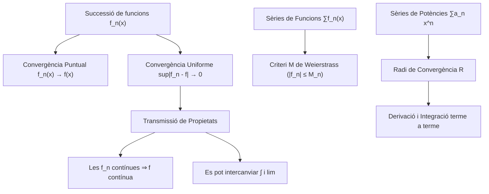

# Successions i sèries de funcions

## 1. Convergència de Successions de Funcions

Sigui $(f_n)_{n \in \mathbb{N}}$ una successió de funcions definides en un domini $D \subseteq \mathbb{R}$ cap a $\mathbb{R}$.

### Convergència Puntual
> [!IMPORTANT] Definició (Convergència Puntual)
> La successió $(f_n)$ convergeix puntualment a una funció $f$ en el domini $D$ si per a cada punt fixat $x_0 \in D$, la successió numèrica $(f_n(x_0))$ convergeix a $f(x_0)$.
> 
> En llenguatge $\varepsilon-\delta$: $\forall x \in D, \forall \varepsilon > 0, \exists n_0(\varepsilon, x) \in \mathbb{N}$ tal que:
> $$n \ge n_0 \implies |f_n(x) - f(x)| < \varepsilon$$

*Nota:* A la convergència puntual, el $n_0$ depèn del punt $x$. Això provoca que propietats com la continuïtat o la integrabilitat no sempre es conservin.

### Convergència Uniforme
> [!IMPORTANT] Definició (Convergència Uniforme)
> La successió $(f_n)$ convergeix **uniformement** a $f$ en $D$ (denotat $f_n \rightrightarrows f$) si el $n_0$ és independent del punt $x$.
> 
> Formalment: $\forall \varepsilon > 0, \exists n_0(\varepsilon) \in \mathbb{N}$ tal que per a **tot** $x \in D$:
> $$n \ge n_0 \implies |f_n(x) - f(x)| < \varepsilon$$

### Teoremes de Transmissió de Propietats
1. **Continuïtat:** Si $f_n \rightrightarrows f$ i totes les $f_n$ són contínues en $x_0$, aleshores $f$ també és contínua en $x_0$. 
2. **Integrabilitat:** Si $f_n \rightrightarrows f$ en $[a,b]$ i les $f_n$ són integrables, $f$ ho és, i es pot commutar el límit amb la integral:
   $$\lim_{n \to \infty} \int_a^b f_n(x) \, dx = \int_a^b f(x) \, dx$$
3. **Derivabilitat:** Si $f'_n \rightrightarrows g$ uniformement i $f_n$ convergeix en almenys un punt, llavors $f_n \rightrightarrows f$ uniformement, $f$ és derivable, i $f'(x) = g(x)$.

---

## 2. Sèries de Funcions

> [!IMPORTANT] Criteri M de Weierstrass
> És el test més poderós per garantir la convergència uniforme en sèries de funcions.
> Si existeix una successió numèrica de reals positius $(M_n)$ tal que:
> 1. $|f_n(x)| \le M_n \quad \forall x \in D, \forall n \in \mathbb{N}$
> 2. La sèrie numèrica $\sum M_n$ convergeix.
> 
> Aleshores, la sèrie de funcions $\sum f_n(x)$ convergeix **absolutament i uniformement** en $D$.

---

## 3. Sèries de Potències

Són sèries de la forma $f(x) = \sum_{n=0}^\infty a_n (x - x_0)^n$.

### Radi i Interval de Convergència
> [!IMPORTANT] Teorema de Cauchy-Hadamard
> El radi de convergència $R$ es calcula com:
> $$R = \frac{1}{\limsup_{n \to \infty} \sqrt[n]{|a_n|}} \quad \text{o bé} \quad R = \lim_{n\to\infty} \left| \frac{a_n}{a_{n+1}} \right|$$
> 
> - Si $|x - x_0| < R$: Convergeix absolutament.
> - Si $|x - x_0| > R$: Divergeix.
> - Si $|x - x_0| = R$: S'ha d'estudiar puntualment.

### Operacions dins del Radi de Convergència
Dins l'interval $(x_0-R, x_0+R)$, la funció $f(x)$ és de classe $C^\infty$. Es pot **derivar i integrar terme a terme**, mantenint exactament el mateix radi de convergència $R$.

---

## 4. Esquema Resum de Successions de Funcions

---

**Navegació:**
- **Anterior:** [[01. Sèries numèriques]]
- **Següent:** (Pendent)
- **Índexs:** [[Índex - Anàlisis Matemàtica]] | [[Índex]]