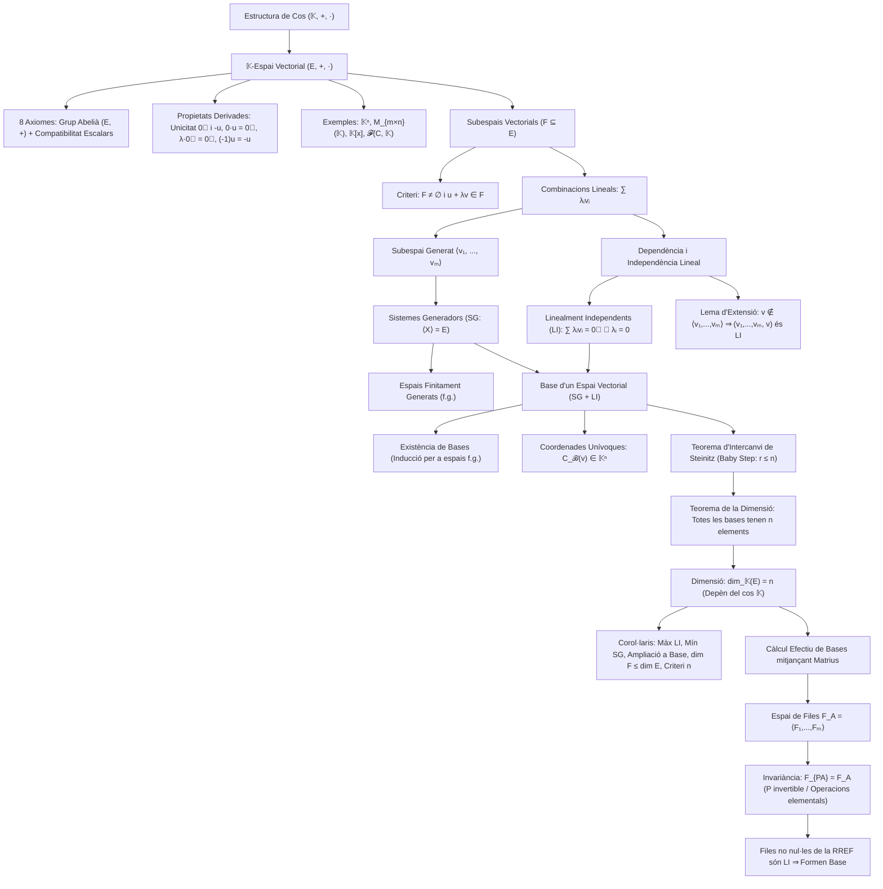

# Espais Vectorials

## 1. Introducció i Motivació

L'àlgebra lineal s'ocupa de l'estudi de sistemes geomètrics i algebraics que preserven combinacions lineals. Fins ara hem treballat amb matrius i vectors definits sobre nombres reals o sobre un cos genèric $\mathbb{K}$.

Per construir una teoria axiomàtica sòlida i general de l'àlgebra lineal, el primer pas consisteix a formalitzar l'estructura algebraica dels coeficients escalars (el concepte de **cos**) i, posteriorment, l'estructura dels vectors sobre els quals operen aquests escalars (el concepte d'**espai vectorial**).

---

## 2. L'Estructura Algebraica de Cos

> [!IMPORTANT] Definició Axiomàtica de Cos
> Un **cos** és un triplet $(\mathbb{K}, +, \cdot)$ format per un conjunt no buit $\mathbb{K}$ i dues operacions binàries internes:
> $$\begin{aligned}
> +: \mathbb{K} \times \mathbb{K} &\longrightarrow \mathbb{K}, \quad (a, b) \longmapsto a + b \quad \text{(suma)} \\
> \cdot: \mathbb{K} \times \mathbb{K} &\longrightarrow \mathbb{K}, \quad (a, b) \longmapsto a \cdot b \quad \text{(producte, sovint escrit } ab\text{)}
> \end{aligned}$$
> que compleixen les següents propietats per a qualssevol elements $a, b, c \in \mathbb{K}$:
> 
> ### I. Propietats de la Suma: $(\mathbb{K}, +)$ és un Grup Abelià
> 1. **Associativitat:** $a + (b + c) = (a + b) + c$
> 2. **Commutativitat:** $a + b = b + a$
> 3. **Element Neutre:** Existeix un element $0 \in \mathbb{K}$ tal que:
>    $$a + 0 = a \quad \forall a \in \mathbb{K}$$
> 4. **Element Oposat:** Per a cada $a \in \mathbb{K}$, existeix un element $-a \in \mathbb{K}$ tal que:
>    $$a + (-a) = 0$$
> 
> ### II. Propietats del Producte
> 1. **Associativitat:** $a \cdot (b \cdot c) = (a \cdot b) \cdot c$
> 2. **Commutativitat:** $a \cdot b = b \cdot a$
> 3. **Element Unitat (Neutre del Producte):** Existeix un element $1 \in \mathbb{K}$ tal que:
>    $$a \cdot 1 = a \quad \forall a \in \mathbb{K}$$
> 4. **Element Invers:** Per a cada element no nul $a \in \mathbb{K}$ ($a \neq 0$), existeix un element invers $a^{-1} \in \mathbb{K}$ (o $\frac{1}{a}$) tal que:
>    $$a \cdot a^{-1} = 1$$
>    *(Equivalentment, $(\mathbb{K} \setminus \{0\}, \cdot)$ és un grup abelià).*
> 
> ### III. Compatibilitat entre Operacions i No Degeneració
> 1. **Distributivitat del producte respecte de la suma:**
>    $$a \cdot (b + c) = a \cdot b + a \cdot c$$
> 2. **No trivialitat:** L'element neutre de la suma i el de la multiplicació són diferents:
>    $$0 \neq 1$$

---

## 3. Exemples Fonamentals de Cossos

### 3.1. Cossos Numèrics Clàssics
Els exemples més habituals en anàlisi i geometria són:
1. **$(\mathbb{Q}, +, \cdot)$:** El cos dels nombres racionals. És el cos de característica zero més petit (cos primer).
2. **$(\mathbb{R}, +, \cdot)$:** El cos dels nombres reals. A més de cos, és complet (axioma del suprem) i ordenat.
3. **$(\mathbb{C}, +, \cdot)$:** El cos dels nombres complexos, definit formalment com:
   $$\mathbb{C} \underset{\text{def}}{=} \{a + bi \mid a, b \in \mathbb{R}\} \quad \text{on } i^2 = -1$$
   proveït de les operacions:
   - Suma: $(a + bi) + (c + di) = (a + c) + (b + d)i$
   - Producte: $(a + bi)(c + di) = (ac - bd) + (ad + bc)i$
   - Element neutre de la suma: $0 = 0 + 0i \in \mathbb{C}$
   - Element unitat del producte: $1 = 1 + 0i \in \mathbb{C}$
   És un cos algebraicament tancat (Teorema Fonamental de l'Àlgebra), però no admet una relació d'ordre compatible amb les operacions.

---

### 3.2. El Cos Finit $\mathbb{Z}/2\mathbb{Z}$ ($\mathbb{F}_2$)
Considerem el conjunt quocient format per les classes de restes mòdul 2:
$$\mathbb{Z}/2\mathbb{Z} = \{[0], [1]\} \quad \text{o simplement} \quad \{0, 1\}$$
Definim la suma i el producte mòdul 2 mitjançant les seves taules de Cayley:

| $+$ | $0$ | $1$ |
|:---:|:---:|:---:|
| **$0$** | $0$ | $1$ |
| **$1$** | $1$ | $0$ |

| $\cdot$ | $0$ | $1$ |
|:---:|:---:|:---:|
| **$0$** | $0$ | $0$ |
| **$1$** | $0$ | $1$ |

> [!NOTE] Característica 2
> En aquest cos es compleix que $1 + 1 = 0$, la qual cosa implica que tot element és el seu propi oposat: $-1 = 1$. Aquest cos és fonamental en teoria de la informació, criptografia i ciències de la computació.

---

### 3.3. L'Extensió Quadràtica $\mathbb{Q}(\sqrt{2})$
Definim el subconjunt dels nombres reals:
$$\mathbb{Q}(\sqrt{2}) \underset{\text{def}}{=} \{a + b\sqrt{2} \mid a, b \in \mathbb{Q}\} \subseteq \mathbb{R}$$

Comprovem que $\mathbb{Q}(\sqrt{2})$ té estructura de cos amb les operacions heretades de $\mathbb{R}$:
1. **Clausura per la suma:**
   $$(a + b\sqrt{2}) + (c + d\sqrt{2}) = (a + c) + (b + d)\sqrt{2} \in \mathbb{Q}(\sqrt{2})$$
   ja que $a+c \in \mathbb{Q}$ i $b+d \in \mathbb{Q}$.
2. **Clausura pel producte:**
   $$(a + b\sqrt{2}) \cdot (c + d\sqrt{2}) = (ac + 2bd) + (ad + bc)\sqrt{2} \in \mathbb{Q}(\sqrt{2})$$
   ja que $ac + 2bd \in \mathbb{Q}$ i $ad + bc \in \mathbb{Q}$.
3. **Elements neutres:**
   - Neutre de la suma: $0 = 0 + 0\sqrt{2} \in \mathbb{Q}(\sqrt{2})$.
   - Neutre del producte: $1 = 1 + 0\sqrt{2} \in \mathbb{Q}(\sqrt{2})$.
4. **Existència d'invers:**
   Sigui $x = a + b\sqrt{2} \in \mathbb{Q}(\sqrt{2})$ amb $x \neq 0$.
   Com que $\sqrt{2}$ és irracional ($\sqrt{2} \notin \mathbb{Q}$), és impossible que $a^2 - 2b^2 = 0$ llevat que $a = b = 0$. Per tant, $a^2 - 2b^2 \neq 0$.
   Racionalitzant el quocient:
   $$x^{-1} = \frac{1}{a + b\sqrt{2}} = \frac{a - b\sqrt{2}}{(a + b\sqrt{2})(a - b\sqrt{2})} = \frac{a - b\sqrt{2}}{a^2 - 2b^2} = \left(\frac{a}{a^2 - 2b^2}\right) - \left(\frac{b}{a^2 - 2b^2}\right)\sqrt{2}$$
   Com que $\frac{a}{a^2 - 2b^2} \in \mathbb{Q}$ i $-\frac{b}{a^2 - 2b^2} \in \mathbb{Q}$, tenim que $x^{-1} \in \mathbb{Q}(\sqrt{2})$.

Per tant, $(\mathbb{Q}(\sqrt{2}), +, \cdot)$ és un subcos de $\mathbb{R}$.

---

## 4. Definició Axiomàtica d'Espai Vectorial

### 4.1. Exemple Motivador: $\mathbb{R}^n$
L'exemple intuïtiu i geomètric per excel·lència és l'espai numèric real $n$-dimensional:
$$\mathbb{R}^n = \{(a_1, \dots, a_n) \mid a_i \in \mathbb{R}\}$$
En aquest conjunt disposem de dues operacions fonamentals:
1. **Suma de vectors:**
   $$(a_1, \dots, a_n) + (b_1, \dots, b_n) = (a_1 + b_1, \dots, a_n + b_n)$$
   Geomètricament a $\mathbb{R}^2$ correspon a la coneguda regla del paral·lelogram per sumar $\vec{a} + \vec{b}$.
2. **Producte per escalars reals:**
   $$\forall \lambda \in \mathbb{R}, \quad \lambda(a_1, \dots, a_n) = (\lambda a_1, \dots, \lambda a_n)$$
   Geomètricament representa la dilatació ($\lambda > 1$), contracció ($0 < \lambda < 1$) o inversió de sentit ($\lambda < 0$) del vector original.

> [!NOTE] Observació Fonamental: Generalització a Cossos Arbitraris
> A partir d'ara treballarem prenent com a base un **cos arbitrari $\mathbb{K}$**.
> **Tot el que s'ha fet fins ara** en l'assignatura (matrius, sistemes d'equacions lineals, operacions elementals, PAQ-reducció, rang i determinants) **és plenament vàlid si agafem els coeficients en qualsevol cos $\mathbb{K}$**.

---

### 4.2. Els 8 Axiomes d'Espai Vectorial

> [!IMPORTANT] Definició d'Espai Vectorial sobre un Cos
> Sigui $\mathbb{K}$ un cos. Un **espai vectorial sobre $\mathbb{K}$** (o $\mathbb{K}$-espai vectorial, $\mathbb{K}$-e.v., o simplement e.v. si el cos se sobreentén) és un conjunt no buit $E$ proveït de dues operacions:
> 1. Una operació interna anomenada **suma de vectors**:
>    $$+: E \times E \longrightarrow E, \quad (u, v) \longmapsto u + v$$
> 2. Una operació externa anomenada **producte per escalars**:
>    $$\cdot: \mathbb{K} \times E \longrightarrow E, \quad (\lambda, u) \longmapsto \lambda \cdot u \quad (\text{o bé } \lambda u)$$
> 
> que compleixen les següents propietats:
> 
> #### I. Estructura de Grup Abelià per a $(E, +)$
> - **(i) Associativa:** $(u + v) + w = u + (v + w) \quad \forall u, v, w \in E$
> - **(ii) Commutativa:** $u + v = v + u \quad \forall u, v \in E$
> - **(iii) Element Neutre (Vector Nul):** $\exists \vec{0} \in E$ tal que $u + \vec{0} = u \quad \forall u \in E$
> - **(iv) Element Oposat:** $\forall u \in E, \; \exists -u \in E$ tal que $u + (-u) = \vec{0}$
> 
> #### II. Compatibilitat del Producte per Escalars de $\mathbb{K}$
> - **(i) Associativa Mixta (Pseudoassociativitat):** $(\lambda \mu) u = \lambda (\mu u) \quad \forall \lambda, \mu \in \mathbb{K}, \; \forall u \in E$
> - **(ii) Distributivitat respecte a la suma d'escalars:** $(\lambda + \mu) u = \lambda u + \mu u \quad \forall \lambda, \mu \in \mathbb{K}, \; \forall u \in E$
> - **(iii) Distributivitat respecte a la suma de vectors:** $\lambda(u + v) = \lambda u + \lambda v \quad \forall \lambda \in \mathbb{K}, \; \forall u, v \in E$
> - **(iv) Normalització per la Unitat del Cos:** $1_{\mathbb{K}} \cdot u = u \quad \forall u \in E$

Els elements d'$E$ s'anomenen **vectors** i els elements de $\mathbb{K}$ s'anomenen **escalars**.

---

## 5. Exemples Canònics d'Espais Vectorials

### Exemple 0: L'Espai Vectorial Nul (Trivial)
Sigui $\mathbb{K}$ un cos qualsevol. El conjunt format únicament pel vector zero:
$$E = \{\vec{0}\}$$
és un $\mathbb{K}$-espai vectorial amb les operacions òbvies:
$$\vec{0} + \vec{0} = \vec{0}, \qquad \lambda \vec{0} = \vec{0} \quad \forall \lambda \in \mathbb{K}$$

---

### Exemple 1: L'Espai Numèric $\mathbb{K}^n$ ($n \ge 1$)
Generalitzant $\mathbb{R}^n$, per a qualsevol enter $n \ge 1$ i qualsevol cos $\mathbb{K}$, definim:
$$\mathbb{K}^n = \{(a_1, \dots, a_n) \mid a_i \in \mathbb{K}\}$$
amb la suma i el producte definits component a component:
$$\begin{aligned}
(a_1, \dots, a_n) + (b_1, \dots, b_n) &= (a_1 + b_1, \dots, a_n + b_n) \\
\lambda(a_1, \dots, a_n) &= (\lambda a_1, \dots, \lambda a_n), \quad \lambda \in \mathbb{K}
\end{aligned}$$
El vector nul és $\vec{0} = (0, \dots, 0)$.

---

### Exemple 2: L'Espai de Matrius $\mathcal{M}_{m \times n}(\mathbb{K})$
El conjunt de totes les matrius de mida $m \times n$ amb coeficients al cos $\mathbb{K}$:
$$E = \mathcal{M}_{m \times n}(\mathbb{K})$$
és un $\mathbb{K}$-espai vectorial considerant:
- La suma usual de matrius: $(A + B)_{ij} = a_{ij} + b_{ij}$.
- El producte per escalars: $(\lambda A)_{ij} = \lambda a_{ij}$ per a tot $\lambda \in \mathbb{K}$.
- El vector nul és la matriu nul·la: $\vec{0} = (0)_{m \times n}$.

---

### Exemple 3: L'Espai dels Polinomis $\mathbb{K}[x]$
Definim el conjunt de tots els polinomis en la indeterminada $x$ amb coeficients al cos $\mathbb{K}$:
$$\mathbb{K}[x] \underset{\text{def}}{=} \{a_0 + a_1 x + a_2 x^2 + \dots + a_n x^n \mid n \ge 0, \; a_0, a_1, \dots, a_n \in \mathbb{K}\}$$
amb les operacions:
- **Suma de polinomis:** agrupant els coeficients del mateix grau:
  $$(a + bx + cx^2) + (d + ex) = (a + d) + (b + e)x + cx^2$$
- **Producte per escalars de $\mathbb{K}$:**
  $$\lambda (a_0 + a_1 x + \dots + a_n x^n) = (\lambda a_0) + (\lambda a_1)x + \dots + (\lambda a_n)x^n$$

#### Subconjunts de Polinomis de Grau Fitat $\mathbb{K}_n[x]$
Si fixem un grau màxim $n \ge 0$, considerem:
$$\mathbb{K}_n[x] = \{p(x) \in \mathbb{K}[x] \mid \operatorname{grau}(p(x)) \le n\}$$
Per exemple:
- $\mathbb{K}_1[x] = \{a + bx \mid a, b \in \mathbb{K}\}$ (polinomis de grau $\le 1$).
- $\mathbb{K}_2[x] = \{a + bx + cx^2 \mid a, b, c \in \mathbb{K}\}$ (polinomis de grau $\le 2$).

Com que la suma de polinomis de grau $\le n$ i el producte per un escalar no augmenten mai el grau, cadascun d'aquests conjunts és també un $\mathbb{K}$-espai vectorial, complint-se la cadena d'inclusions:
$$\mathbb{K}_1[x] \subseteq \mathbb{K}_2[x] \subseteq \dots \subseteq \mathbb{K}_n[x] \subseteq \dots \subseteq \mathbb{K}[x]$$

---

### Exemple 4: Cossos com a Espais Vectorials sobre Subcossos
Si tenim una cadena d'inclusió de cossos $\mathbb{Q} \subseteq \mathbb{R} \subseteq \mathbb{C}$:
- $\mathbb{R}$ té estructura natural d'espai vectorial sobre $\mathbb{Q}$ ($\mathbb{Q}$-espai vectorial), amb la suma usual i el producte d'un racional per un real.
- $\mathbb{C}$ té estructura d'espai vectorial sobre $\mathbb{R}$ ($\mathbb{R}$-espai vectorial), on tot nombre complex $z = a + bi$ es veu com una combinació lineal amb escalars reals.

---

### Exemple 5: L'Espai d'Aplicacions $\mathcal{F}(C, \mathbb{K})$
Sigui $C$ un conjunt no buit arbitrari i sigui $\mathbb{K}$ un cos. Considerem el conjunt de totes les aplicacions de $C$ a $\mathbb{K}$:
$$\mathcal{F}(C, \mathbb{K}) = \{f: C \longrightarrow \mathbb{K}\}$$
Aquest conjunt és un $\mathbb{K}$-espai vectorial definint les operacions punt a punt:
- **Suma de funcions:** $(f + g)(x) = f(x) + g(x) \quad \forall x \in C$
- **Producte per un escalar $\lambda \in \mathbb{K}$:** $(\lambda f)(x) = \lambda f(x) \quad \forall x \in C$
- **Vector nul (funció nul·la):** $\vec{0}: C \longrightarrow \mathbb{K}$ donada per $\vec{0}(x) = 0 \quad \forall x \in C$

#### Casos Particulars:
1. **$C = \{1, 2, \dots, n\}$:** Una aplicació $f: \{1, \dots, n\} \to \mathbb{K}$ queda completament determinada per la llista de valors $(f(1), \dots, f(n)) \in \mathbb{K}^n$. Per tant:
   $$\mathcal{F}(\{1, \dots, n\}, \mathbb{K}) \cong \mathbb{K}^n$$
   Per exemple, si $C = \{1, 2, 3\}$ i $\mathbb{K} = \mathbb{R}$, donar una funció equival a donar una terna $(a_1, a_2, a_3) \in \mathbb{R}^3$.
2. **$C = \mathbb{R}, \mathbb{K} = \mathbb{R}$:** L'espai $\mathcal{F}(\mathbb{R}, \mathbb{R})$ és l'espai de totes les funcions reals de variable real.

---

## 6. Propietats Immediates Derivades dels Axiomes

A partir dels 8 axiomes d'espai vectorial es dedueixen de forma unívoca les següents propietats fonamentals per a qualsevol $\mathbb{K}$-espai vectorial $E$:

> [!NOTE] Proposició: Propietats Fonamentals
> Sigui $E$ un $\mathbb{K}$-espai vectorial. Es compleixen les següents propietats per a qualssevol $u \in E$ i $\lambda \in \mathbb{K}$:
> 1. **Unicitat de l'element neutre:** El vector nul $\vec{0} \in E$ és únic.
> 2. **Unicitat de l'oposat:** Per a cada $u \in E$, el seu vector oposat $-u$ és únic.
> 3. **Anul·lació pel zero escalar:** $0_{\mathbb{K}} \cdot u = \vec{0}$.
> 4. **Anul·lació del vector nul:** $\lambda \cdot \vec{0} = \vec{0}$.
> 5. **Criteri d'anul·lació del producte:** $\lambda \cdot u = \vec{0} \implies \lambda = 0_{\mathbb{K}} \quad \text{o bé} \quad u = \vec{0}$.
> 6. **Multiplicació per $-1$:** $(-1_{\mathbb{K}}) \cdot u = -u$.

### Demostració
1. **Unicitat del neutre:**
   Suposem que existeixen dos elements neutres $\vec{0}_1, \vec{0}_2 \in E$. Com que $\vec{0}_2$ és neutre, $\vec{0}_1 + \vec{0}_2 = \vec{0}_1$. Com que $\vec{0}_1$ és neutre, $\vec{0}_1 + \vec{0}_2 = \vec{0}_2$. En conseqüència, $\vec{0}_1 = \vec{0}_2$.
2. **Unicitat de l'oposat:**
   Si $v_1$ i $v_2$ són dos oposats de $u$, tenim $v_1 = v_1 + \vec{0} = v_1 + (u + v_2) = (v_1 + u) + v_2 = \vec{0} + v_2 = v_2$.
3. **$0 \cdot u = \vec{0}$:**
   Com que $0 = 0 + 0$ al cos $\mathbb{K}$, per la distributivitat respecte a la suma d'escalars:
   $$0 \cdot u = (0 + 0) \cdot u = 0 \cdot u + 0 \cdot u$$
   Sumant a banda i banda l'oposat $-(0 \cdot u)$:
   $$\vec{0} = 0 \cdot u + (-(0 \cdot u)) = (0 \cdot u + 0 \cdot u) + (-(0 \cdot u)) = 0 \cdot u + \vec{0} = 0 \cdot u$$
   Per tant, $0 \cdot u = \vec{0}$.
4. **$\lambda \cdot \vec{0} = \vec{0}$:**
   Anàlogament, com que $\vec{0} = \vec{0} + \vec{0}$, tenim $\lambda \cdot \vec{0} = \lambda \cdot (\vec{0} + \vec{0}) = \lambda \cdot \vec{0} + \lambda \cdot \vec{0}$. Sumant $-(\lambda \cdot \vec{0})$ s'obté $\lambda \cdot \vec{0} = \vec{0}$.
5. **$\lambda \cdot u = \vec{0} \implies \lambda = 0 \lor u = \vec{0}$:**
   Suposem que $\lambda \cdot u = \vec{0}$. Si $\lambda = 0$, la conclusió és immediata. Si $\lambda \neq 0$, com que $\mathbb{K}$ és un cos, existeix l'invers $\lambda^{-1} \in \mathbb{K}$. Multiplicant:
   $$u = 1 \cdot u = (\lambda^{-1} \lambda) u = \lambda^{-1} (\lambda u) = \lambda^{-1} \vec{0} = \vec{0}$$
6. **$(-1) \cdot u = -u$:**
   Per la propietat (3) i la distributivitat:
   $$\vec{0} = 0 \cdot u = (1 + (-1)) u = 1 \cdot u + (-1) u = u + (-1) u$$
   Com que l'oposat de $u$ és únic per la propietat (2), deduïm que $(-1) \cdot u = -u$. $\blacksquare$

---

## 7. Subespais Vectorials

### 7.1. Motivació: L'Espai de Funcions Contínues $\mathcal{C}^0(\mathbb{R}, \mathbb{R})$
Dins de l'espai total de totes les funcions reals $\mathcal{F}(\mathbb{R}, \mathbb{R})$, considerem el subconjunt de les **funcions contínues**:
$$\mathcal{C}^0(\mathbb{R}, \mathbb{R}) \subset \mathcal{F}(\mathbb{R}, \mathbb{R})$$
De l'anàlisi matemàtica sabem que:
1. La suma de dues funcions contínues és una funció contínua: $f, g \in \mathcal{C}^0 \implies f + g \in \mathcal{C}^0$.
2. El producte d'un escalar real per una funció contínua és continu: $\lambda \in \mathbb{R}, f \in \mathcal{C}^0 \implies \lambda f \in \mathcal{C}^0$.
3. La funció constant zero $\vec{0}(x) = 0$ és contínua ($\vec{0} \in \mathcal{C}^0$).

Això fa que $\mathcal{C}^0(\mathbb{R}, \mathbb{R})$ sigui un espai vectorial en si mateix amb les mateixes operacions heretades. Aquest fenomen s'anomena **subespai vectorial**.

---

### 7.2. Definició i Caracterització de Subespai Vectorial

> [!IMPORTANT] Definició de Subespai Vectorial
> Sigui $E$ un $\mathbb{K}$-espai vectorial i sigui $F \subseteq E$ un subconjunt de $E$.
> Diem que $F$ és un **subespai vectorial** de $E$ (denotat sovint $F \le E$) si $F \neq \emptyset$ i $F$ és tancat per les operacions de $E$:
> 1. $\forall u, v \in F \implies u + v \in F$
> 2. $\forall \lambda \in \mathbb{K}, \forall u \in F \implies \lambda u \in F$

> [!NOTE] Criteri de Subespai Vectorial
> Sigui $E$ un $\mathbb{K}$-espai vectorial i $F \subseteq E$. Aleshores:
> $$F \text{ és subespai vectorial de } E \iff F \neq \emptyset \quad \text{i} \quad \forall u, v \in F, \; \forall \lambda \in \mathbb{K}, \; u + \lambda v \in F$$

*(Demostració: Immediata prenent $\lambda = 1$ per a la suma, i $u = \vec{0}$ o $\lambda = -1$ per a oposats i escalars).*

---

### 7.3. Exemples Fonamentals de Subespais Vectorials

1. **Subespais Trivials:**
   En qualsevol $\mathbb{K}$-espai vectorial $E$, sempre existeixen com a mínim dos subespais:
   - El **subespai zero**: $F = \{\vec{0}\}$ (subespai trivial).
   - El **subespai total**: $F = E$.
2. **Subespais de $\mathbb{R}^2$:**
   Considerem $E = \mathbb{R}^2$:
   - **Recta que passa per l'origen:** $F = \{(x, x) \mid x \in \mathbb{R}\} \subset \mathbb{R}^2$.
     Comprovem que $(0, 0) \in F$. A més:
     $$(x, x) + \lambda (y, y) = (x + \lambda y, x + \lambda y) = (z, z) \in F$$
     Per tant, $F$ és un subespai vectorial.
   - **Recta afí que no passa per l'origen:** $R = \{(x, 1) \mid x \in \mathbb{R}\}$.
     $(0, 0) \notin R$. A més:
     $$(x, 1) + (y, 1) = (x+y, 2) \notin R$$
     Per tant, $R$ **no** és un subespai vectorial.
   - **Corbes no lineals:** $P = \{(x, x^2) \mid x \in \mathbb{R}\}$ (paràbola).
     $(1, 1) \in P$, però $2 \cdot (1, 1) = (2, 2) \notin P$ (ja que $2^2 = 4 \neq 2$). Per tant, **no** és subespai vectorial.
3. **Nucli d'un Sistema Homogeni:**
   Sigui $A \in \mathcal{M}_{m \times n}(\mathbb{K})$ una matriu. El conjunt de solucions del sistema d'equacions lineals homogeni associat:
   $$F = \left\{(x_1, \dots, x_n) \in \mathbb{K}^n \;\middle|\; A \begin{pmatrix} x_1 \\ \vdots \\ x_n \end{pmatrix} = \begin{pmatrix} 0 \\ \vdots \\ 0 \end{pmatrix} \right\} \subseteq \mathbb{K}^n$$
   és sempre un subespai vectorial de $\mathbb{K}^n$:
   - Com que $A \vec{0} = \vec{0}$, tenim $\vec{0} \in F \neq \emptyset$.
   - Si $u, v \in F$ i $\lambda \in \mathbb{K}$, per la linealitat del producte matricial:
     $$A(u + \lambda v) = Au + \lambda Av = \vec{0} + \lambda \vec{0} = \vec{0}$$
     la qual cosa implica $(u + \lambda v) \in F$.
   Aquest subespai rep el nom de **nucli** de la matriu, $\operatorname{Nuc}(A)$.

---

## 8. Combinacions Lineals i Subespais Generats

### 8.1. Combinació Lineal (CL)

> [!IMPORTANT] Definició de Combinació Lineal
> Sigui $E$ un $\mathbb{K}$-espai vectorial i siguin $v_1, \dots, v_m \in E$.
> Una **combinació lineal (CL)** de $v_1, \dots, v_m$ és qualsevol vector de $E$ que es pot escriure en la forma:
> $$\lambda_1 v_1 + \lambda_2 v_2 + \dots + \lambda_m v_m, \quad \text{on } \lambda_1, \dots, \lambda_m \in \mathbb{K}$$

---

### 8.2. Subespai Generat per una Família de Vectors

Denotem per $\langle v_1, \dots, v_m \rangle$ el conjunt de totes les combinacions lineals possibles d'aquests vectors:
$$\langle v_1, \dots, v_m \rangle \underset{\text{def}}{=} \{\lambda_1 v_1 + \dots + \lambda_m v_m \mid \lambda_1, \dots, \lambda_m \in \mathbb{K}\} \subseteq E$$

> [!NOTE] Lema del Subespai Generat
> El conjunt $\langle v_1, \dots, v_m \rangle$ és un subespai vectorial de $E$, i és el **subespai vectorial més petit de $E$ que conté els vectors $v_1, \dots, v_m$**.

#### Demostració:
1. **És subespai vectorial:**
   Sigui $F = \langle v_1, \dots, v_m \rangle$. Com que $\vec{0} = 0 v_1 + \dots + 0 v_m \in F$, tenim $F \neq \emptyset$.
   Siguin $w, w' \in F$:
   $$w = \lambda_1 v_1 + \dots + \lambda_m v_m, \qquad w' = \lambda'_1 v_1 + \dots + \lambda'_m v_m$$
   Aleshores:
   $$w + w' = (\lambda_1 + \lambda'_1)v_1 + \dots + (\lambda_m + \lambda'_m)v_m \in F$$
   Si $\lambda \in \mathbb{K}$:
   $$\lambda w = (\lambda \lambda_1) v_1 + \dots + (\lambda \lambda_m) v_m \in F$$
   Per tant, $F$ és un subespai vectorial.
2. **És el més petit:**
   Sigui $F' \subseteq E$ qualsevol altre subespai vectorial tal que $v_1, \dots, v_m \in F'$.
   Com que $F'$ és tancat per la suma i pel producte per escalars, qualsevol combinació lineal $\lambda_1 v_1 + \dots + \lambda_m v_m$ pertany obligatòriament a $F'$.
   Per tant, $\langle v_1, \dots, v_m \rangle \subseteq F'$. $\blacksquare$

Diem que $\langle v_1, \dots, v_m \rangle$ és el **subespai generat** per $v_1, \dots, v_m$, i que és un subespai **finitament generat**.

#### Generalització a Subconjunts Arbitraris:
Per a qualsevol subconjunt $X \subseteq E$, denotem per $\langle X \rangle$ el subespai vectorial més petit de $E$ que conté $X$:
- Si $X \neq \emptyset$: $\langle X \rangle = \{\lambda_1 u_1 + \dots + \lambda_k u_k \mid k \ge 1, \; \lambda_i \in \mathbb{K}, \; u_i \in X\}$.
- Si $X = \emptyset$: per conveni $\langle \emptyset \rangle = \{\vec{0}\}$.

---

### 8.3. Exemples Pràctics a $\mathbb{R}^3$

#### Exemple 1:
Considerem a $\mathbb{R}^3$ el subespai $F = \langle (1, 2, 0), (-1, 2, 0) \rangle$:
$$F = \{\lambda(1, 2, 0) + \mu(-1, 2, 0) \mid \lambda, \mu \in \mathbb{R}\} = \{(\lambda - \mu, 2\lambda + 2\mu, 0) \mid \lambda, \mu \in \mathbb{R}\}$$
Un vector $(x, y, 0)$ pertany a $F$ si podem resoldre el sistema:
$$\begin{cases} \lambda - \mu = x \\ 2\lambda + 2\mu = y \end{cases}$$
Aquest sistema té solució única per a qualssevol $x, y \in \mathbb{R}$ ($\lambda = \frac{2x+y}{4}, \mu = \frac{y-2x}{4}$).
Per tant, $F$ és el pla $z = 0$, que es pot generar simplement per la base canònica del pla:
$$F = \{(x, y, 0) \mid x, y \in \mathbb{R}\} = \langle (1, 0, 0), (0, 1, 0) \rangle$$

#### Exemple 2: Càlcul d'Equacions Implícites
Sigui $F = \langle (1, -1, 2), (0, 1, 1), (1, 1, 4) \rangle \subset \mathbb{R}^3$.
Un vector $(x, y, z) \in F$ si existeixen $\lambda, \mu, \nu \in \mathbb{R}$ tals que:
$$\begin{pmatrix} x \\ y \\ z \end{pmatrix} = \lambda \begin{pmatrix} 1 \\ -1 \\ 2 \end{pmatrix} + \mu \begin{pmatrix} 0 \\ 1 \\ 1 \end{pmatrix} + \nu \begin{pmatrix} 1 \\ 1 \\ 4 \end{pmatrix}$$
Estudiem la compatibilitat del sistema ampliat mitjançant eliminació gaussiana per files:
$$\begin{pmatrix} 1 & 0 & 1 & x \\ -1 & 1 & 1 & y \\ 2 & 1 & 4 & z \end{pmatrix} 
\xrightarrow{\substack{F_2 \leftarrow F_2 + F_1 \\ F_3 \leftarrow F_3 - 2F_1}}
\begin{pmatrix} 1 & 0 & 1 & x \\ 0 & 1 & 2 & x+y \\ 0 & 1 & 2 & z - 2x \end{pmatrix}
\xrightarrow{F_3 \leftarrow F_3 - F_2}
\begin{pmatrix} 1 & 0 & 1 & x \\ 0 & 1 & 2 & x+y \\ 0 & 0 & 0 & z - 3x - y \end{pmatrix}$$
Pel Teorema de Rouché-Frobenius, el sistema és compatible si i només si l'última fila s'anul·la completament:
$$z - 3x - y = 0 \iff z = 3x + y$$
Per tant, l'**equació implícita** de $F$ és $3x + y - z = 0$.
Els vectors de $F$ són de la forma $(x, y, 3x + y) = x(1, 0, 3) + y(0, 1, 1)$. En conseqüència:
$$F = \langle (1, 0, 3), (0, 1, 1) \rangle$$

---

## 9. Dependència i Independència Lineal

> [!IMPORTANT] Definició de Vectors Linealment Independents (LI) i Dependents (LD)
> Sigui $E$ un $\mathbb{K}$-espai vectorial i siguin $v_1, \dots, v_m \in E$.
> 1. Diem que $v_1, \dots, v_m$ són **linealment independents (LI)** si l'única combinació lineal que dóna el vector nul és la trivial:
>    $$\lambda_1 v_1 + \dots + \lambda_m v_m = \vec{0} \implies \lambda_1 = \lambda_2 = \dots = \lambda_m = 0$$
> 2. En cas contrari (si existeixen escalars no tots nuls tals que $\sum \lambda_i v_i = \vec{0}$), diem que els vectors són **linealment dependents (LD)**.

#### Extensió a Conjunts Generals:
- Un subconjunt no buit $X \subseteq E$ és **linealment independent** si qualsevol subconjunt finit d'elements diferents de $X$ és LI.
- Per conveni, el conjunt buit $X = \emptyset$ és **linealment independent**.

---

### 9.1. Caracterització Fonamental de la Independència Lineal

> [!NOTE] Proposició: Caracterització per Combinació Lineal
> Els vectors $v_1, \dots, v_m \in E$ són **linealment independents** si i només si **cap d'ells es pot expressar com a combinació lineal dels altres**.
> 
> *Equivalentment (contrarecíproca):*
> Els vectors $v_1, \dots, v_m$ són **linealment dependents** si i només si **almenys un d'ells és combinació lineal dels restants**.

#### Demostració:
- $(\implies)$ Suposem que $v_1, \dots, v_m$ són LI. Demostrem que cap vector és CL dels altres per reducció a l'absurd.
  Suposem que un d'ells (per exemple $v_1$) fos combinació lineal dels altres:
  $$v_1 = \lambda_2 v_2 + \dots + \lambda_m v_m \quad \text{amb } \lambda_2, \dots, \lambda_m \in \mathbb{K}$$
  Reorganitzant la igualtat:
  $$1 \cdot v_1 - \lambda_2 v_2 - \dots - \lambda_m v_m = \vec{0}$$
  Això és una combinació lineal nul·la on el coeficient de $v_1$ és $1 \neq 0$. Això contradiu directament la hipòtesi que els vectors són linealment independents.
- $(\impliedby)$ Suposem que cap vector és combinació lineal dels altres. Volem provar que són LI.
  Considerem una combinació lineal nul·la qualsevol:
  $$\lambda_1 v_1 + \dots + \lambda_m v_m = \vec{0}$$
  Demostrem que tots els $\lambda_i = 0$ per reducció a l'absurd. Suposem que algun coeficient fos no nul, per exemple $\lambda_1 \neq 0$.
  Com que $\mathbb{K}$ és un cos i $\lambda_1 \neq 0$, existeix el seu invers $\lambda_1^{-1} \in \mathbb{K}$. Multiplicant tota la igualtat per $\lambda_1^{-1}$:
  $$\lambda_1^{-1}(\lambda_1 v_1 + \dots + \lambda_m v_m) = \lambda_1^{-1} \vec{0} = \vec{0}$$
  $$v_1 + \lambda_1^{-1}\lambda_2 v_2 + \dots + \lambda_1^{-1}\lambda_m v_m = \vec{0}$$
  Aïllant $v_1$:
  $$v_1 = -(\lambda_1^{-1}\lambda_2) v_2 - \dots - (\lambda_1^{-1}\lambda_m) v_m$$
  Això expressa $v_1$ com a combinació lineal dels restants vectors $v_2, \dots, v_m$, entrant en contradicció amb la hipòtesi.
  Per tant, necessàriament $\lambda_1 = \dots = \lambda_m = 0$, provant que els vectors són linealment independents. $\blacksquare$

---

## 10. Sistemes Generadors i Espais Finitament Generats

### 10.1. Definició de Sistema Generador (SG)

> [!IMPORTANT] Definició de Sistema Generador
> Sigui $E$ un $\mathbb{K}$-espai vectorial. Diem que una família de vectors $v_1, \dots, v_m \in E$ és un **sistema generador (SG)** de $E$ si el subespai que generen coincideix amb tot l'espai:
> $$\langle v_1, \dots, v_m \rangle = E$$
> És a dir, qualsevol vector $v \in E$ es pot escriure com a combinació lineal dels vectors $v_1, \dots, v_m$:
> $$\forall v \in E, \; \exists \lambda_1, \dots, \lambda_m \in \mathbb{K} \quad \text{tals que} \quad v = \sum_{i=1}^m \lambda_i v_i$$

#### Convencions i Conjunts Generals:
1. **El conjunt buit:** Per conveni, el conjunt buit $\emptyset$ genera el subespai nul:
   $$\langle \emptyset \rangle = \{\vec{0}\}$$
2. **Subconjunts arbitraris:** Si $X \subseteq E$ és un subconjunt qualsevol (finit o infinit), diem que $X$ és un **sistema generador** de $E$ si tot vector $v \in E$ es pot escriure com una combinació lineal finita d'elements de $X$:
   $$\langle X \rangle = E$$

---

### 10.2. Espais Vectorials Finitament Generats

> [!IMPORTANT] Definició d'Espai Finitament Generat
> Un $\mathbb{K}$-espai vectorial $E$ s'anomena **finitament generat (f.g.)** si posseeix un sistema generador format per un nombre finit de vectors.
> És a dir, existeixen $v_1, \dots, v_m \in E$ tals que:
> $$E = \langle v_1, \dots, v_m \rangle$$

---

## 11. Bases d'un Espai Vectorial

### 11.1. Definició Axiomàtica de Base

El concepte de base unifica dues propietats essencials: la capacitat de generar tot l'espai (sistema generador) i la no-redundància d'elements (independència lineal).

> [!IMPORTANT] Definició de Base
> Sigui $E$ un $\mathbb{K}$-espai vectorial. Una família de vectors $\mathcal{B} = (v_1, \dots, v_n)$ s'anomena **base** de $E$ si satisfà simultàniament les dues condicions següents:
> 1. És un **sistema generador (SG)** de $E$: $\langle v_1, \dots, v_n \rangle = E$.
> 2. És un conjunt **linealment independent (LI)**: 
>    $$\sum_{i=1}^n \lambda_i v_i = \vec{0} \implies \lambda_1 = \dots = \lambda_n = 0$$

*Notació:* Quan treballem amb bases on l'ordre dels vectors és rellevant (per exemple, per definir coordenades), escriurem la base com una tupla ordenada $\mathcal{B} = (v_1, \dots, v_n)$.

---

### 11.2. Exemples Fonamentals de Bases

1. **L'espai trivial $\{\vec{0}\}$:**
   L'única base de l'espai format només pel vector nul és el conjunt buit:
   $$\mathcal{B} = \emptyset$$
   Efectivament, $\emptyset$ és LI per conveni i $\langle \emptyset \rangle = \{\vec{0}\}$.

2. **L'espai $\mathbb{K}^n$ (Base Canònica):**
   Els vectors unitaris:
   $$e_1 = (1, 0, \dots, 0), \quad e_2 = (0, 1, \dots, 0), \quad \dots, \quad e_n = (0, \dots, 0, 1)$$
   formen la denominada **base canònica** de $\mathbb{K}^n$.
   - **Són LI:** $\sum_{i=1}^n \lambda_i e_i = (\lambda_1, \dots, \lambda_n) = (0, \dots, 0) \implies \lambda_1 = \dots = \lambda_n = 0$.
   - **Generen $\mathbb{K}^n$:** Donat qualsevol $(\lambda_1, \dots, \lambda_n) \in \mathbb{K}^n$, tenim directament:
     $$(\lambda_1, \dots, \lambda_n) = \lambda_1 e_1 + \dots + \lambda_n e_n \implies \langle e_1, \dots, e_n \rangle = \mathbb{K}^n$$

3. **L'espai de matrius $M_{m \times n}(\mathbb{K})$:**
   Les matrius elementals $E_{ij}$ (amb un 1 a la fila $i$, columna $j$, i 0 a totes les altres entrades) per a $1 \le i \le m$, $1 \le j \le n$, formen una base de $M_{m \times n}(\mathbb{K})$.
   Efectivament, qualsevol matriu $A = (a_{ij}) \in M_{m \times n}(\mathbb{K})$ s'expressa de forma única com:
   $$A = \sum_{i=1}^m \sum_{j=1}^n a_{ij} E_{ij}$$

4. **L'espai de polinomis:**
   - Per a l'espai complet de polinomis $\mathbb{K}[x]$, la família infinita de monomis:
     $$\mathcal{B} = (1, x, x^2, x^3, \dots)$$
     és una base (qualsevol polinomi és combinació lineal finita d'aquests monomis, i són linealment independents).
   - Per al subespai $\mathbb{K}_n[x]$ de polinomis de grau com a màxim $n$, la família finita:
     $$\mathcal{B} = (1, x, x^2, \dots, x^n)$$
     constitueix la seva base canònica.

---

### 11.3. Lema d'Extensió per un Vector Exterior

> [!NOTE] Lema d'Extensió per un Vector Exterior
> Siguin $v_1, \dots, v_m \in E$ vectors **linealment independents**, i sigui $v \in E$ tal que $v \notin \langle v_1, \dots, v_m \rangle$.
> Aleshores, la família ampliada:
> $$v_1, \dots, v_m, v$$
> és també **linealment independent**.

#### Demostració:
Considerem una combinació lineal nul·la qualsevol:
$$\lambda_1 v_1 + \dots + \lambda_m v_m + \lambda v = \vec{0}, \quad \text{amb } \lambda_1, \dots, \lambda_m, \lambda \in \mathbb{K}$$
Distingim dos casos per al coeficient $\lambda$:
- **Cas 1: $\lambda = 0$.**
  L'equació es redueix a $\lambda_1 v_1 + \dots + \lambda_m v_m = \vec{0}$.
  Com que per hipòtesi els vectors $v_1, \dots, v_m$ són linealment independents, necessàriament:
  $$\lambda_1 = \dots = \lambda_m = 0$$
- **Cas 2: $\lambda \neq 0$.**
  Com que $\mathbb{K}$ és un cos i $\lambda \neq 0$, existeix el seu element invers $\lambda^{-1} \in \mathbb{K}$.
  Aïllant el terme $\lambda v$:
  $$\lambda v = -\lambda_1 v_1 - \dots - \lambda_m v_m$$
  Multiplicant per $\lambda^{-1}$:
  $$v = -(\lambda^{-1}\lambda_1) v_1 - \dots - (\lambda^{-1}\lambda_m) v_m$$
  Això expressa $v$ com a combinació lineal dels vectors $v_1, \dots, v_m$, per la qual cosa $v \in \langle v_1, \dots, v_m \rangle$.
  Això és una **contradicció** flagrant amb la hipòtesi $v \notin \langle v_1, \dots, v_m \rangle$.

Per tant, obligatòriament hem de tenir $\lambda = 0$, la qual cosa implica $\lambda_1 = \dots = \lambda_m = 0$.
En conseqüència, els vectors $v_1, \dots, v_m, v$ són linealment independents. $\blacksquare$

---

### 11.4. Teorema d'Existència de Bases

> [!IMPORTANT] Teorema d'Existència de Bases (Cas Finitament Generat)
> Tot $\mathbb{K}$-espai vectorial finitament generat $E$ posseeix almenys una base.
> 
> *(Nota: Tot espai vectorial, sigui finitament generat o no, admet una base. En el cas general no finitament generat, la demostració requereix el Lema de Zorn o l'Axioma d'Elecció).*

#### Demostració:
- Si $E = \{\vec{0}\}$, el conjunt buit $\emptyset$ és base de $E$, per la qual cosa el teorema és cert.
- Podem suposar doncs que $E \neq \{\vec{0}\}$. Com que $E$ és finitament generat, admet un sistema generador finit:
  $$E = \langle v_1, \dots, v_n \rangle$$
  Procedim per **inducció matemàtica** sobre el nombre de generadors $n$:
  
  - **Cas base ($n = 1$):**
    Tenim $E = \langle v_1 \rangle$. Com que $E \neq \{\vec{0}\}$, necessàriament $v_1 \neq \vec{0}$.
    Un únic vector no nul és linealment independent: $\lambda v_1 = \vec{0} \implies \lambda = 0$.
    Com que $\{v_1\}$ genera $E$ i és LI, $(v_1)$ és una base de $E$.
  
  - **Pas d'inducció ($n \ge 2$):**
    Suposem que qualsevol espai vectorial generat per $n-1$ vectors admet una base (Hipòtesi d'Inducció).
    Considerem el subespai generat pels primers $n-1$ vectors:
    $$F = \langle v_1, \dots, v_{n-1} \rangle \subseteq E$$
    Per Hipòtesi d'Inducció, $F$ té una base, que denotem per $(w_1, \dots, w_k)$.
    Això significa que $w_1, \dots, w_k$ són linealment independents i $\langle w_1, \dots, w_k \rangle = F$.
    
    Analitzem ara la relació del darrer vector $v_n$ amb el subespai $F$:
    1. **Si $v_n \in F$:**
       Aleshores tots els generadors $v_1, \dots, v_n$ pertanyen a $F$, per la qual cosa:
       $$E = \langle v_1, \dots, v_n \rangle \subseteq F \subseteq E \implies E = F$$
       Per tant, la base $(w_1, \dots, w_k)$ de $F$ és també una base de $E$.
    2. **Si $v_n \notin F$:**
       Com que $w_1, \dots, w_k$ són LI i $v_n \notin \langle w_1, \dots, w_k \rangle = F$, apliquem el **Lema d'Extensió** (apartat 11.3): la família:
       $$w_1, \dots, w_k, v_n$$
       és **linealment independent**.
       A més, aquesta família genera tot $E$:
       - D'una banda, $v_n \in \langle w_1, \dots, w_k, v_n \rangle$.
       - De l'altra banda, $v_1, \dots, v_{n-1} \in F = \langle w_1, \dots, w_k \rangle \subseteq \langle w_1, \dots, w_k, v_n \rangle$.
       Com que conté tots els generadors originals $v_1, \dots, v_n$, deduïm:
       $$\langle w_1, \dots, w_k, v_n \rangle = E$$
       En conseqüència, $(w_1, \dots, w_k, v_n)$ és una base de $E$.
  
Això conclou la demostració per inducció. $\blacksquare$

---

## 12. Coordenades respecte d'una Base

### 12.1. Unicitat de la Representació

La gran utilitat pràctica d'una base rau en el fet que permet representar cada vector de l'espai de forma única mitjançant una llista d'escalars.

> [!NOTE] Lema d'Unicitat de les Coordenades
> Sigui $\mathcal{B} = (v_1, \dots, v_n)$ una base d'un $\mathbb{K}$-espai vectorial $E$.
> Llavors, qualsevol vector $v \in E$ s'expressa de **manera única** com a combinació lineal dels elements de la base $\mathcal{B}$.

#### Demostració:
1. **Existència:** Com que $\mathcal{B}$ és un sistema generador de $E$, per a qualsevol $v \in E$ existeixen escalars $\lambda_1, \dots, \lambda_n \in \mathbb{K}$ tals que:
   $$v = \lambda_1 v_1 + \dots + \lambda_n v_n$$
2. **Unicitat:** Suposem que existís una altra combinació lineal per al mateix vector $v$:
   $$v = \mu_1 v_1 + \dots + \mu_n v_n \quad \text{amb } \mu_1, \dots, \mu_n \in \mathbb{K}$$
   Restant ambdues expressions terme a terme:
   $$\vec{0} = v - v = (\lambda_1 - \mu_1) v_1 + (\lambda_2 - \mu_2) v_2 + \dots + (\lambda_n - \mu_n) v_n$$
   Com que els vectors $v_1, \dots, v_n$ són linealment independents (per ser base), tots els coeficients de la combinació lineal nul·la han de ser forçosament zero:
   $$\lambda_i - \mu_i = 0 \iff \lambda_i = \mu_i \quad \forall i \in \{1, \dots, n\}$$
   Per tant, els coeficients són únics. $\blacksquare$

---

### 12.2. Vector Columna de Coordenades

> [!IMPORTANT] Definició de Coordenades
> Sigui $\mathcal{B} = (v_1, \dots, v_n)$ una base d'un $\mathbb{K}$-espai vectorial $E$. Donat un vector $v \in E$, els únics escalars $\lambda_1, \dots, \lambda_n \in \mathbb{K}$ que compleixen:
> $$v = \lambda_1 v_1 + \dots + \lambda_n v_n$$
> s'anomenen **coordenades** del vector $v$ en la base $\mathcal{B}$.
> 
> *Notació matricial:* Escriurem les coordenades en forma de vector columna:
> $$C_\mathcal{B}(v) = \begin{pmatrix} \lambda_1 \\ \lambda_2 \\ \vdots \\ \lambda_n \end{pmatrix} \in \mathbb{K}^n$$

L'aplicació $v \longmapsto C_\mathcal{B}(v)$ és un isomorfisme lineal entre l'espai vectorial abstracte $E$ i l'espai concret $\mathbb{K}^n$, permetent traduir operacions geomètriques abstractes en càlculs matricials explícits.

---

## 13. El Teorema d'Intercanvi de Steinitz

### 13.1. Pregunta Fonamental
Sabem que tot espai vectorial finitament generat té almenys una base i que aquesta proporciona coordenades úniques.
Ara bé: **pot un mateix espai vectorial tenir bases amb diferent nombre d'elements?**
Per exemple, a $\mathbb{R}^2$ la base canònica té 2 elements. Podria existir una altra base de $\mathbb{R}^2$ amb 3 elements o amb 1 sol element?

La resposta és **no**, i el resultat que ho garanteix és el cèlebre **Teorema d'Intercanvi de Steinitz**.

---

### 13.2. Lema d'Intercanvi Elemental (Baby Step)

Abans de provar el teorema general, establim com substituir un sol vector d'una base per un altre vector sense perdre l'estructura de base.

> [!NOTE] Lema d'Intercanvi Elemental (Baby Step)
> Sigui $\mathcal{B} = (v_1, \dots, v_n)$ una base d'un $\mathbb{K}$-espai vectorial $E$.
> Sigui $\vec{0} \neq w \in E$, la representació del qual en la base $\mathcal{B}$ és:
> $$w = \lambda_1 v_1 + \dots + \lambda_n v_n$$
> Si per a algun índex $i \in \{1, \dots, n\}$ es compleix $\lambda_i \neq 0$, aleshores la família resultant de substituir $v_i$ per $w$:
> $$(v_1, \dots, v_{i-1}, w, v_{i+1}, \dots, v_n)$$
> és també una **base** de $E$.

#### Demostració:
Per demostrar que és base hem de verificar dues propietats: independència lineal i capacitat generadora.

1. **La nova família és linealment independent:**
   Considerem una combinació lineal nul·la:
   $$\mu_1 v_1 + \dots + \mu_{i-1} v_{i-1} + \mu w + \mu_{i+1} v_{i+1} + \dots + \mu_n v_n = \vec{0}$$
   Substituïm l'expressió de $w = \sum_{j=1}^n \lambda_j v_j$:
   $$\sum_{j \neq i} \mu_j v_j + \mu \left( \sum_{j=1}^n \lambda_j v_j \right) = \vec{0}$$
   Reagrupant termes segons els vectors de la base original:
   $$\sum_{j \neq i} (\mu_j + \mu \lambda_j) v_j + (\mu \lambda_i) v_i = \vec{0}$$
   Com que $(v_1, \dots, v_n)$ són linealment independents, tots els coeficients són nuls:
   - Per al vector $v_i$: $\mu \lambda_i = 0$.
     Com que per hipòtesi $\lambda_i \neq 0$ i estem sobre un cos, necessàriament:
     $$\mu = 0$$
   - Per a la resta de vectors $j \neq i$: substituint $\mu = 0$, tenim:
     $$\mu_j + 0 \cdot \lambda_j = 0 \implies \mu_j = 0 \quad \forall j \neq i$$
   Per tant, tots els coeficients s'anul·len, demostrant que la família és LI.

2. **La nova família és un sistema generador de $E$:**
   Sigui $u \in E$ un vector arbitrari. Com que $\mathcal{B} = (v_1, \dots, v_n)$ és base, $u$ s'expressa com a combinació lineal:
   $$u = \sum_{j \neq i} \gamma_j v_j + \gamma_i v_i \quad \text{amb } \gamma_j \in \mathbb{K}$$
   D'altra banda, com que $w = \sum_{j \neq i} \lambda_j v_j + \lambda_i v_i$ amb $\lambda_i \neq 0$, podem aïllar el vector $v_i$:
   $$\lambda_i v_i = w - \sum_{j \neq i} \lambda_j v_j \implies v_i = \lambda_i^{-1} w - \sum_{j \neq i} (\lambda_i^{-1} \lambda_j) v_j$$
   Substituint aquesta expressió de $v_i$ dins de la combinació lineal de $u$:
   $$u = \sum_{j \neq i} \gamma_j v_j + \gamma_i \left[ \lambda_i^{-1} w - \sum_{j \neq i} (\lambda_i^{-1} \lambda_j) v_j \right] = \sum_{j \neq i} (\gamma_j - \gamma_i \lambda_i^{-1} \lambda_j) v_j + (\gamma_i \lambda_i^{-1}) w$$
   Això expressa $u$ com a combinació lineal dels vectors $\{v_1, \dots, v_{i-1}, w, v_{i+1}, \dots, v_n\}$.
   Per tant, generen tot l'espai $E$.

Havent provat ambdues propietats, la família modificada és una base de $E$. $\blacksquare$

---

### 13.3. Teorema d'Intercanvi de Steinitz

> [!IMPORTANT] Teorema d'Intercanvi de Steinitz
> Sigui $E$ un $\mathbb{K}$-espai vectorial, sigui $\mathcal{B} = (v_1, \dots, v_n)$ una base de $E$ i siguin $w_1, \dots, w_r \in E$ vectors **linealment independents**.
> Aleshores:
> 1. Es poden substituir $r$ vectors de la base $\mathcal{B}$ pels vectors $w_1, \dots, w_r$ de manera que el nou conjunt obtingut continua sent una base de $E$.
> 2. En particular, es compleix sempre la desigualtat:
>    $$r \le n$$
>    *(Cap família de vectors linealment independents no pot tenir més elements que una base de l'espai).*

#### Demostració:
Procedim per **inducció matemàtica** sobre $r$ (el nombre de vectors LI que volem introduir):

- **Cas base ($r = 1$):**
  Tenim un sol vector $w_1$, que per ser LI compleix $w_1 \neq \vec{0}$.
  Com que $\mathcal{B} = (v_1, \dots, v_n)$ és una base de $E$, tenim:
  $$w_1 = \lambda_1 v_1 + \dots + \lambda_n v_n$$
  Com que $w_1 \neq \vec{0}$, almenys un dels coeficients $\lambda_i \neq 0$.
  Pel Lema d'Intercanvi Elemental (apartat 13.2), podem substituir el vector $v_i$ per $w_1$ i el conjunt resultant segueix sent una base de $E$.
  A més, com que existeix un vector no nul $w_1 \in E$, l'espai no és buit i $n \ge 1$, de manera que $r = 1 \le n$.

- **Pas d'inducció ($r \ge 2$):**
  Suposem que el resultat és cert per a $r - 1$ vectors LI (Hipòtesi d'Inducció).
  Considerem la família de $r$ vectors linealment independents $w_1, \dots, w_r$.
  Els primers $r-1$ vectors $w_1, \dots, w_{r-1}$ són també linealment independents. Per Hipòtesi d'Inducció, podem substituir $r-1$ vectors de la base original $\mathcal{B}$ per $w_1, \dots, w_{r-1}$ de manera que el resultat és una nova base.
  Sense pèrdua de generalitat (reordenant els índexs de la base $\mathcal{B}$ si cal), podem suposar que hem substituït els primers $r-1$ vectors, de manera que:
  $$\mathcal{B}' = (w_1, \dots, w_{r-1}, v_r, \dots, v_n)$$
  és una base de $E$.
  
  Com que $\mathcal{B}'$ és una base, el darrer vector $w_r \in E$ es pot expressar de forma única com a combinació lineal dels elements de $\mathcal{B}'$:
  $$w_r = \lambda_1 w_1 + \dots + \lambda_{r-1} w_{r-1} + \lambda_r v_r + \dots + \lambda_n v_n \quad \text{amb } \lambda_i \in \mathbb{K}$$
  
  **Afirmació:** Els coeficients $\lambda_r, \dots, \lambda_n$ no poden ser tots simultàniament nuls.
  *Demostració de l'afirmació:* Si fos $\lambda_r = \dots = \lambda_n = 0$, l'expressió es reduiria a:
  $$w_r = \lambda_1 w_1 + \dots + \lambda_{r-1} w_{r-1}$$
  Això expressaria $w_r$ com a combinació lineal dels vectors $w_1, \dots, w_{r-1}$, contradient directament la hipòtesi que $w_1, \dots, w_r$ són linealment independents!
  
  Per tant, existeix com a mínim un índex $j \in \{r, \dots, n\}$ tal que $\lambda_j \neq 0$.
  D'aquí es dedueixen dues conclusions fonamentals:
  1. El conjunt d'índexs $\{r, \dots, n\}$ no és buit, la qual cosa implica immediatament:
     $$r \le n$$
  2. Reordenant els vectors $v_r, \dots, v_n$ si cal, podem suposar que $\lambda_r \neq 0$.
     Aplicant el Lema d'Intercanvi Elemental a la base $\mathcal{B}'$ i al vector $w_r$, podem substituir el vector $v_r$ per $w_r$, obtenint la família:
     $$(w_1, \dots, w_{r-1}, w_r, v_{r+1}, \dots, v_n)$$
     la qual és una nova base de $E$.
  
Això completa el pas d'inducció i demostra el teorema. $\blacksquare$

---

## 14. La Dimensió d'un Espai Vectorial

### 14.1. Teorema de la Dimensió

Gràcies al Teorema de Steinitz, podem enunciar el resultat central que dóna sentit al concepte de dimensió:

> [!IMPORTANT] Teorema de la Dimensió
> Sigui $E$ un $\mathbb{K}$-espai vectorial. Si $E$ admet una base finita formada per $n$ elements, aleshores **qualsevol altra base de $E$ és també finita i té exactament $n$ elements**.

#### Demostració:
Sigui $\mathcal{B} = (v_1, \dots, v_n)$ una base de $E$ amb $n$ elements. Sigui $\mathcal{B}'$ una altra base de $E$.
- **Cas 1: $\mathcal{B}'$ és infinita.**
  Si $\mathcal{B}'$ fos infinita, podríem escollir un subconjunt de $n+1$ vectors diferents de $\mathcal{B}'$. Com que qualsevol subconjunt d'una base és linealment independent, aquests $n+1$ vectors serien LI.
  Pel Teorema de Steinitz aplicat a aquests $n+1$ vectors LI respecte de la base $\mathcal{B}$ de mida $n$, tindríem $n+1 \le n$, la qual cosa és un absurd. Per tant, $\mathcal{B}'$ ha de ser finita.
- **Cas 2: $\mathcal{B}'$ és finita amb $m$ elements.**
  Posem $\mathcal{B}' = (w_1, \dots, w_m)$.
  - Com que els vectors $w_1, \dots, w_m$ són linealment independents (per ser base) i $\mathcal{B}$ és una base de mida $n$, pel Teorema de Steinitz:
    $$m \le n$$
  - Recíprocament, com que els vectors $v_1, \dots, v_n$ són linealment independents i $\mathcal{B}'$ és una base de mida $m$, pel Teorema de Steinitz:
    $$n \le m$$
  De les dues desigualtats concloem necessàriament que:
  $$m = n$$
Per tant, totes les bases de $E$ tenen exactament el mateix nombre d'elements. $\blacksquare$

---

### 14.2. Definició de Dimensió i Dependència del Cos

> [!IMPORTANT] Definició de Dimensió
> Sigui $E$ un $\mathbb{K}$-espai vectorial finitament generat. Definim la **dimensió** de $E$ sobre el cos $\mathbb{K}$, denotada per $\dim_\mathbb{K} E$ (o simplement $\dim E$), com el nombre d'elements d'una base qualsevol de $E$.
> - Si $E = \{\vec{0}\}$, la seva única base és $\emptyset$, per la qual cosa:
>   $$\dim_\mathbb{K} \{\vec{0}\} = 0$$
> - Si $E$ no és finitament generat (no admet cap base finita), diem que té **dimensió infinita**:
>   $$\dim_\mathbb{K} E = \infty$$

> [!WARNING] Atenció: La Dimensió depèn del Cos Escalar
> La dimensió d'un espai no és una propietat intrínseca del conjunt de vectors sol, sinó de l'estructura d'espai vectorial amb el cos $\mathbb{K}$ associat:
> - **Tot cos sobre ell mateix té dimensió 1:** $\dim_\mathbb{K} \mathbb{K} = 1$, ja que $\{1\}$ n'és una base.
>   En particular, $\dim_\mathbb{R} \mathbb{R} = 1$ i $\dim_\mathbb{C} \mathbb{C} = 1$.
> - **L'espai $\mathbb{K}^n$:** $\dim_\mathbb{K} \mathbb{K}^n = n$.
> - **L'espai de matrius:** $\dim_\mathbb{K} M_{m \times n}(\mathbb{K}) = m \cdot n$.
> - **El cos complex com a espai real:**
>   $\mathbb{C}$ vist com a $\mathbb{R}$-espai vectorial té dimensió 2:
>   $$\dim_\mathbb{R} \mathbb{C} = 2$$
>   ja que qualsevol nombre complex $z \in \mathbb{C}$ s'escriu com $z = a \cdot 1 + b \cdot i$ amb $a, b \in \mathbb{R}$, de manera que $\mathcal{B} = \{1, i\}$ és una base sobre $\mathbb{R}$. En canvi, com hem vist, $\dim_\mathbb{C} \mathbb{C} = 1$.

---

### 14.3. Corol·laris Fonamentals de la Dimensió

> [!NOTE] Corol·laris Fonamentals
> Sigui $E$ un $\mathbb{K}$-espai vectorial de dimensió finita $\dim_\mathbb{K} E = n < \infty$.
> 1. **Màxim de vectors LI i mínim de generadors:**
>    - El nombre màxim de vectors linealment independents en $E$ és $n$.
>    - El nombre mínim de vectors per formar un sistema generador de $E$ és $n$.
> 2. **Teorema de la Base Incompleta (Ampliació a Base):**
>    Tot conjunt de vectors linealment independents $w_1, \dots, w_r \in E$ (amb $r \le n$) es pot ampliar fins a formar una base de $E$, afegint-hi $n - r$ vectors d'una base preexistent. *(Aquesta ampliació no és única).*
> 3. **Subespais i Dimensió:**
>    Si $F \subseteq E$ és un subespai vectorial, aleshores $\dim F \le \dim E$.
>    A més a més:
>    $$\dim F = \dim E \iff F = E$$
> 4. **Criteri de Cardinal $n$:**
>    Si tenim un conjunt de $n$ vectors $\{u_1, \dots, u_n\} \subseteq E$ (on $n = \dim E$):
>    - $\{u_1, \dots, u_n\}$ són LI $\iff$ són una base de $E$.
>    - $\{u_1, \dots, u_n\}$ són un sistema generador $\iff$ són una base de $E$.

#### Demostracions:
1. **Màxim i mínim:**
   - Si $w_1, \dots, w_r$ són LI, pel Teorema de Steinitz $r \le n$. Per tant, cap família LI pot tenir més de $n$ vectors.
   - Si $\langle w_1, \dots, w_m \rangle = E$, pel Teorema d'Existència de Bases en podem extreure una base. Com que tota base té $n$ elements, necessàriament $m \ge n$.
2. **Ampliació a base:**
   Siguin $w_1, \dots, w_r$ linealment independents i sigui $\mathcal{B} = (v_1, \dots, v_n)$ una base de $E$. Pel Teorema d'Intercanvi de Steinitz, podem substituir $r$ vectors de $\mathcal{B}$ pels $w_1, \dots, w_r$, obtenint una nova base formada per $w_1, \dots, w_r$ i els restants $n - r$ vectors de $\mathcal{B}$.
3. **Subespais:**
   Sigui $(f_1, \dots, f_m)$ una base de $F$. Els vectors $f_1, \dots, f_m$ són linealment independents a $F$, i per tant també a $E$. Pel Teorema de Steinitz, $m \le n$, d'on $\dim F \le \dim E$.
   Suposem ara que $\dim F = \dim E = n$. La base $(f_1, \dots, f_n)$ de $F$ és una família de $n$ vectors linealment independents a $E$. Pel Teorema de Steinitz (substituint tots els $n$ vectors d'una base de $E$), $(f_1, \dots, f_n)$ és també una base de $E$. Per tant:
   $$E = \langle f_1, \dots, f_n \rangle = F$$
4. **Criteri de cardinal $n$:**
   - Suposem que $u_1, \dots, u_n$ són LI. Considerem el subespai $F = \langle u_1, \dots, u_n \rangle$. Com que són LI, formen una base de $F$, de manera que $\dim F = n = \dim E$. Per la propietat (3), deduïm que $F = E$. Per tant, generen tot l'espai i són base de $E$.
   - Suposem que $\langle u_1, \dots, u_n \rangle = E$. En podem extreure una base. Com que qualsevol base té exactament $n$ elements, no es pot extreure cap subconjunt propi; per tant, tots els $n$ vectors són necessaris i linealment independents, formant una base de $E$. $\blacksquare$

---

## 15. Càlcul Efectiu de Bases mitjançant Matrius

A la pràctica, sovint ens trobem amb un subespai vectorial expressat com a subespai generat $\langle v_1, \dots, v_m \rangle \subseteq \mathbb{K}^n$ i volem determinar-ne una base i la seva dimensió.
Aquest problema es resol de manera senzilla i algorísmica a través de l'àlgebra matricial i les operacions elementals per files.

---

### 15.1. Independència Lineal de les Files Esglaonades Reduïdes

> [!NOTE] Lema: Independència Lineal de les Files Esglaonades Reduïdes
> Sigui $A \in M_{m \times n}(\mathbb{K})$ una matriu en **forma esglaonada reduïda per files (RREF)** de rang $r$.
> Aleshores, les seves $r$ files no nul·les $F_1, \dots, F_r$, interpretades com a vectors de $\mathbb{K}^n$, són **linealment independents**.

#### Demostració:
Com que $A$ és esglaonada reduïda de rang $r$, conté $r$ posicions de pivots a les columnes $j_1 < j_2 < \dots < j_r$.
Per definició de forma esglaonada reduïda:
- A la fila $i$-èsima ($1 \le i \le r$), l'entrada a la columna $j_i$ és exactament $1$ (el pivot).
- A qualsevol altra fila $k \neq i$, l'entrada a la columna $j_i$ és $0$.

Considerem una combinació lineal d'aquestes files que doni el vector nul:
$$\mu_1 F_1 + \mu_2 F_2 + \dots + \mu_r F_r = \vec{0} = (0, 0, \dots, 0) \in \mathbb{K}^n$$
Per a cada índex de pivot $k \in \{1, \dots, r\}$, examinem la component $j_k$-èsima d'aquest vector:
$$(\mu_1 F_1 + \dots + \mu_r F_r)_{j_k} = \mu_k \cdot 1 + \sum_{i \neq k} \mu_i \cdot 0 = \mu_k$$
Com que el vector suma és nul, necessàriament $\mu_k = 0$ per a tot $k \in \{1, \dots, r\}$.
En conseqüència, $\mu_1 = \mu_2 = \dots = \mu_r = 0$, provant que les files $F_1, \dots, F_r$ són linealment independents. $\blacksquare$

---

### 15.2. L'Espai de Files ($F_A$) i la seva Invariància

> [!IMPORTANT] Definició de l'Espai de Files
> Sigui $A \in M_{m \times n}(\mathbb{K})$ una matriu amb files $F_1, \dots, F_m \in \mathbb{K}^n$.
> Definim l'**espai de files** de $A$, denotat per $F_A$ (o $\operatorname{Row}(A)$), com el subespai vectorial generat per les seves files:
> $$F_A \underset{\text{def}}{=} \langle F_1, F_2, \dots, F_m \rangle \subseteq \mathbb{K}^n$$

> [!NOTE] Proposició: Invariància de l'Espai de Files per Multiplicació per l'Esquerra
> Sigui $A \in M_{m \times n}(\mathbb{K})$ i sigui $P \in \mathrm{GL}_m(\mathbb{K})$ una matriu invertible de mida $m \times m$.
> Aleshores:
> $$F_{PA} = F_A$$
> 
> *En particular:* Atès que cada operació elemental de files equival a multiplicar per l'esquerra per una matriu elemental invertible, **les operacions elementals per files conserven inalterat l'espai vectorial generat per les files**.

#### Demostració:
Sigui $P = (p_{ik})_{1 \le i, k \le m} \in \mathrm{GL}_m(\mathbb{K})$.
Escriurem la matriu producte $PA$ en termes de les files $F_1, \dots, F_m$ de la matriu $A$:
$$PA = \begin{pmatrix} p_{11} & \dots & p_{1m} \\ \vdots & \ddots & \vdots \\ p_{m1} & \dots & p_{mm} \end{pmatrix} \begin{pmatrix} F_1 \\ \vdots \\ F_m \end{pmatrix} = \begin{pmatrix} p_{11} F_1 + \dots + p_{1m} F_m \\ \vdots \\ p_{m1} F_1 + \dots + p_{mm} F_m \end{pmatrix}$$
Per tant, cada fila $(PA)_i$ és una combinació lineal de les files $F_1, \dots, F_m$:
$$(PA)_i = \sum_{k=1}^m p_{ik} F_k \in \langle F_1, \dots, F_m \rangle = F_A \quad \forall i \in \{1, \dots, m\}$$
Com que tots els generadors de $F_{PA}$ pertanyen a $F_A$, tenim:
$$F_{PA} = \langle (PA)_1, \dots, (PA)_m \rangle \subseteq F_A$$

D'altra banda, com que $P$ és una matriu invertible, existeix la seva matriu inversa $P^{-1} \in \mathrm{GL}_m(\mathbb{K})$.
Podem recuperar $A$ com:
$$A = P^{-1}(PA)$$
Aplicant la inclusió que acabem de demostrar a la matriu invertible $P^{-1}$ i a la matriu $PA$:
$$F_A = F_{P^{-1}(PA)} \subseteq F_{PA}$$
Havent provat que $F_{PA} \subseteq F_A$ i que $F_A \subseteq F_{PA}$, deduïm la igualtat:
$$F_{PA} = F_A \qquad \blacksquare$$

---

### 15.3. Mètode Pràctic per Trobar una Base d'un Subespai Generat

Aquest resultat proporciona una tècnica algorísmica directa per trobar una base i calcular la dimensió de qualsevol subespai finitament generat $F = \langle v_1, \dots, v_m \rangle \subseteq \mathbb{K}^n$:

1. **Construcció de la matriu:** Es col·loquen els vectors $v_1, \dots, v_m$ com a files d'una matriu $A \in M_{m \times n}(\mathbb{K})$, de manera que $F_A = F$.
2. **Reducció gaussiana:** S'apliquen operacions elementals per files (equivalents a multiplicar per una matriu invertible $P$) fins a obtenir la forma esglaonada reduïda $R = PA$.
3. **Obtenció de la base:**
   - Com que les operacions elementals conserven l'espai generat, $F_R = F_A = F$.
   - Les $r = \operatorname{rang}(A)$ files no nul·les de $R$ són linealment independents i generen $F_R$.
   - Per tant, **les files no nul·les de $R$ constitueixen una base de $F$**.
4. **Càlcul de la dimensió:**
   $$\dim \langle v_1, \dots, v_m \rangle = \operatorname{rang}(A)$$

---

## 16. Esquema Resum

---

*Enllaços relacionats:*
- [[Índex|Tornar a l'Índex Principal]]
- [[Índex - 1r Curs|Tornar a l'Índex de Primer Curs]]
- [[Índex - Àlgebra 1|Tornar a l'Índex d'Àlgebra 1]]
- [[03. Determinants|Tema anterior: Determinants]]
