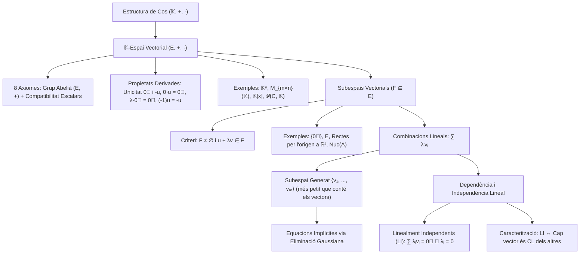

# Espais Vectorials

## 1. Introducció i Motivació

L'àlgebra lineal s'ocupa de l'estudi de sistemes geomètrics i algebraics que preserven combinacions lineals. Fins ara hem treballat amb matrius i vectors definits sobre nombres reals o sobre un cos genèric $\mathbb{K}$.

Per construir una teoria axiomàtica sòlida i general de l'àlgebra lineal, el primer pas consisteix a formalitzar l'estructura algebraica dels coeficients escalars (el concepte de **cos**) i, posteriorment, l'estructura dels vectors sobre els quals operen aquests escalars (el concepte d'**espai vectorial**).

---

## 2. L'Estructura Algebraica de Cos

> [!IMPORTANT] Definició Axiomàtica de Cos
> Un **cos** és un triplet $(\mathbb{K}, +, \cdot)$ format per un conjunt no buit $\mathbb{K}$ i dues operacions binàries internes:
> $$\begin{aligned}
> +: \mathbb{K} \times \mathbb{K} &\longrightarrow \mathbb{K}, \quad (a, b) \longmapsto a + b \quad \text{(suma)} \\
> \cdot: \mathbb{K} \times \mathbb{K} &\longrightarrow \mathbb{K}, \quad (a, b) \longmapsto a \cdot b \quad \text{(producte, sovint escrit } ab\text{)}
> \end{aligned}$$
> que compleixen les següents propietats per a qualssevol elements $a, b, c \in \mathbb{K}$:
> 
> ### I. Propietats de la Suma: $(\mathbb{K}, +)$ és un Grup Abelià
> 1. **Associativitat:** $a + (b + c) = (a + b) + c$
> 2. **Commutativitat:** $a + b = b + a$
> 3. **Element Neutre:** Existeix un element $0 \in \mathbb{K}$ tal que:
>    $$a + 0 = a \quad \forall a \in \mathbb{K}$$
> 4. **Element Oposat:** Per a cada $a \in \mathbb{K}$, existeix un element $-a \in \mathbb{K}$ tal que:
>    $$a + (-a) = 0$$
> 
> ### II. Propietats del Producte
> 1. **Associativitat:** $a \cdot (b \cdot c) = (a \cdot b) \cdot c$
> 2. **Commutativitat:** $a \cdot b = b \cdot a$
> 3. **Element Unitat (Neutre del Producte):** Existeix un element $1 \in \mathbb{K}$ tal que:
>    $$a \cdot 1 = a \quad \forall a \in \mathbb{K}$$
> 4. **Element Invers:** Per a cada element no nul $a \in \mathbb{K}$ ($a \neq 0$), existeix un element invers $a^{-1} \in \mathbb{K}$ (o $\frac{1}{a}$) tal que:
>    $$a \cdot a^{-1} = 1$$
>    *(Equivalentment, $(\mathbb{K} \setminus \{0\}, \cdot)$ és un grup abelià).*
> 
> ### III. Compatibilitat entre Operacions i No Degeneració
> 1. **Distributivitat del producte respecte de la suma:**
>    $$a \cdot (b + c) = a \cdot b + a \cdot c$$
> 2. **No trivialitat:** L'element neutre de la suma i el de la multiplicació són diferents:
>    $$0 \neq 1$$

---

## 3. Exemples Fonamentals de Cossos

### 3.1. Cossos Numèrics Clàssics
Els exemples més habituals en anàlisi i geometria són:
1. **$(\mathbb{Q}, +, \cdot)$:** El cos dels nombres racionals. És el cos de característica zero més petit (cos primer).
2. **$(\mathbb{R}, +, \cdot)$:** El cos dels nombres reals. A més de cos, és complet (axioma del suprem) i ordenat.
3. **$(\mathbb{C}, +, \cdot)$:** El cos dels nombres complexos, definit formalment com:
   $$\mathbb{C} \underset{\text{def}}{=} \{a + bi \mid a, b \in \mathbb{R}\} \quad \text{on } i^2 = -1$$
   proveït de les operacions:
   - Suma: $(a + bi) + (c + di) = (a + c) + (b + d)i$
   - Producte: $(a + bi)(c + di) = (ac - bd) + (ad + bc)i$
   - Element neutre de la suma: $0 = 0 + 0i \in \mathbb{C}$
   - Element unitat del producte: $1 = 1 + 0i \in \mathbb{C}$
   És un cos algebraicament tancat (Teorema Fonamental de l'Àlgebra), però no admet una relació d'ordre compatible amb les operacions.

---

### 3.2. El Cos Finit $\mathbb{Z}/2\mathbb{Z}$ ($\mathbb{F}_2$)
Considerem el conjunt quocient format per les classes de restes mòdul 2:
$$\mathbb{Z}/2\mathbb{Z} = \{[0], [1]\} \quad \text{o simplement} \quad \{0, 1\}$$
Definim la suma i el producte mòdul 2 mitjançant les seves taules de Cayley:

| $+$ | $0$ | $1$ |
|:---:|:---:|:---:|
| **$0$** | $0$ | $1$ |
| **$1$** | $1$ | $0$ |

| $\cdot$ | $0$ | $1$ |
|:---:|:---:|:---:|
| **$0$** | $0$ | $0$ |
| **$1$** | $0$ | $1$ |

> [!NOTE] Característica 2
> En aquest cos es compleix que $1 + 1 = 0$, la qual cosa implica que tot element és el seu propi oposat: $-1 = 1$. Aquest cos és fonamental en teoria de la informació, criptografia i ciències de la computació.

---

### 3.3. L'Extensió Quadràtica $\mathbb{Q}(\sqrt{2})$
Definim el subconjunt dels nombres reals:
$$\mathbb{Q}(\sqrt{2}) \underset{\text{def}}{=} \{a + b\sqrt{2} \mid a, b \in \mathbb{Q}\} \subseteq \mathbb{R}$$

Comprovem que $\mathbb{Q}(\sqrt{2})$ té estructura de cos amb les operacions heretades de $\mathbb{R}$:
1. **Clausura per la suma:**
   $$(a + b\sqrt{2}) + (c + d\sqrt{2}) = (a + c) + (b + d)\sqrt{2} \in \mathbb{Q}(\sqrt{2})$$
   ja que $a+c \in \mathbb{Q}$ i $b+d \in \mathbb{Q}$.
2. **Clausura pel producte:**
   $$(a + b\sqrt{2}) \cdot (c + d\sqrt{2}) = (ac + 2bd) + (ad + bc)\sqrt{2} \in \mathbb{Q}(\sqrt{2})$$
   ja que $ac + 2bd \in \mathbb{Q}$ i $ad + bc \in \mathbb{Q}$.
3. **Elements neutres:**
   - Neutre de la suma: $0 = 0 + 0\sqrt{2} \in \mathbb{Q}(\sqrt{2})$.
   - Neutre del producte: $1 = 1 + 0\sqrt{2} \in \mathbb{Q}(\sqrt{2})$.
4. **Existència d'invers:**
   Sigui $x = a + b\sqrt{2} \in \mathbb{Q}(\sqrt{2})$ amb $x \neq 0$.
   Com que $\sqrt{2}$ és irracional ($\sqrt{2} \notin \mathbb{Q}$), és impossible que $a^2 - 2b^2 = 0$ llevat que $a = b = 0$. Per tant, $a^2 - 2b^2 \neq 0$.
   Racionalitzant el quocient:
   $$x^{-1} = \frac{1}{a + b\sqrt{2}} = \frac{a - b\sqrt{2}}{(a + b\sqrt{2})(a - b\sqrt{2})} = \frac{a - b\sqrt{2}}{a^2 - 2b^2} = \left(\frac{a}{a^2 - 2b^2}\right) - \left(\frac{b}{a^2 - 2b^2}\right)\sqrt{2}$$
   Com que $\frac{a}{a^2 - 2b^2} \in \mathbb{Q}$ i $-\frac{b}{a^2 - 2b^2} \in \mathbb{Q}$, tenim que $x^{-1} \in \mathbb{Q}(\sqrt{2})$.

Per tant, $(\mathbb{Q}(\sqrt{2}), +, \cdot)$ és un subcos de $\mathbb{R}$.

---

## 4. Definició Axiomàtica d'Espai Vectorial

### 4.1. Exemple Motivador: $\mathbb{R}^n$
L'exemple intuïtiu i geomètric per excel·lència és l'espai numèric real $n$-dimensional:
$$\mathbb{R}^n = \{(a_1, \dots, a_n) \mid a_i \in \mathbb{R}\}$$
En aquest conjunt disposem de dues operacions fonamentals:
1. **Suma de vectors:**
   $$(a_1, \dots, a_n) + (b_1, \dots, b_n) = (a_1 + b_1, \dots, a_n + b_n)$$
   Geomètricament a $\mathbb{R}^2$ correspon a la coneguda regla del paral·lelogram per sumar $\vec{a} + \vec{b}$.
2. **Producte per escalars reals:**
   $$\forall \lambda \in \mathbb{R}, \quad \lambda(a_1, \dots, a_n) = (\lambda a_1, \dots, \lambda a_n)$$
   Geomètricament representa la dilatació ($\lambda > 1$), contracció ($0 < \lambda < 1$) o inversió de sentit ($\lambda < 0$) del vector original.

> [!NOTE] Observació Fonamental: Generalització a Cossos Arbitraris
> A partir d'ara treballarem prenent com a base un **cos arbitrari $\mathbb{K}$**.
> **Tot el que s'ha fet fins ara** en l'assignatura (matrius, sistemes d'equacions lineals, operacions elementals, PAQ-reducció, rang i determinants) **és plenament vàlid si agafem els coeficients en qualsevol cos $\mathbb{K}$**.

---

### 4.2. Els 8 Axiomes d'Espai Vectorial

> [!IMPORTANT] Definició d'Espai Vectorial sobre un Cos
> Sigui $\mathbb{K}$ un cos. Un **espai vectorial sobre $\mathbb{K}$** (o $\mathbb{K}$-espai vectorial, $\mathbb{K}$-e.v., o simplement e.v. si el cos se sobreentén) és un conjunt no buit $E$ proveït de dues operacions:
> 1. Una operació interna anomenada **suma de vectors**:
>    $$+: E \times E \longrightarrow E, \quad (u, v) \longmapsto u + v$$
> 2. Una operació externa anomenada **producte per escalars**:
>    $$\cdot: \mathbb{K} \times E \longrightarrow E, \quad (\lambda, u) \longmapsto \lambda \cdot u \quad (\text{o bé } \lambda u)$$
> 
> que compleixen les següents propietats:
> 
> #### I. Estructura de Grup Abelià per a $(E, +)$
> - **(i) Associativa:** $(u + v) + w = u + (v + w) \quad \forall u, v, w \in E$
> - **(ii) Commutativa:** $u + v = v + u \quad \forall u, v \in E$
> - **(iii) Element Neutre (Vector Nul):** $\exists \vec{0} \in E$ tal que $u + \vec{0} = u \quad \forall u \in E$
> - **(iv) Element Oposat:** $\forall u \in E, \; \exists -u \in E$ tal que $u + (-u) = \vec{0}$
> 
> #### II. Compatibilitat del Producte per Escalars de $\mathbb{K}$
> - **(i) Associativa Mixta (Pseudoassociativitat):** $(\lambda \mu) u = \lambda (\mu u) \quad \forall \lambda, \mu \in \mathbb{K}, \; \forall u \in E$
> - **(ii) Distributivitat respecte a la suma d'escalars:** $(\lambda + \mu) u = \lambda u + \mu u \quad \forall \lambda, \mu \in \mathbb{K}, \; \forall u \in E$
> - **(iii) Distributivitat respecte a la suma de vectors:** $\lambda(u + v) = \lambda u + \lambda v \quad \forall \lambda \in \mathbb{K}, \; \forall u, v \in E$
> - **(iv) Normalització per la Unitat del Cos:** $1_{\mathbb{K}} \cdot u = u \quad \forall u \in E$

Els elements d'$E$ s'anomenen **vectors** i els elements de $\mathbb{K}$ s'anomenen **escalars**.

---

## 5. Exemples Canònics d'Espais Vectorials

### Exemple 0: L'Espai Vectorial Nul (Trivial)
Sigui $\mathbb{K}$ un cos qualsevol. El conjunt format únicament pel vector zero:
$$E = \{\vec{0}\}$$
és un $\mathbb{K}$-espai vectorial amb les operacions òbvies:
$$\vec{0} + \vec{0} = \vec{0}, \qquad \lambda \vec{0} = \vec{0} \quad \forall \lambda \in \mathbb{K}$$

---

### Exemple 1: L'Espai Numèric $\mathbb{K}^n$ ($n \ge 1$)
Generalitzant $\mathbb{R}^n$, per a qualsevol enter $n \ge 1$ i qualsevol cos $\mathbb{K}$, definim:
$$\mathbb{K}^n = \{(a_1, \dots, a_n) \mid a_i \in \mathbb{K}\}$$
amb la suma i el producte definits component a component:
$$\begin{aligned}
(a_1, \dots, a_n) + (b_1, \dots, b_n) &= (a_1 + b_1, \dots, a_n + b_n) \\
\lambda(a_1, \dots, a_n) &= (\lambda a_1, \dots, \lambda a_n), \quad \lambda \in \mathbb{K}
\end{aligned}$$
El vector nul és $\vec{0} = (0, \dots, 0)$.

---

### Exemple 2: L'Espai de Matrius $\mathcal{M}_{m \times n}(\mathbb{K})$
El conjunt de totes les matrius de mida $m \times n$ amb coeficients al cos $\mathbb{K}$:
$$E = \mathcal{M}_{m \times n}(\mathbb{K})$$
és un $\mathbb{K}$-espai vectorial considerant:
- La suma usual de matrius: $(A + B)_{ij} = a_{ij} + b_{ij}$.
- El producte per escalars: $(\lambda A)_{ij} = \lambda a_{ij}$ per a tot $\lambda \in \mathbb{K}$.
- El vector nul és la matriu nul·la: $\vec{0} = (0)_{m \times n}$.

---

### Exemple 3: L'Espai dels Polinomis $\mathbb{K}[x]$
Definim el conjunt de tots els polinomis en la indeterminada $x$ amb coeficients al cos $\mathbb{K}$:
$$\mathbb{K}[x] \underset{\text{def}}{=} \{a_0 + a_1 x + a_2 x^2 + \dots + a_n x^n \mid n \ge 0, \; a_0, a_1, \dots, a_n \in \mathbb{K}\}$$
amb les operacions:
- **Suma de polinomis:** agrupant els coeficients del mateix grau:
  $$(a + bx + cx^2) + (d + ex) = (a + d) + (b + e)x + cx^2$$
- **Producte per escalars de $\mathbb{K}$:**
  $$\lambda (a_0 + a_1 x + \dots + a_n x^n) = (\lambda a_0) + (\lambda a_1)x + \dots + (\lambda a_n)x^n$$

#### Subconjunts de Polinomis de Grau Fitat $\mathbb{K}_n[x]$
Si fixem un grau màxim $n \ge 0$, considerem:
$$\mathbb{K}_n[x] = \{p(x) \in \mathbb{K}[x] \mid \operatorname{grau}(p(x)) \le n\}$$
Per exemple:
- $\mathbb{K}_1[x] = \{a + bx \mid a, b \in \mathbb{K}\}$ (polinomis de grau $\le 1$).
- $\mathbb{K}_2[x] = \{a + bx + cx^2 \mid a, b, c \in \mathbb{K}\}$ (polinomis de grau $\le 2$).

Com que la suma de polinomis de grau $\le n$ i el producte per un escalar no augmenten mai el grau, cadascun d'aquests conjunts és també un $\mathbb{K}$-espai vectorial, complint-se la cadena d'inclusions:
$$\mathbb{K}_1[x] \subseteq \mathbb{K}_2[x] \subseteq \dots \subseteq \mathbb{K}_n[x] \subseteq \dots \subseteq \mathbb{K}[x]$$

---

### Exemple 4: Cossos com a Espais Vectorials sobre Subcossos
Si tenim una cadena d'inclusió de cossos $\mathbb{Q} \subseteq \mathbb{R} \subseteq \mathbb{C}$:
- $\mathbb{R}$ té estructura natural d'espai vectorial sobre $\mathbb{Q}$ ($\mathbb{Q}$-espai vectorial), amb la suma usual i el producte d'un racional per un real.
- $\mathbb{C}$ té estructura d'espai vectorial sobre $\mathbb{R}$ ($\mathbb{R}$-espai vectorial), on tot nombre complex $z = a + bi$ es veu com una combinació lineal amb escalars reals.

---

### Exemple 5: L'Espai d'Aplicacions $\mathcal{F}(C, \mathbb{K})$
Sigui $C$ un conjunt no buit arbitrari i sigui $\mathbb{K}$ un cos. Considerem el conjunt de totes les aplicacions de $C$ a $\mathbb{K}$:
$$\mathcal{F}(C, \mathbb{K}) = \{f: C \longrightarrow \mathbb{K}\}$$
Aquest conjunt és un $\mathbb{K}$-espai vectorial definint les operacions punt a punt:
- **Suma de funcions:** $(f + g)(x) = f(x) + g(x) \quad \forall x \in C$
- **Producte per un escalar $\lambda \in \mathbb{K}$:** $(\lambda f)(x) = \lambda f(x) \quad \forall x \in C$
- **Vector nul (funció nul·la):** $\vec{0}: C \longrightarrow \mathbb{K}$ donada per $\vec{0}(x) = 0 \quad \forall x \in C$

#### Casos Particulars:
1. **$C = \{1, 2, \dots, n\}$:** Una aplicació $f: \{1, \dots, n\} \to \mathbb{K}$ queda completament determinada per la llista de valors $(f(1), \dots, f(n)) \in \mathbb{K}^n$. Per tant:
   $$\mathcal{F}(\{1, \dots, n\}, \mathbb{K}) \cong \mathbb{K}^n$$
   Per exemple, si $C = \{1, 2, 3\}$ i $\mathbb{K} = \mathbb{R}$, donar una funció equival a donar una terna $(a_1, a_2, a_3) \in \mathbb{R}^3$.
2. **$C = \mathbb{R}, \mathbb{K} = \mathbb{R}$:** L'espai $\mathcal{F}(\mathbb{R}, \mathbb{R})$ és l'espai de totes les funcions reals de variable real.

---

## 6. Propietats Immediates Derivades dels Axiomes

A partir dels 8 axiomes d'espai vectorial es dedueixen de forma unívoca les següents propietats fonamentals per a qualsevol $\mathbb{K}$-espai vectorial $E$:

> [!NOTE] Proposició: Propietats Fonamentals
> Sigui $E$ un $\mathbb{K}$-espai vectorial. Es compleixen les següents propietats per a qualssevol $u \in E$ i $\lambda \in \mathbb{K}$:
> 1. **Unicitat de l'element neutre:** El vector nul $\vec{0} \in E$ és únic.
> 2. **Unicitat de l'oposat:** Per a cada $u \in E$, el seu vector oposat $-u$ és únic.
> 3. **Anul·lació pel zero escalar:** $0_{\mathbb{K}} \cdot u = \vec{0}$.
> 4. **Anul·lació del vector nul:** $\lambda \cdot \vec{0} = \vec{0}$.
> 5. **Criteri d'anul·lació del producte:** $\lambda \cdot u = \vec{0} \implies \lambda = 0_{\mathbb{K}} \quad \text{o bé} \quad u = \vec{0}$.
> 6. **Multiplicació per $-1$:** $(-1_{\mathbb{K}}) \cdot u = -u$.

### Demostració
1. **Unicitat del neutre:**
   Suposem que existeixen dos elements neutres $\vec{0}_1, \vec{0}_2 \in E$. Com que $\vec{0}_2$ és neutre, $\vec{0}_1 + \vec{0}_2 = \vec{0}_1$. Com que $\vec{0}_1$ és neutre, $\vec{0}_1 + \vec{0}_2 = \vec{0}_2$. En conseqüència, $\vec{0}_1 = \vec{0}_2$.
2. **Unicitat de l'oposat:**
   Si $v_1$ i $v_2$ són dos oposats de $u$, tenim $v_1 = v_1 + \vec{0} = v_1 + (u + v_2) = (v_1 + u) + v_2 = \vec{0} + v_2 = v_2$.
3. **$0 \cdot u = \vec{0}$:**
   Com que $0 = 0 + 0$ al cos $\mathbb{K}$, per la distributivitat respecte a la suma d'escalars:
   $$0 \cdot u = (0 + 0) \cdot u = 0 \cdot u + 0 \cdot u$$
   Sumant a banda i banda l'oposat $-(0 \cdot u)$:
   $$\vec{0} = 0 \cdot u + (-(0 \cdot u)) = (0 \cdot u + 0 \cdot u) + (-(0 \cdot u)) = 0 \cdot u + \vec{0} = 0 \cdot u$$
   Per tant, $0 \cdot u = \vec{0}$.
4. **$\lambda \cdot \vec{0} = \vec{0}$:**
   Anàlogament, com que $\vec{0} = \vec{0} + \vec{0}$, tenim $\lambda \cdot \vec{0} = \lambda \cdot (\vec{0} + \vec{0}) = \lambda \cdot \vec{0} + \lambda \cdot \vec{0}$. Sumant $-(\lambda \cdot \vec{0})$ s'obté $\lambda \cdot \vec{0} = \vec{0}$.
5. **$\lambda \cdot u = \vec{0} \implies \lambda = 0 \lor u = \vec{0}$:**
   Suposem que $\lambda \cdot u = \vec{0}$. Si $\lambda = 0$, la conclusió és immediata. Si $\lambda \neq 0$, com que $\mathbb{K}$ és un cos, existeix l'invers $\lambda^{-1} \in \mathbb{K}$. Multiplicant:
   $$u = 1 \cdot u = (\lambda^{-1} \lambda) u = \lambda^{-1} (\lambda u) = \lambda^{-1} \vec{0} = \vec{0}$$
6. **$(-1) \cdot u = -u$:**
   Per la propietat (3) i la distributivitat:
   $$\vec{0} = 0 \cdot u = (1 + (-1)) u = 1 \cdot u + (-1) u = u + (-1) u$$
   Com que l'oposat de $u$ és únic per la propietat (2), deduïm que $(-1) \cdot u = -u$. $\blacksquare$

---

## 7. Subespais Vectorials

### 7.1. Motivació: L'Espai de Funcions Contínues $\mathcal{C}^0(\mathbb{R}, \mathbb{R})$
Dins de l'espai total de totes les funcions reals $\mathcal{F}(\mathbb{R}, \mathbb{R})$, considerem el subconjunt de les **funcions contínues**:
$$\mathcal{C}^0(\mathbb{R}, \mathbb{R}) \subset \mathcal{F}(\mathbb{R}, \mathbb{R})$$
De l'anàlisi matemàtica sabem que:
1. La suma de dues funcions contínues és una funció contínua: $f, g \in \mathcal{C}^0 \implies f + g \in \mathcal{C}^0$.
2. El producte d'un escalar real per una funció contínua és continu: $\lambda \in \mathbb{R}, f \in \mathcal{C}^0 \implies \lambda f \in \mathcal{C}^0$.
3. La funció constant zero $\vec{0}(x) = 0$ és contínua ($\vec{0} \in \mathcal{C}^0$).

Això fa que $\mathcal{C}^0(\mathbb{R}, \mathbb{R})$ sigui un espai vectorial en si mateix amb les mateixes operacions heretades. Aquest fenomen s'anomena **subespai vectorial**.

---

### 7.2. Definició i Caracterització de Subespai Vectorial

> [!IMPORTANT] Definició de Subespai Vectorial
> Sigui $E$ un $\mathbb{K}$-espai vectorial i sigui $F \subseteq E$ un subconjunt de $E$.
> Diem que $F$ és un **subespai vectorial** de $E$ (denotat sovint $F \le E$) si $F \neq \emptyset$ i $F$ és tancat per les operacions de $E$:
> 1. $\forall u, v \in F \implies u + v \in F$
> 2. $\forall \lambda \in \mathbb{K}, \forall u \in F \implies \lambda u \in F$

> [!NOTE] Criteri de Subespai Vectorial
> Sigui $E$ un $\mathbb{K}$-espai vectorial i $F \subseteq E$. Aleshores:
> $$F \text{ és subespai vectorial de } E \iff F \neq \emptyset \quad \text{i} \quad \forall u, v \in F, \; \forall \lambda \in \mathbb{K}, \; u + \lambda v \in F$$

*(Demostració: Immediata prenent $\lambda = 1$ per a la suma, i $u = \vec{0}$ o $\lambda = -1$ per a oposats i escalars).*

---

### 7.3. Exemples Fonamentals de Subespais Vectorials

1. **Subespais Trivials:**
   En qualsevol $\mathbb{K}$-espai vectorial $E$, sempre existeixen com a mínim dos subespais:
   - El **subespai zero**: $F = \{\vec{0}\}$ (subespai trivial).
   - El **subespai total**: $F = E$.
2. **Subespais de $\mathbb{R}^2$:**
   Considerem $E = \mathbb{R}^2$:
   - **Recta que passa per l'origen:** $F = \{(x, x) \mid x \in \mathbb{R}\} \subset \mathbb{R}^2$.
     Comprovem que $(0, 0) \in F$. A més:
     $$(x, x) + \lambda (y, y) = (x + \lambda y, x + \lambda y) = (z, z) \in F$$
     Per tant, $F$ és un subespai vectorial.
   - **Recta afí que no passa per l'origen:** $R = \{(x, 1) \mid x \in \mathbb{R}\}$.
     $(0, 0) \notin R$. A més:
     $$(x, 1) + (y, 1) = (x+y, 2) \notin R$$
     Per tant, $R$ **no** és un subespai vectorial.
   - **Corbes no lineals:** $P = \{(x, x^2) \mid x \in \mathbb{R}\}$ (paràbola).
     $(1, 1) \in P$, però $2 \cdot (1, 1) = (2, 2) \notin P$ (ja que $2^2 = 4 \neq 2$). Per tant, **no** és subespai vectorial.
3. **Nucli d'un Sistema Homogeni:**
   Sigui $A \in \mathcal{M}_{m \times n}(\mathbb{K})$ una matriu. El conjunt de solucions del sistema d'equacions lineals homogeni associat:
   $$F = \left\{(x_1, \dots, x_n) \in \mathbb{K}^n \;\middle|\; A \begin{pmatrix} x_1 \\ \vdots \\ x_n \end{pmatrix} = \begin{pmatrix} 0 \\ \vdots \\ 0 \end{pmatrix} \right\} \subseteq \mathbb{K}^n$$
   és sempre un subespai vectorial de $\mathbb{K}^n$:
   - Com que $A \vec{0} = \vec{0}$, tenim $\vec{0} \in F \neq \emptyset$.
   - Si $u, v \in F$ i $\lambda \in \mathbb{K}$, per la linealitat del producte matricial:
     $$A(u + \lambda v) = Au + \lambda Av = \vec{0} + \lambda \vec{0} = \vec{0}$$
     la qual cosa implica $(u + \lambda v) \in F$.
   Aquest subespai rep el nom de **nucli** de la matriu, $\operatorname{Nuc}(A)$.

---

## 8. Combinacions Lineals i Subespais Generats

### 8.1. Combinació Lineal (CL)

> [!IMPORTANT] Definició de Combinació Lineal
> Sigui $E$ un $\mathbb{K}$-espai vectorial i siguin $v_1, \dots, v_m \in E$.
> Una **combinació lineal (CL)** de $v_1, \dots, v_m$ és qualsevol vector de $E$ que es pot escriure en la forma:
> $$\lambda_1 v_1 + \lambda_2 v_2 + \dots + \lambda_m v_m, \quad \text{on } \lambda_1, \dots, \lambda_m \in \mathbb{K}$$

---

### 8.2. Subespai Generat per una Família de Vectors

Denotem per $\langle v_1, \dots, v_m \rangle$ el conjunt de totes les combinacions lineals possibles d'aquests vectors:
$$\langle v_1, \dots, v_m \rangle \underset{\text{def}}{=} \{\lambda_1 v_1 + \dots + \lambda_m v_m \mid \lambda_1, \dots, \lambda_m \in \mathbb{K}\} \subseteq E$$

> [!NOTE] Lema del Subespai Generat
> El conjunt $\langle v_1, \dots, v_m \rangle$ és un subespai vectorial de $E$, i és el **subespai vectorial més petit de $E$ que conté els vectors $v_1, \dots, v_m$**.

#### Demostració:
1. **És subespai vectorial:**
   Sigui $F = \langle v_1, \dots, v_m \rangle$. Com que $\vec{0} = 0 v_1 + \dots + 0 v_m \in F$, tenim $F \neq \emptyset$.
   Siguin $w, w' \in F$:
   $$w = \lambda_1 v_1 + \dots + \lambda_m v_m, \qquad w' = \lambda'_1 v_1 + \dots + \lambda'_m v_m$$
   Aleshores:
   $$w + w' = (\lambda_1 + \lambda'_1)v_1 + \dots + (\lambda_m + \lambda'_m)v_m \in F$$
   Si $\lambda \in \mathbb{K}$:
   $$\lambda w = (\lambda \lambda_1) v_1 + \dots + (\lambda \lambda_m) v_m \in F$$
   Per tant, $F$ és un subespai vectorial.
2. **És el més petit:**
   Sigui $F' \subseteq E$ qualsevol altre subespai vectorial tal que $v_1, \dots, v_m \in F'$.
   Com que $F'$ és tancat per la suma i pel producte per escalars, qualsevol combinació lineal $\lambda_1 v_1 + \dots + \lambda_m v_m$ pertany obligatòriament a $F'$.
   Per tant, $\langle v_1, \dots, v_m \rangle \subseteq F'$. $\blacksquare$

Diem que $\langle v_1, \dots, v_m \rangle$ és el **subespai generat** per $v_1, \dots, v_m$, i que és un subespai **finitament generat**.

#### Generalització a Subconjunts Arbitraris:
Per a qualsevol subconjunt $X \subseteq E$, denotem per $\langle X \rangle$ el subespai vectorial més petit de $E$ que conté $X$:
- Si $X \neq \emptyset$: $\langle X \rangle = \{\lambda_1 u_1 + \dots + \lambda_k u_k \mid k \ge 1, \; \lambda_i \in \mathbb{K}, \; u_i \in X\}$.
- Si $X = \emptyset$: per conveni $\langle \emptyset \rangle = \{\vec{0}\}$.

---

### 8.3. Exemples Pràctics a $\mathbb{R}^3$

#### Exemple 1:
Considerem a $\mathbb{R}^3$ el subespai $F = \langle (1, 2, 0), (-1, 2, 0) \rangle$:
$$F = \{\lambda(1, 2, 0) + \mu(-1, 2, 0) \mid \lambda, \mu \in \mathbb{R}\} = \{(\lambda - \mu, 2\lambda + 2\mu, 0) \mid \lambda, \mu \in \mathbb{R}\}$$
Un vector $(x, y, 0)$ pertany a $F$ si podem resoldre el sistema:
$$\begin{cases} \lambda - \mu = x \\ 2\lambda + 2\mu = y \end{cases}$$
Aquest sistema té solució única per a qualssevol $x, y \in \mathbb{R}$ ($\lambda = \frac{2x+y}{4}, \mu = \frac{y-2x}{4}$).
Per tant, $F$ és el pla $z = 0$, que es pot generar simplement per la base canònica del pla:
$$F = \{(x, y, 0) \mid x, y \in \mathbb{R}\} = \langle (1, 0, 0), (0, 1, 0) \rangle$$

#### Exemple 2: Càlcul d'Equacions Implícites
Sigui $F = \langle (1, -1, 2), (0, 1, 1), (1, 1, 4) \rangle \subset \mathbb{R}^3$.
Un vector $(x, y, z) \in F$ si existeixen $\lambda, \mu, \nu \in \mathbb{R}$ tals que:
$$\begin{pmatrix} x \\ y \\ z \end{pmatrix} = \lambda \begin{pmatrix} 1 \\ -1 \\ 2 \end{pmatrix} + \mu \begin{pmatrix} 0 \\ 1 \\ 1 \end{pmatrix} + \nu \begin{pmatrix} 1 \\ 1 \\ 4 \end{pmatrix}$$
Estudiem la compatibilitat del sistema ampliat mitjançant eliminació gaussiana per files:
$$\begin{pmatrix} 1 & 0 & 1 & x \\ -1 & 1 & 1 & y \\ 2 & 1 & 4 & z \end{pmatrix} 
\xrightarrow{\substack{F_2 \leftarrow F_2 + F_1 \\ F_3 \leftarrow F_3 - 2F_1}}
\begin{pmatrix} 1 & 0 & 1 & x \\ 0 & 1 & 2 & x+y \\ 0 & 1 & 2 & z - 2x \end{pmatrix}
\xrightarrow{F_3 \leftarrow F_3 - F_2}
\begin{pmatrix} 1 & 0 & 1 & x \\ 0 & 1 & 2 & x+y \\ 0 & 0 & 0 & z - 3x - y \end{pmatrix}$$
Pel Teorema de Rouché-Frobenius, el sistema és compatible si i només si l'última fila s'anul·la completament:
$$z - 3x - y = 0 \iff z = 3x + y$$
Per tant, l'**equació implícita** de $F$ és $3x + y - z = 0$.
Els vectors de $F$ són de la forma $(x, y, 3x + y) = x(1, 0, 3) + y(0, 1, 1)$. En conseqüència:
$$F = \langle (1, 0, 3), (0, 1, 1) \rangle$$

---

## 9. Dependència i Independència Lineal

> [!IMPORTANT] Definició de Vectors Linealment Independents (LI) i Dependents (LD)
> Sigui $E$ un $\mathbb{K}$-espai vectorial i siguin $v_1, \dots, v_m \in E$.
> 1. Diem que $v_1, \dots, v_m$ són **linealment independents (LI)** si l'única combinació lineal que dóna el vector nul és la trivial:
>    $$\lambda_1 v_1 + \dots + \lambda_m v_m = \vec{0} \implies \lambda_1 = \lambda_2 = \dots = \lambda_m = 0$$
> 2. En cas contrari (si existeixen escalars no tots nuls tals que $\sum \lambda_i v_i = \vec{0}$), diem que els vectors són **linealment dependents (LD)**.

#### Extensió a Conjunts Generals:
- Un subconjunt no buit $X \subseteq E$ és **linealment independent** si qualsevol subconjunt finit d'elements diferents de $X$ és LI.
- Per conveni, el conjunt buit $X = \emptyset$ és **linealment independent**.

---

### 9.1. Caracterització Fonamental de la Independència Lineal

> [!NOTE] Proposició: Caracterització per Combinació Lineal
> Els vectors $v_1, \dots, v_m \in E$ són **linealment independents** si i només si **cap d'ells es pot expressar com a combinació lineal dels altres**.
> 
> *Equivalentment (contrarecíproca):*
> Els vectors $v_1, \dots, v_m$ són **linealment dependents** si i només si **almenys un d'ells és combinació lineal dels restants**.

#### Demostració:
- $(\implies)$ Suposem que $v_1, \dots, v_m$ són LI. Demostrem que cap vector és CL dels altres per reducció a l'absurd.
  Suposem que un d'ells (per exemple $v_1$) fos combinació lineal dels altres:
  $$v_1 = \lambda_2 v_2 + \dots + \lambda_m v_m \quad \text{amb } \lambda_2, \dots, \lambda_m \in \mathbb{K}$$
  Reorganitzant la igualtat:
  $$1 \cdot v_1 - \lambda_2 v_2 - \dots - \lambda_m v_m = \vec{0}$$
  Això és una combinació lineal nul·la on el coeficient de $v_1$ és $1 \neq 0$. Això contradiu directament la hipòtesi que els vectors són linealment independents.
- $(\impliedby)$ Suposem que cap vector és combinació lineal dels altres. Volem provar que són LI.
  Considerem una combinació lineal nul·la qualsevol:
  $$\lambda_1 v_1 + \dots + \lambda_m v_m = \vec{0}$$
  Demostrem que tots els $\lambda_i = 0$ per reducció a l'absurd. Suposem que algun coeficient fos no nul, per exemple $\lambda_1 \neq 0$.
  Com que $\mathbb{K}$ és un cos i $\lambda_1 \neq 0$, existeix el seu invers $\lambda_1^{-1} \in \mathbb{K}$. Multiplicant tota la igualtat per $\lambda_1^{-1}$:
  $$\lambda_1^{-1}(\lambda_1 v_1 + \dots + \lambda_m v_m) = \lambda_1^{-1} \vec{0} = \vec{0}$$
  $$v_1 + \lambda_1^{-1}\lambda_2 v_2 + \dots + \lambda_1^{-1}\lambda_m v_m = \vec{0}$$
  Aïllant $v_1$:
  $$v_1 = -(\lambda_1^{-1}\lambda_2) v_2 - \dots - (\lambda_1^{-1}\lambda_m) v_m$$
  Això expressa $v_1$ com a combinació lineal dels restants vectors $v_2, \dots, v_m$, entrant en contradicció amb la hipòtesi.
  Per tant, necessàriament $\lambda_1 = \dots = \lambda_m = 0$, provant que els vectors són linealment independents. $\blacksquare$

---

## 10. Esquema Resum

---

*Enllaços relacionats:*
- [[Índex|Tornar a l'Índex Principal]]
- [[Índex - Àlgebra 1|Tornar a l'Índex d'Àlgebra 1]]
- [[03. Determinants|Tema anterior: Determinants]]
