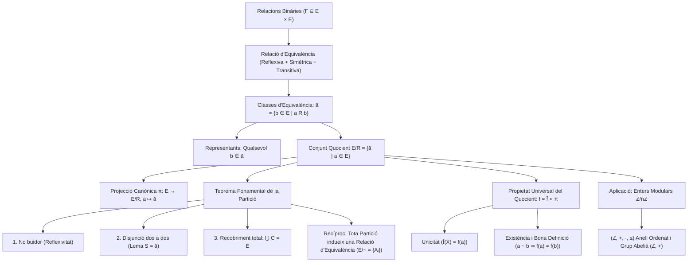

# Relacions d'Equivalència

## 1. Definició de Relació d'Equivalència

> [!IMPORTANT] Definició de Relació d'Equivalència
> Sigui $E$ un conjunt i sigui $R$ una relació binària sobre $E$ ($R \subseteq E \times E$).
> Diem que $R$ és una **relació d'equivalència** si i només si compleix simultàniament les tres propietats següents:
> 1. **Reflexiva:** $\forall a \in E, \; a \, R \, a$
> 2. **Simètrica:** $\forall a, b \in E, \; a \, R \, b \implies b \, R \, a$
> 3. **Transitiva:** $\forall a, b, c \in E, \; (a \, R \, b \land b \, R \, c) \implies a \, R \, c$
> 
> **Notacions usuals:** Per indicar una relació d'equivalència s'acostuma a emprar símbols com $\simeq$, $\sim$ o $\equiv$.

### Motivació: Més enllà de la Igualtat
La relació d'igualtat formal ($=$) sovint és **massa forta**: dos objectes matemàtics poden ser formalment diferents però compartir una mateixa propietat rellevant.

*Exemple de classe:*
Considerem dos conjunts dibuixats $C_1$ (format per $\{1, \text{casa}, \text{arbre}\}$) i $C_2$ (format per $\{\text{arbre}, 1, \text{casa}\}$). Com a dibuixos o representacions ordenades són diferents ($C_1 \neq C_2$). Tanmateix, existeix una aplicació canònica (bijecció) que fa equivalents aquests dos conjunts des del punt de vista conjuntista. Una relació d'equivalència permet formalitzar aquesta identificació.

---

## 2. Classes d'Equivalència

> [!IMPORTANT] Definició de Classe d'Equivalència
> Sigui $(E, R)$ un conjunt dotat d'una relació d'equivalència $R$, i sigui $a \in E$.
> La **classe d'equivalència de $a$** és el conjunt de tots els elements de $E$ relacionats amb $a$:
> $$\bar{a} = \{b \in E \mid a \, R \, b\}$$
> Per simetria de $R$, també s'expressa com $\bar{a} = \{b \in E \mid b \, R \, a\}$.
> 
> Una **classe d'equivalència** en $E$ és qualsevol subconjunt $S \subseteq E$ tal que existeix un $a \in E$ amb $S = \bar{a}$.

### Notacions Habituals per a les Classes
La classe d'un element $a$ es pot denotar segons el text per:
$$\bar{a}, \quad \bar{a}^R, \quad \mathcal{C}(a), \quad \mathcal{C}_R(a), \quad \dot{a}, \quad [a]$$

### Observació: Classes per a Relacions Generals
La noció de "classe d'un element $a$" té sentit per a qualsevol relació binària $R$ sobre $E$, però si $R$ no és simètrica cal distingir:
- **Classe a la dreta:** $\bar{a}^{\rightarrow R} = \{b \in E \mid a \, R \, b\}$
- **Classe a l'esquerra:** $\bar{a}^{R \leftarrow} = \{b \in E \mid b \, R \, a\}$
- **Classes bilaterals:** $\bar{a}^{\rightarrow R} \cap \bar{a}^{R \leftarrow}$

En una relació d'equivalència, per la propietat simètrica, les classes a la dreta i a l'esquerra coincideixen exactament.

### Concepte de Representant
- Les classes d'equivalència són **subconjunts** de $E$ ($S \subseteq E$). Són objectes "amorfs" (conjunts purs sense elements internament preferits).
- Qualsevol element $b \in \bar{a}$ s'anomena un **representant** de la classe d'equivalència $\bar{a}$.

---

## 3. Conjunt Quocient i Projecció Canònica

> [!IMPORTANT] Definició de Conjunt Quocient
> Sigui $E$ un conjunt i $R$ una relació d'equivalència sobre $E$.
> El conjunt format per totes les classes d'equivalència s'anomena **conjunt quocient** de $E$ per $R$, i es denota per $E/R$:
> $$E/R = \{\bar{a} \mid a \in E\}$$
> 
> Aquest conjunt ve dotat d'una **projecció canònica**:
> $$\pi: E \longrightarrow E/R, \quad a \longmapsto \bar{a}$$
> que a cada element de $E$ li assigna la seva classe d'equivalència.

---

## 4. Teorema Fonamental de la Partició

> [!IMPORTANT] Teorema: Les Classes d'Equivalència Formen una Partició
> Sigui $E$ un conjunt i $R$ una relació d'equivalència sobre $E$.
> Les classes d'equivalència satisfan les tres propietats següents:
> 1. **No buidor:** $\forall C \in E/R, \; C \neq \emptyset$.
> 2. **Disjunció dos a dos:** $\forall C, D \in E/R, \; C \cap D \neq \emptyset \implies C = D$.
> 3. **Recobriment total:** $\bigcup_{C \in E/R} C = E$.
> 
> En conseqüència, les classes d'equivalència formen una **partició** del conjunt $E$.

### Demostració
1. **No buidor:**
   Sigui $C \in E/R$. Per definició de quocient, existeix un element $a \in E$ tal que $C = \bar{a}$.
   Com que la relació $R$ és **reflexiva**, es compleix $a \, R \, a$.
   Per tant, $a \in \bar{a} = C$, la qual cosa demostra que $C \neq \emptyset$.

2. **Disjunció dos a dos:**
   Siguin $C, D \in E/R$. Suposem que $C \cap D \neq \emptyset$. Volem demostrar que $C = D$ per doble inclusió.
   Per a provar-ho, utilitzem el següent lema fonamental sobre les classes d'equivalència:

   > [!NOTE] Lema de Caracterització d'una Classe per Qualsevol dels seus Elements
   > Sigui $S \in E/R$ una classe d'equivalència i sigui $a \in S$. Aleshores:
   > $$S = \bar{a}$$
   > *(Una classe d'equivalència coincideix exactament amb la classe generada per qualsevol dels seus elements).*

   **Demostració del lema:**
   Com que $S \in E/R$, per definició de conjunt quocient existeix un element $s \in E$ tal que $S = \bar{s}$.
   - **Inclusió $S \subseteq \bar{a}$:**
     Sigui $x \in S = \bar{s}$. Aleshores $x \, R \, s$.
     Com que per hipòtesi $a \in S = \bar{s}$, tenim en particular $a \, R \, s$.
     Per la propietat **simètrica**, $s \, R \, a$.
     Per la propietat **transitiva** ($x \, R \, s$ i $s \, R \, a$), deduïm que $x \, R \, a$.
     Per tant, $x \in \bar{a}$, la qual cosa demostra que $S \subseteq \bar{a}$.
   - **Inclusió $\bar{a} \subseteq S$:**
     Sigui $y \in \bar{a}$. Aleshores $y \, R \, a$.
     Com que $a \in S = \bar{s}$, tenim $a \, R \, s$.
     Per la propietat **transitiva** ($y \, R \, a$ i $a \, R \, s$), deduïm que $y \, R \, s$.
     Llavors $y \in \bar{s} = S$, provant que $\bar{a} \subseteq S$.
   
   Per doble inclusió, concloem que $S = \bar{a}$. $\blacksquare$ (lema)

   **Conclusió de la disjunció:**
   Com que hem suposat $C \cap D \neq \emptyset$, sigui $b \in C \cap D$:
   - Com que $b \in C$, aplicant el lema a $C$ tenim $C = \bar{b}$.
   - Com que $b \in D$, aplicant el lema a $D$ tenim $D = \bar{b}$.
   En conseqüència:
   $$C = \bar{b} = D$$
   Això demostra que si dues classes d'equivalència tenen com a mínim un element en comú, han de ser obligatòriament idèntiques.

3. **Recobriment total ($\bigcup_{C \in E/R} C = E$):**
   - **Inclusió $\bigcup_{C \in E/R} C \subseteq E$:**
     Trivialment, per a tota classe $C \in E/R$ es compleix $C \subseteq E$, per tant la unió de totes elles continua continguda a $E$:
     $$\bigcup_{C \in E/R} C \subseteq E$$
   - **Inclusió $E \subseteq \bigcup_{C \in E/R} C$:**
     Sigui $a \in E$ un element arbitrari.
     Com que la relació $R$ és **reflexiva**, tenim $a \, R \, a$, la qual cosa implica $a \in \bar{a}$.
     Com que $\bar{a} \in E/R$, tenim:
     $$a \in \bar{a} \subseteq \bigcup_{C \in E/R} C$$
     Per tant, $E \subseteq \bigcup_{C \in E/R} C$.

   Per doble inclusió, $\bigcup_{C \in E/R} C = E$. $\blacksquare$

---

### Definició Formal de Partició d'un Conjunt

> [!IMPORTANT] Definició de Partició
> Sigui $E$ un conjunt no buit. Una família $(A_i)_{i \in I}$ de subconjunts de $E$ forma una **partició** de $E$ si i només si compleix les tres condicions següents:
> 1. **No buidor:** $\forall i \in I, \; A_i \neq \emptyset$.
> 2. **Disjunció dos a dos:** $\forall i, j \in I, \; A_i \cap A_j \neq \emptyset \implies A_i = A_j$ (els conjunts diferents són completament disjunts).
> 3. **Recobriment total:** $\bigcup_{i \in I} A_i = E$.

---

## 5. Recíproc del Teorema de la Partició: Relació d'Equivalència Induïda

Mentre que el teorema anterior demostra que tota relació d'equivalència indueix una partició, el següent teorema estableix el camí invers: **tota partició defineix de manera natural una relació d'equivalència**.

> [!IMPORTANT] Teorema de la Relació d'Equivalència Induïda
> Sigui $E$ un conjunt i sigui $\{A_i\}_{i \in I}$ una partició de $E$.
> Aleshores existeix una relació d'equivalència $\sim$ sobre $E$ tal que el seu conjunt quocient és exactament la partició de partida:
> $$E/\sim \; = \{A_i\}_{i \in I}$$

### Demostració
Definim sobre $E$ la relació binària $\sim$ com:
$$\forall a, b \in E, \quad a \sim b \iff \exists i \in I \text{ tal que } a, b \in A_i$$
*(Dos elements estan relacionats si i només si pertanyen al mateix subconjunt de la partició).*

#### 1. Verificació que $\sim$ és una relació d'equivalència:
- **(i) Reflexivitat:**
  Sigui $a \in E$. Com que $\bigcup_{i \in I} A_i = E$, existeix un índex $i \in I$ tal que $a \in A_i$.
  Per tant, $a, a \in A_i$, d'on $a \sim a$.
  A més a més, per la condició de disjunció dos a dos de la partició, aquest índex $i$ és **únic**.
- **(ii) Transitivitat:**
  Siguin $a, b, c \in E$. Suposem que $a \sim b$ i $b \sim c$:
  - $a \sim b \implies \exists i \in I$ tal que $a, b \in A_i$.
  - $b \sim c \implies \exists j \in I$ tal que $b, c \in A_j$.
  Com que $b \in A_i$ i $b \in A_j$, tenim $b \in A_i \cap A_j \neq \emptyset$.
  Per la propietat (2) de partició, necessàriament $A_i = A_j$.
  Per tant, $a, c \in A_i$, la qual cosa implica $a \sim c$.
- **(iii) Simetria:**
  Siguin $a, b \in E$. Suposem que existeix $t \in I$ tal que $a, b \in A_t$ (és a dir, $a \sim b$).
  Aleshores també $b, a \in A_t$, per la qual cosa $b \sim a$.

En conseqüència, $\sim$ és una relació d'equivalència sobre $E$.

#### 2. Demostració que $E/\sim \; = \{A_i\}_{i \in I}$ per doble inclusió:
- **Inclusió $E/\sim \; \subseteq \{A_i\}_{i \in I}$:**
  Sigui $C \in E/\sim$. Volem trobar un índex $k \in I$ tal que $C = A_k$.
  Com que $C$ és una classe d'equivalència, existeix un representant $c \in C$ tal que $C = \bar{c}$.
  Com que $\bigcup_{i \in I} A_i = E$ i $c \in E$, existeix un índex $l \in I$ tal que $c \in A_l$.
  Comprovem que $C = \bar{c} = A_l$:
  - Si $x \in \bar{c} \implies x \sim c \implies \exists j \in I$ tal que $x, c \in A_j$. Com que $c \in A_l \cap A_j \neq \emptyset$, tenim $A_j = A_l$, per tant $x \in A_l$. Això demostra $\bar{c} \subseteq A_l$.
  - Si $y \in A_l$, com que $c \in A_l$, tenim $y, c \in A_l \implies y \sim c \implies y \in \bar{c}$. Això demostra $A_l \subseteq \bar{c}$.
  Per tant, $C = \bar{c} = A_l \in \{A_i\}_{i \in I}$.
- **Inclusió $\{A_i\}_{i \in I} \subseteq E/\sim$:**
  Sigui $l \in I$. Demostrarem que $A_l \in E/\sim$.
  Per definició de partició, $A_l \neq \emptyset$. Sigui $a \in A_l$.
  Comprovem que $A_l = \bar{a}$:
  - Si $x \in A_l$, com que $a \in A_l$, tenim $x, a \in A_l \implies x \sim a \implies x \in \bar{a}$.
  - Si $y \in \bar{a} \implies y \sim a \implies \exists j \in I$ tal que $y, a \in A_j$. Com que $a \in A_l \cap A_j \neq \emptyset$, tenim $A_j = A_l$, d'on $y \in A_l$.
  Així doncs, $A_l = \bar{a} \in E/\sim$.

Per doble inclusió, $E/\sim \; = \{A_i\}_{i \in I}$. $\blacksquare$

---

## 6. Propietat Universal del Conjunt Quocient

La projecció canònica $\pi: E \to E/\sim$ satisfà una propietat fonamental en àlgebra abstracta i teoria de categories: qualsevol aplicació que respecti la relació d'equivalència es pot factoritzar de manera única a través del conjunt quocient.

> [!IMPORTANT] Teorema de la Propietat Universal de la Projecció Quocient
> Sigui $E$ un conjunt, $\sim$ una relació d'equivalència sobre $E$, i sigui $\pi: E \longrightarrow E/\sim$ l'aplicació quocient canònica ($a \longmapsto \bar{a}$).
> 
> Sigui $Z$ un conjunt qualsevol i $f: E \longrightarrow Z$ una aplicació que satisfà:
> $$\forall a, b \in E, \quad a \sim b \implies f(a) = f(b)$$
> *(És a dir, $f$ pren un valor constant sobre cadascuna de les classes d'equivalència).*
> 
> Aleshores **existeix una única aplicació** $\bar{f}: E/\sim \longrightarrow Z$ tal que el diagrama commuta:
> $$f = \bar{f} \circ \pi$$
> 
> ```mermaid
> flowchart TD
>     E["E"] -- "f" --> Z["Z"]
>     E -- "π" --> Eq["E/~"]
>     Eq -. "∃! f̄" .-> Z
> ```

### Demostració

#### 1. Unicitat:
Suposem que $\bar{f}$ existeix i demostrem-ne la unicitat.
Una aplicació queda unívocament determinada pels valors que pren sobre cadascun dels elements del seu domini.
Sigui $X \in E/\sim$ una classe d'equivalència qualsevol. Volem calcular $\bar{f}(X)$.
Per la commutativitat del diagrama ($f = \bar{f} \circ \pi$), si $a \in X$ és un representant de la classe ($X = \bar{a} = \pi(a)$), tenim:
$$f(a) = (\bar{f} \circ \pi)(a) = \bar{f}(\pi(a)) = \bar{f}(X)$$
Si $b \in X$ fos un altre representant de la mateixa classe $X$, com que $a \sim b$, per la hipòtesi sobre $f$ tenim $f(b) = f(a)$. Per tant:
$$\bar{f}(X) = \bar{f}(\bar{b}) = f(b) = f(a)$$
Això demostra que el valor $\bar{f}(X)$ està completament forçat a ser $f(a)$ per a qualsevol representant $a \in X$. Per tant, si $\bar{f}$ existeix, és **única**.

#### 2. Existència i Bona Definició:
Definim explícitament l'aplicació:
$$\begin{aligned}
\bar{f}: E/\sim &\longrightarrow Z \\
X &\longmapsto f(a), \quad \text{on } a \in X \text{ és un representant arbitrari.}
\end{aligned}$$

Per la hipòtesi sobre $f$ ($a \sim b \implies f(a) = f(b)$), el valor de $\bar{f}$ **no depèn de l'elecció del representant** $a \in X$. Per tant, l'aplicació $\bar{f}$ està **ben definida**.

Verifiquem que satisfà la condició de commutativitat:
Sigui $a \in E$, calculem:
$$(\bar{f} \circ \pi)(a) = \bar{f}(\pi(a)) = \bar{f}(\bar{a}) = f(a)$$
ja que $a \in \bar{a}$ és un representant vàlid de la classe $\bar{a}$.
En conseqüència, $f = \bar{f} \circ \pi$. $\blacksquare$

---

## 7. Introducció als Enters Modulars ($\mathbb{Z}/n\mathbb{Z}$)

Una aplicació clau de les relacions d'equivalència i de la propietat universal del quocient és la construcció dels **enters modulars** (o *sencers modulars*).

### 7.1. L'Estructura dels Nombres Enters $(\mathbb{Z}, +, \cdot, \le)$
Considerem el conjunt dels nombres enters:
$$\mathbb{Z} = \{0, 1, -1, 2, -2, \dots\}$$
Aquest conjunt, proveït de les operacions usuals de suma i producte i de la relació d'ordre usual, té estructura d'**anell ordenat**.

### 7.2. L'Operació de Suma: $(\mathbb{Z}, +)$ és un Grup Commutatiu (Abelià)
La suma d'enters és una operació binària interna:
$$+: \mathbb{Z} \times \mathbb{Z} \longrightarrow \mathbb{Z}, \quad (a, b) \longmapsto a + b$$
que satisfà les quatre propietats següents:

1. **Existència d'un Element Neutre:**
   Existeix $0 \in \mathbb{Z}$ tal que per a tot $b \in \mathbb{Z}$:
   $$b + 0 = b = 0 + b$$
2. **Existència d'un Oposat:**
   Per a cada $a \in \mathbb{Z}$, existeix un enter $b \in \mathbb{Z}$ (denotat $b = -a$) tal que:
   $$a + b = 0 = b + a$$
3. **Associativitat:**
   Per a qualssevol $a, b, c \in \mathbb{Z}$:
   $$(a + b) + c = a + (b + c)$$
4. **Commutativitat:**
   Per a qualssevol $a, b \in \mathbb{Z}$:
   $$a + b = b + a$$

> [!NOTE] Altres Exemples de Grups Commutatius respecte a la Suma
> Aquesta estructura de grup abelià és ubiqua en àlgebra i anàlisi. Altres exemples notables són:
> - L'espai de matrius reals: $(\mathcal{M}_{m \times n}(\mathbb{R}), +)$.
> - L'espai de funcions contínues reals: $(\mathcal{C}^0(\mathbb{R}, \mathbb{R}), +)$.
> - En general, el grup additiu subjacent a qualsevol cos o espai vectorial.

---

## 8. Esquema Resum



---

*Enllaços de navegació:*
- [[Índex|Tornar a l'Índex Principal]]
- [[Índex - Fonaments 1|Tornar a l'Índex de Fonaments 1]]
- [[03. Relacions Binàries i Ordre|Tema anterior: Relacions Binàries i Ordre]]
