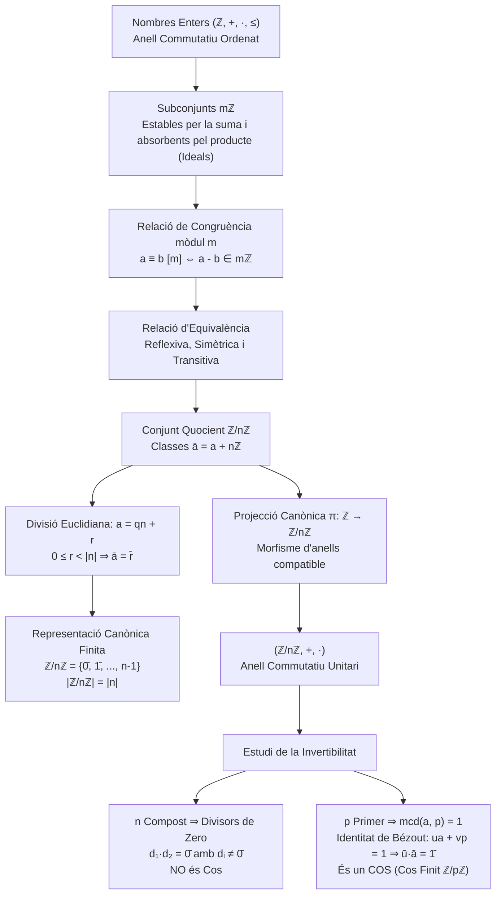

# Enters Modulars

Una de les aplicacions més fonamentals de la teoria de relacions d'equivalència, del conjunt quocient i de la propietat universal és la construcció formal dels **enters modulars** (denotats per $\mathbb{Z}/n\mathbb{Z}$). Aquesta construcció permet projectar la rica estructura algebraica dels nombres enters sobre conjunts finits, preservant simultàniament les propietats aritmètiques de la suma i del producte.

---

## 1. L'Estructura dels Nombres Enters $(\mathbb{Z}, +, \cdot, \le)$

Considerem el conjunt dels nombres enters:
$$\mathbb{Z} = \{0, 1, -1, 2, -2, \dots\} = \{0, \pm 1, \pm 2, \dots\}$$
Aquest conjunt, proveït de les operacions usuals de suma i producte i de la relació d'ordre usual, té estructura d'**anell commutatiu unitari ordenat**.

### 1.1. L'Operació de Suma: $(\mathbb{Z}, +)$ com a Grup Abelià
La suma d'enters és una operació binària interna:
$$+: \mathbb{Z} \times \mathbb{Z} \longrightarrow \mathbb{Z}, \quad (a, b) \longmapsto a + b$$
que satisfà les quatre propietats següents:

1. **Element Neutre:** Existeix un element $0 \in \mathbb{Z}$ tal que per a tot $b \in \mathbb{Z}$:
   $$b + 0 = b = 0 + b$$
2. **Element Oposat:** Per a cada $a \in \mathbb{Z}$, existeix un enter $b \in \mathbb{Z}$ (denotat $b = -a$) tal que:
   $$a + b = 0 = b + a$$
3. **Associativitat:** Per a qualssevol $a, b, c \in \mathbb{Z}$:
   $$(a + b) + c = a + (b + c)$$
4. **Commutativitat:** Per a qualssevol $a, b \in \mathbb{Z}$:
   $$a + b = b + a$$

Per tant, $(\mathbb{Z}, +)$ és un **grup abelià** (o commutatiu).

> [!NOTE] Altres Exemples de Grups Commutatius Additius
> L'estructura de grup abelià respecte a la suma és present a nombroses branques de la matemàtica:
> - L'espai de matrius reals: $(\mathcal{M}_{m \times n}(\mathbb{R}), +)$.
> - L'espai de funcions contínues reals: $(\mathcal{C}^0(\mathbb{R}, \mathbb{R}), +)$.
> - En general, el grup additiu subjacent a qualsevol cos o espai vectorial.

---

### 1.2. L'Operació de Producte: $(\mathbb{Z}, \cdot)$
El producte d'enters és una operació binària interna:
$$\cdot: \mathbb{Z} \times \mathbb{Z} \longrightarrow \mathbb{Z}, \quad (a, b) \longmapsto a \cdot b$$
que satisfà les propietats següents:

1. **Element Unitat (Neutre del Producte):** Existeix $1 \in \mathbb{Z}$ tal que per a tot $a \in \mathbb{Z}$:
   $$a \cdot 1 = a = 1 \cdot a$$
2. **Associativitat:** Per a qualssevol $a, b, c \in \mathbb{Z}$:
   $$(a \cdot b) \cdot c = a \cdot (b \cdot c)$$
3. **Commutativitat:** Per a qualssevol $a, b \in \mathbb{Z}$:
   $$a \cdot b = b \cdot a$$

#### Lligam entre la Suma i el Producte
- **Distributivitat** del producte respecte de la suma: per a qualssevol $a, b, c \in \mathbb{Z}$:
  $$a \cdot (b + c) = a \cdot b + a \cdot c \quad \text{i} \quad (a + b) \cdot c = a \cdot c + b \cdot c$$

---

### 1.3. Compatibilitat amb la Relació d'Ordre

> [!IMPORTANT] Definició: Relació d'Ordre Compatible
> L'ordre $\le$ de $\mathbb{Z}$ és **compatible** amb la suma i el producte en el sentit següent: per a qualssevol $a, b, c \in \mathbb{Z}$:
> 1. Si $a \le b$, aleshores $a + c \le b + c$.
> 2. Si $c \ge 0$ i $a \le b$, aleshores $ac \le bc$.
> 3. Si $c \le 0$ i $a \le b$, aleshores $ac \ge bc$ (inversió del sentit de la desigualtat).

---

## 2. Els Subconjunts $m\mathbb{Z}$ (Múltiples d'un Enter)

### 2.1. Definició del Conjunt $m\mathbb{Z}$

> [!IMPORTANT] Definició: El Conjunt $m\mathbb{Z}$
> Sigui $m \in \mathbb{Z}$. Definim el conjunt dels múltiples de $m$ com:
> $$m\mathbb{Z} = \{\kappa m \mid \kappa \in \mathbb{Z}\} = \{a \in \mathbb{Z} \mid \exists \kappa \in \mathbb{Z} \text{ tal que } a = \kappa m\}$$

> [!TIP] Exemples Fonamentals
> - **$m = 0$:** $0\mathbb{Z} = \{0 \cdot \kappa \mid \kappa \in \mathbb{Z}\} = \{0\}$.
> - **$m = 1$:** $1\mathbb{Z} = \{1 \cdot \kappa \mid \kappa \in \mathbb{Z}\} = \mathbb{Z}$.
> - **Múltiples negatius:** $(-m)\mathbb{Z} = m\mathbb{Z}$, ja que $\kappa(-m) = (-\kappa)m$, i quan $\kappa$ recorre tot $\mathbb{Z}$, $-\kappa$ també recorre tot $\mathbb{Z}$.

---

### 2.2. Propietats Algebraiques de $m\mathbb{Z}$ (Estructura d'Ideal)

> [!NOTE] Proposició: Propietats de $m\mathbb{Z}$
> Sigui $m \in \mathbb{Z}$. El subconjunt $m\mathbb{Z} \subseteq \mathbb{Z}$ compleix les tres propietats següents:
> 1. **No buidor:** $m\mathbb{Z} \neq \emptyset$.
> 2. **Estabilitat per la suma (subgrup):** $\forall \alpha, \beta \in m\mathbb{Z} \implies \alpha + \beta \in m\mathbb{Z}$.
> 3. **Absorció pel producte (ideal):** $\forall \alpha \in m\mathbb{Z}, \; \forall \beta \in \mathbb{Z} \implies \alpha\beta \in m\mathbb{Z}$.

#### Demostració
1. **No buidor:** Prenent $\kappa = 1$, tenim $m = 1 \cdot m \in m\mathbb{Z}$. En particular, prenent $\kappa = 0$, $0 \in m\mathbb{Z}$. Per tant, $m\mathbb{Z} \neq \emptyset$.
2. **Estabilitat per la suma:** Siguin $\alpha, \beta \in m\mathbb{Z}$. Per definició, existeixen enters $\kappa, r \in \mathbb{Z}$ tals que $\alpha = \kappa m$ i $\beta = rm$. Llavors:
   $$\alpha + \beta = \kappa m + rm = (\kappa + r)m$$
   Com que $\mathbb{Z}$ és tancat per la suma, $\kappa + r \in \mathbb{Z}$, d'on deduïm que $\alpha + \beta \in m\mathbb{Z}$.
3. **Absorció pel producte:** Siguin $\alpha \in m\mathbb{Z}$ i $\beta \in \mathbb{Z}$. Existeix $\kappa \in \mathbb{Z}$ tal que $\alpha = \kappa m$. Aleshores:
   $$\alpha\beta = (\kappa m)\beta = (\kappa \beta) m$$
   Com que $\kappa\beta \in \mathbb{Z}$, concloem que $\alpha\beta \in m\mathbb{Z}$. $\blacksquare$

---

## 3. La Relació de Congruència Mòdul $m$

### 3.1. Definició de Congruència

> [!IMPORTANT] Definició: Congruència Mòdul $m$
> Fixat un enter $m \in \mathbb{Z}$, definim sobre $\mathbb{Z}$ la relació binària següent:
> $$\forall a, b \in \mathbb{Z}, \quad a \sim b \iff a - b \in m\mathbb{Z}$$
> Escrivim habitualment:
> $$a \equiv b \pmod m \quad \text{o bé} \quad a \equiv b \ [m]$$
> *(Es llegeix: "$a$ és congruent amb $b$ mòdul $m$").*

> [!TIP] Exemples Segons el Valor de $m$
> - **$m = 0$:**
>   $$a \equiv b \ [0] \iff a - b \in 0\mathbb{Z} = \{0\} \iff a - b = 0 \iff a = b$$
>   La congruència mòdul 0 és la **relació d'igualtat**.
> - **$m = 1$:**
>   $$a \equiv b \ [1] \iff a - b \in 1\mathbb{Z} = \mathbb{Z}$$
>   Com que la diferència de dos enters qualssevol pertany sempre a $\mathbb{Z}$, tots els nombres enters són congruents entre si mòdul 1.
> - **$m = 2$:**
>   $$a \equiv b \ [2] \iff a - b \in 2\mathbb{Z} \iff \exists \kappa \in \mathbb{Z} \text{ tal que } a - b = 2\kappa$$
>   Això expressa que $a$ i $b$ tenen la **mateixa paritat** (tots dos són parells o tots dos són senars).

---

### 3.2. Prova que la Congruència és una Relació d'Equivalència

> [!IMPORTANT] Teorema: La Congruència Mòdul $m$ és una Relació d'Equivalència
> Sigui $m \in \mathbb{Z}$. La relació de congruència mòdul $m$ és reflexiva, simètrica i transitiva; per tant, és una **relació d'equivalència** sobre $\mathbb{Z}$.

#### Demostració
1. **Reflexivitat:**
   Hem de provar que per a tot $a \in \mathbb{Z}$ es compleix $a \equiv a \ [m]$, és a dir, $a - a \in m\mathbb{Z}$.
   Com que $a - a = 0 = 0 \cdot m$, prenent $\kappa = 0 \in \mathbb{Z}$ tenim $a - a \in m\mathbb{Z}$.
2. **Simetria:**
   Siguin $a, b \in \mathbb{Z}$ tals que $a \equiv b \ [m]$. Per definició, existeix $d \in \mathbb{Z}$ tal que $a - b = dm$.
   Llavors:
   $$b - a = -(a - b) = -(dm) = (-d)m$$
   Com que $-d \in \mathbb{Z}$, deduïm que $b - a \in m\mathbb{Z}$, i per tant $b \equiv a \ [m]$.
3. **Transitivitat:**
   Siguin $a, b, c \in \mathbb{Z}$ tals que $a \equiv b \ [m]$ i $b \equiv c \ [m]$. Existeixen $\lambda_1, \lambda_2 \in \mathbb{Z}$ tals que:
   $$a - b = \lambda_1 m \quad \text{i} \quad b - c = \lambda_2 m$$
   Sumant ambdues igualtats:
   $$a - c = (a - b) + (b - c) = \lambda_1 m + \lambda_2 m = (\lambda_1 + \lambda_2) m$$
   Com que $\lambda_1 + \lambda_2 \in \mathbb{Z}$, tenim $a - c \in m\mathbb{Z}$, d'on $a \equiv c \ [m]$. $\blacksquare$

---

### 3.3. El Conjunt Quocient $\mathbb{Z}/n\mathbb{Z}$

> [!NOTE] Notació i Conjunt Quocient
> Com que la congruència mòdul $n$ és una relació d'equivalència sobre $\mathbb{Z}$, podem considerar el seu **conjunt quocient**:
> $$\mathbb{Z}/n\mathbb{Z} \quad (\text{denotat també per } \mathbb{Z}/n \text{ o bé } \mathbb{Z}_n)$$
> Cada element de $\mathbb{Z}/n\mathbb{Z}$ és una classe d'equivalència $\bar{a}$, formada per tots els enters congruents amb $a$:
> $$\bar{a} = \{x \in \mathbb{Z} \mid x \equiv a \pmod n\} = a + n\mathbb{Z} = \{a + \kappa n \mid \kappa \in \mathbb{Z}\}$$

---

## 4. L'Estructura d'Anell de $\mathbb{Z}/n\mathbb{Z}$

> [!IMPORTANT] Teorema Fonamental de l'Estructura d'Anell
> L'estructura d'anell de $(\mathbb{Z}, +, \cdot)$ indueix de manera natural una estructura d'anell sobre el conjunt quocient $(\mathbb{Z}/n\mathbb{Z}, +, \cdot)$.
> 
> Aquesta estructura es transfereix mitjançant la **projecció canònica**:
> $$\pi: \mathbb{Z} \longrightarrow \mathbb{Z}/n\mathbb{Z}, \quad a \longmapsto \bar{a}$$
> la qual esdevé un **morfisme d'anells**.

---

### 4.1. L'Operació de Suma a $\mathbb{Z}/n\mathbb{Z}$

Volem definir l'operació de suma sobre les classes de $\mathbb{Z}/n\mathbb{Z}$ a partir de la suma ordinària a $\mathbb{Z}$. El diagrama commuta segons el següent esquema:

$$
\begin{array}{ccc}
\mathbb{Z} \times \mathbb{Z} & \xrightarrow{\quad+\quad} & \mathbb{Z} \\
\pi \times \pi \Big\downarrow & & \Big\downarrow \pi \\
\mathbb{Z}/n\mathbb{Z} \times \mathbb{Z}/n\mathbb{Z} & \xrightarrow{\quad+\quad} & \mathbb{Z}/n\mathbb{Z}
\end{array}
\qquad
\begin{aligned}
(a, b) &\longmapsto a + b \\
(\alpha, \beta) = (\bar{a}, \bar{b}) &\longmapsto \alpha + \beta \underset{\text{def}}{=} \overline{a + b}
\end{aligned}
$$

Donades dues classes $\alpha, \beta \in \mathbb{Z}/n\mathbb{Z}$:
1. Escollim representants $a \in \alpha$ i $b \in \beta$ (de manera que $\alpha = \bar{a}$ i $\beta = \bar{b}$).
2. Calculem la suma dels representants a $\mathbb{Z}$: $a + b$.
3. Assignem com a suma de les classes la classe del resultat: $\alpha + \beta = \overline{a + b}$.

Perquè aquesta operació sigui una aplicació ben definida, cal garantir que el resultat **no depèn de l'elecció dels representants**.

> [!NOTE] Proposició: Bona Definició de la Suma Modular
> Si $a' \equiv a \ [n]$ i $b' \equiv b \ [n]$, aleshores:
> $$a' + b' \equiv a + b \ [n]$$
> Per tant, $\overline{a' + b'} = \overline{a + b}$, i la suma a $\mathbb{Z}/n\mathbb{Z}$ està ben definida.

#### Demostració
Fixem primer $b$ i suposem $a' \equiv a \ [n]$. Per definició, existeix $\kappa \in \mathbb{Z}$ tal que $a' - a = \kappa n$, és a dir, $a' = a + \kappa n$. Calculem:
$$(a' + b) - (a + b) = a' - a = \kappa n \in n\mathbb{Z}$$
per tant, $a' + b \equiv a + b \ [n]$.

Anàlogament, intercanviant els papers de $a$ i $b$, si $b' \equiv b \ [n]$, tenim $a + b' \equiv a + b \ [n]$.

En el cas general on varien ambdós representants, per la propietat transitiva de la congruència:
$$a' + b' \equiv a + b' \equiv a + b \pmod n \quad \blacksquare$$

---

#### Axiomes de Grup Abelià per a $(\mathbb{Z}/n\mathbb{Z}, +)$

> [!NOTE] Lema 1: Element Neutre
> La suma a $\mathbb{Z}/n\mathbb{Z}$ admet un element neutre:
> $$\bar{0} = \bar{n} = \overline{-n} = \cdots$$
> És a dir, per a tot $\alpha \in \mathbb{Z}/n\mathbb{Z}$:
> $$\alpha + \bar{0} = \bar{0} + \alpha = \alpha$$

*Demostració.* Sigui $\alpha \in \mathbb{Z}/n\mathbb{Z}$ i escollim un representant $a \in \alpha$. Com que $0 \in \bar{0}$, per definició de la suma modular:
$$\alpha + \bar{0} = \bar{a} + \bar{0} = \overline{a + 0} = \bar{a} = \alpha$$
De la mateixa manera, $\bar{0} + \alpha = \overline{0 + a} = \bar{a} = \alpha$. $\blacksquare$

> [!NOTE] Lema 2: Element Oposat
> Sigui $\alpha \in \mathbb{Z}/n\mathbb{Z}$. Existeix $\beta \in \mathbb{Z}/n\mathbb{Z}$ (que denotem $-\alpha$) tal que:
> $$\alpha + \beta = \bar{0} = \beta + \alpha$$

*Demostració.* Sigui $\alpha \in \mathbb{Z}/n\mathbb{Z}$ i escollim un representant $a \in \alpha$. Definim $\beta = \overline{-a}$. Verifiquem:
$$\alpha + \beta = \bar{a} + \overline{-a} = \overline{a + (-a)} = \bar{0}$$
Anàlogament, $\beta + \alpha = \overline{-a + a} = \bar{0}$. Per tant, $-\bar{a} = \overline{-a}$. $\blacksquare$

> [!NOTE] Lema 3: Associativitat
> Siguin $\alpha, \beta, \gamma \in \mathbb{Z}/n\mathbb{Z}$. Aleshores:
> $$(\alpha + \beta) + \gamma = \alpha + (\beta + \gamma)$$

*Demostració.* Siguin $a \in \alpha$, $b \in \beta$ i $c \in \gamma$. Calculem:
$$(\alpha + \beta) + \gamma = (\bar{a} + \bar{b}) + \bar{c} = \overline{a + b} + \bar{c} = \overline{(a + b) + c}$$
Per l'associativitat de la suma a $\mathbb{Z}$, $(a + b) + c = a + (b + c)$, d'on:
$$\overline{(a + b) + c} = \overline{a + (b + c)} = \bar{a} + \overline{b + c} = \alpha + (\beta + \gamma) \quad \blacksquare$$

> [!NOTE] Lema 4: Commutativitat
> Siguin $\alpha, \beta \in \mathbb{Z}/n\mathbb{Z}$. Aleshores:
> $$\alpha + \beta = \beta + \alpha$$

*Demostració.* Siguin $a \in \alpha$ i $b \in \beta$. Per commutativitat a $\mathbb{Z}$:
$$\alpha + \beta = \bar{a} + \bar{b} = \overline{a + b} = \overline{b + a} = \bar{b} + \bar{a} = \beta + \alpha \quad \blacksquare$$

> [!IMPORTANT] Teorema: $(\mathbb{Z}/n\mathbb{Z}, +)$ és un Grup Abelià
> $(\mathbb{Z}/n\mathbb{Z}, +)$ és un grup abelià, i la projecció canònica:
> $$\pi: (\mathbb{Z}, +) \longrightarrow (\mathbb{Z}/n\mathbb{Z}, +), \quad a \longmapsto \bar{a}$$
> és un **morfisme de grups**, és a dir, satisfà:
> $$\pi(a + b) = \pi(a) + \pi(b)$$

---

### 4.2. L'Operació de Multiplicació a $\mathbb{Z}/n\mathbb{Z}$

De manera anàloga a la suma, definim el producte modular mitjançant el diagrama:

$$
\begin{array}{ccc}
\mathbb{Z} \times \mathbb{Z} & \xrightarrow{\quad\cdot\quad} & \mathbb{Z} \\
\pi \times \pi \Big\downarrow & & \Big\downarrow \pi \\
\mathbb{Z}/n\mathbb{Z} \times \mathbb{Z}/n\mathbb{Z} & \xrightarrow{\quad\cdot\quad} & \mathbb{Z}/n\mathbb{Z}
\end{array}
\qquad
\begin{aligned}
(a, b) &\longmapsto a \cdot b \\
(\alpha, \beta) = (\bar{a}, \bar{b}) &\longmapsto \alpha \cdot \beta \underset{\text{def}}{=} \overline{a \cdot b}
\end{aligned}
$$

> [!NOTE] Proposició: Bona Definició del Producte Modular
> Si $a' \equiv a \ [n]$ i $b' \equiv b \ [n]$, aleshores:
> $$a' \cdot b' \equiv a \cdot b \ [n]$$
> En conseqüència, $\overline{a' \cdot b'} = \overline{a \cdot b}$, i la multiplicació a $\mathbb{Z}/n\mathbb{Z}$ està ben definida.

*Demostració.* Siguin $a' = a + \kappa_1 n$ i $b' = b + \kappa_2 n$ per a $\kappa_1, \kappa_2 \in \mathbb{Z}$. Calculem:
$$a' b' - a b = (a + \kappa_1 n)(b + \kappa_2 n) - ab = ab + a\kappa_2 n + b\kappa_1 n + \kappa_1\kappa_2 n^2 - ab = (a\kappa_2 + b\kappa_1 + \kappa_1\kappa_2 n)n$$
Com que la quantitat entre parèntesis pertany a $\mathbb{Z}$, deduïm que $a' b' - ab \in n\mathbb{Z}$, és a dir, $a' b' \equiv ab \pmod n$. $\blacksquare$

> [!NOTE] Propietats de $(\mathbb{Z}/n\mathbb{Z}, \cdot)$ Heretades de $(\mathbb{Z}, \cdot)$
> - **Element Unitat:** $\bar{1}$ és el neutre del producte, ja que $\bar{a} \cdot \bar{1} = \overline{a \cdot 1} = \bar{a}$.
> - **Associativitat:** $(\alpha \cdot \beta) \cdot \gamma = \alpha \cdot (\beta \cdot \gamma)$.
> - **Commutativitat:** $\alpha \cdot \beta = \beta \cdot \alpha$.
> - **Distributivitat del producte respecte de la suma:**
>   $$\alpha \cdot (\beta + \gamma) = \alpha \cdot \beta + \alpha \cdot \gamma$$

> [!IMPORTANT] Teorema: $(\mathbb{Z}/n\mathbb{Z}, +, \cdot)$ és un Anell Commutatiu Unitari
> Proveït de la suma i el producte de classes, $(\mathbb{Z}/n\mathbb{Z}, +, \cdot)$ té estructura d'**anell commutatiu unitari**, i la projecció canònica:
> $$\pi: (\mathbb{Z}, +, \cdot) \longrightarrow (\mathbb{Z}/n\mathbb{Z}, +, \cdot), \quad a \longmapsto \bar{a}$$
> és un **morfisme d'anells** surjectiu:
> $$\pi(a + b) = \pi(a) + \pi(b), \qquad \pi(a \cdot b) = \pi(a) \cdot \pi(b), \qquad \pi(1) = \bar{1}$$

---

## 5. Divisió Euclidiana i Caracterització dels Elements

### 5.1. Teorema de la Divisió Euclidiana a $\mathbb{Z}$

> [!IMPORTANT] Teorema: Divisió Euclidiana a $\mathbb{Z}$
> Siguin $a \in \mathbb{Z}$ i $n \in \mathbb{Z}$ amb $n \neq 0$. Existeix una **única parella** d'enters $q, r \in \mathbb{Z}$ tals que:
> $$a = qn + r, \qquad 0 \le r < |n|$$
> on $q$ s'anomena **quocient** i $r$ s'anomena **residu** (o resta).

Calculem la relació en termes de congruència:
$$a - r = qn \in n\mathbb{Z} \implies a \equiv r \pmod n \implies \bar{a} = \bar{r}$$
Això garanteix que tota classe d'equivalència $\bar{a} \in \mathbb{Z}/n\mathbb{Z}$ admet com a representant canònic el residu $r$ de la seva divisió euclidiana per $n$.

---

### 5.2. Conjunt Finit de Classes Canòniques

> [!NOTE] Corol·lari: Cardinal i Conjunt de Classes de $\mathbb{Z}/n\mathbb{Z}$
> Sigui $n \in \mathbb{Z}$ amb $n \ge 1$. Els únics residus possibles són $\{0, 1, 2, \dots, n - 1\}$, i aquests residus determinen classes totes elles diferents dos a dos.
> 
> Per tant:
> $$\mathbb{Z}/n\mathbb{Z} = \{\bar{0}, \bar{1}, \bar{2}, \dots, \overline{n - 1}\}$$
> En particular, el conjunt quocient té cardinal finit:
> $$|\mathbb{Z}/n\mathbb{Z}| = |n|$$

---

### 5.3. Representants Negatius i Simetries

> [!WARNING] Atenció: Representants Negatius
> Les classes d'equivalència són conjunts infinits d'enters i admeten una infinitat de representants. En els càlculs concrets sovint és molt convenient emprar representants negatius per simplificar operacions:
> $$\overline{n - 1} = \overline{-1}, \qquad \overline{n - 2} = \overline{-2}, \qquad \dots$$
> Efectivament:
> $$\overline{n - 1} = \bar{n} + \overline{-1} = \bar{0} + \overline{-1} = \overline{-1}$$
> Equivalentment: $a \in \overline{-1} \iff a \equiv -1 \pmod n \iff a + 1 \in n\mathbb{Z}$.

---

## 6. Existència d'Inversos i el Cos $\mathbb{Z}/p\mathbb{Z}$

### 6.1. Taules del Producte i Elements Invertibles

Per calcular multiplicacions a $\mathbb{Z}/n\mathbb{Z}$ es redueixen els resultats al residu canònic entre $0$ i $n-1$.

> [!TIP] Exemple: Taules del Producte a $\mathbb{Z}/3\mathbb{Z}$ i $\mathbb{Z}/5\mathbb{Z}$
> 
> **Taula del producte a $\mathbb{Z}/3\mathbb{Z}$:**
> 
> | $\cdot$ | $\bar{0}$ | $\bar{1}$ | $\bar{2}$ |
> | :---: | :---: | :---: | :---: |
> | **$\bar{0}$** | $\bar{0}$ | $\bar{0}$ | $\bar{0}$ |
> | **$\bar{1}$** | $\bar{0}$ | $\bar{1}$ | $\bar{2}$ |
> | **$\bar{2}$** | $\bar{0}$ | $\bar{2}$ | $\bar{1}$ |
> 
> A $\mathbb{Z}/3\mathbb{Z}$, el producte $\bar{2} \cdot \bar{2} = \bar{4} = \bar{1}$, per tant $\bar{2}^{-1} = \bar{2}$.
> 
> **Taula del producte a $\mathbb{Z}/5\mathbb{Z}$:**
> 
> | $\cdot$ | $\bar{0}$ | $\bar{1}$ | $\bar{2}$ | $\bar{3}$ | $\bar{4}$ |
> | :---: | :---: | :---: | :---: | :---: | :---: |
> | **$\bar{0}$** | $\bar{0}$ | $\bar{0}$ | $\bar{0}$ | $\bar{0}$ | $\bar{0}$ |
> | **$\bar{1}$** | $\bar{0}$ | $\bar{1}$ | $\bar{2}$ | $\bar{3}$ | $\bar{4}$ |
> | **$\bar{2}$** | $\bar{0}$ | $\bar{2}$ | $\bar{4}$ | $\bar{1}$ | $\bar{3}$ |
> | **$\bar{3}$** | $\bar{0}$ | $\bar{3}$ | $\bar{1}$ | $\bar{4}$ | $\bar{2}$ |
> | **$\bar{4}$** | $\bar{0}$ | $\bar{4}$ | $\bar{3}$ | $\bar{2}$ | $\bar{1}$ |
> 
> Observem que a les dues taules tot element no nul admet un invers multiplicatiu:
> - A $\mathbb{Z}/5\mathbb{Z}$: $\bar{1}^{-1} = \bar{1}$, $\bar{2}^{-1} = \bar{3}$, $\bar{3}^{-1} = \bar{2}$ i $\bar{4}^{-1} = \bar{4}$.

---

### 6.2. Caracterització dels Cossos $\mathbb{Z}/n\mathbb{Z}$

> [!IMPORTANT] Teorema: Caracterització dels Cossos Modulars
> Sigui $n \ge 2$ un enter. L'anell commutatiu $(\mathbb{Z}/n\mathbb{Z}, +, \cdot)$ és un **cos** (és a dir, tot element no nul $\bar{a} \neq \bar{0}$ té invers multiplicatiu) **si i només si $n$ és un nombre primer**.

Recordem que un enter $p \in \mathbb{Z}$ ($p \ge 2$) és **primer** si i només si els seus únics divisors positius són $1$ i $p$ (equivalentment, té exactament 4 divisors a $\mathbb{Z}$: $\{\pm 1, \pm p\}$).

---

### 6.3. Demostració del Teorema

#### I. Implicació directa $(\implies)$: Si $n$ no és primer, $\mathbb{Z}/n\mathbb{Z}$ no és un cos
Demostrem el contrarecíproc: si $n$ és compost, aleshores $\mathbb{Z}/n\mathbb{Z}$ conté **divisors de zero** i, per tant, no pot ser un cos.

1. Suposem que $n$ no és primer. Aleshores existeixen dos enters $d_1, d_2 \in \mathbb{Z}$ tals que:
   $$n = d_1 d_2 \quad \text{amb } 0 < d_1 < n \text{ i } 0 < d_2 < n$$
2. En passar a les classes de $\mathbb{Z}/n\mathbb{Z}$, tenim:
   $$\bar{d}_1 \cdot \bar{d}_2 = \overline{d_1 d_2} = \bar{n} = \bar{0}$$
   Com que $0 < d_1 < n$ i $0 < d_2 < n$, cap dels dos residus no és múltiple de $n$; és a dir:
   $$\bar{d}_1 \neq \bar{0} \quad \text{i} \quad \bar{d}_2 \neq \bar{0}$$
3. Provem per **reducció a l'absurd** que $\bar{d}_1$ no pot tenir invers multiplicatiu.
   Suposem que existís $\alpha \in \mathbb{Z}/n\mathbb{Z}$ tal que $\alpha \cdot \bar{d}_1 = \bar{1}$. Multiplicant per $\bar{d}_2$:
   $$(\alpha \cdot \bar{d}_1) \cdot \bar{d}_2 = \bar{1} \cdot \bar{d}_2 = \bar{d}_2$$
   Per l'associativitat del producte:
   $$\alpha \cdot (\bar{d}_1 \cdot \bar{d}_2) = \bar{d}_2 \implies \alpha \cdot \bar{0} = \bar{d}_2 \implies \bar{0} = \bar{d}_2$$
   Això és una contradicció flagrant amb el fet que $\bar{d}_2 \neq \bar{0}$.

Per tant, $\bar{d}_1$ és un element no nul que no admet invers multiplicatiu, la qual cosa demostra que $\mathbb{Z}/n\mathbb{Z}$ no pot ser un cos.

#### II. Implicació recíproca $(\impliedby)$: Si $p$ és primer, $\mathbb{Z}/p\mathbb{Z}$ és un cos
1. Sigui $p$ un nombre primer i considerem una classe no nul·la $\bar{a} \in \mathbb{Z}/p\mathbb{Z}$ ($\bar{a} \neq \bar{0}$).
2. Com que $\bar{a} \neq \bar{0}$, $a$ no és múltiple de $p$ ($p \nmid a$). En ser $p$ un nombre primer, el màxim comú divisor entre $a$ i $p$ només pot ser 1:
   $$\operatorname{mcd}(a, p) = 1$$
3. Pel **Teorema de la Identitat de Bézout**, existeixen dos enters $u, v \in \mathbb{Z}$ tals que:
   $$u a + v p = 1$$
4. Projectant aquesta igualtat a l'anell quocient $\mathbb{Z}/p\mathbb{Z}$:
   $$\overline{ua + vp} = \bar{1} \implies \bar{u}\bar{a} + \bar{v}\bar{p} = \bar{1}$$
   Com que $\bar{p} = \bar{0}$, la igualtat esdevé:
   $$\bar{u} \cdot \bar{a} = \bar{1}$$
5. Per tant, $\bar{u} \in \mathbb{Z}/p\mathbb{Z}$ és l'invers multiplicatiu de $\bar{a}$ ($\bar{a}^{-1} = \bar{u}$).

Com que tot element no nul té invers multiplicatiu, $(\mathbb{Z}/p\mathbb{Z}, +, \cdot)$ és un **cos**. $\blacksquare$

---

## 7. Esquema Resum

---

*Enllaços de navegació:*
- [[Índex|Tornar a l'Índex Principal]]
- [[Índex - Fonaments 1|Tornar a l'Índex de Fonaments 1]]
- [[04. Relacions d'Equivalència|Tema anterior: Relacions d'Equivalència]]
