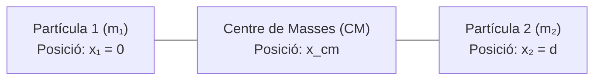
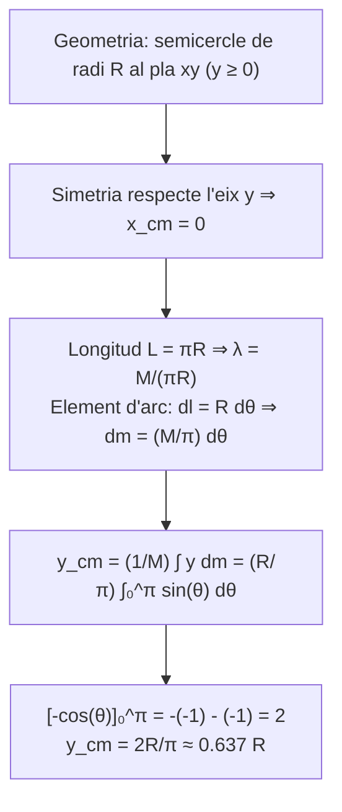
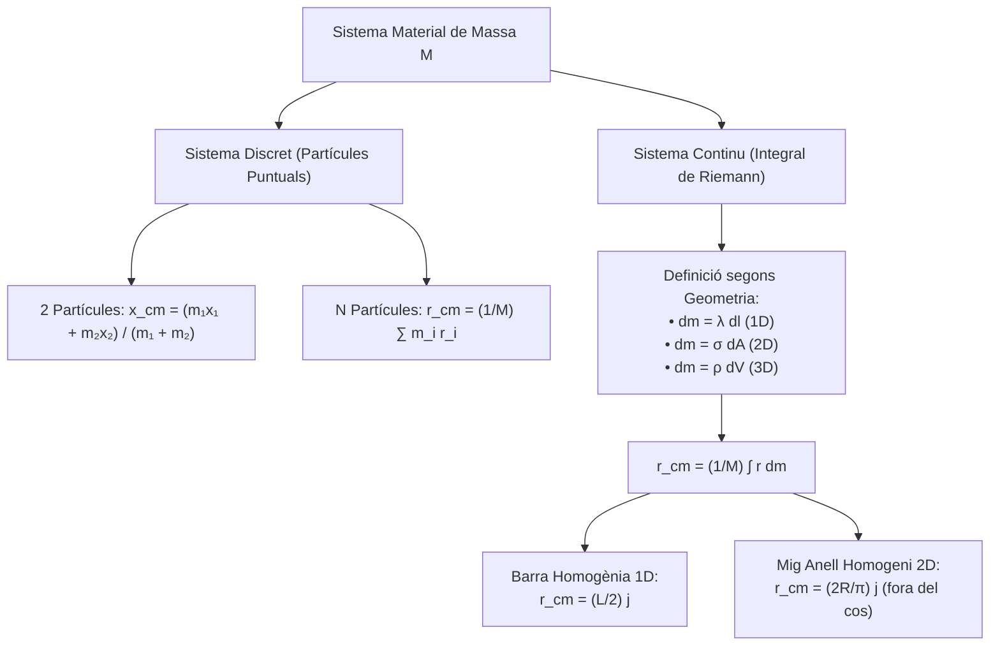

# Dinàmica de Sistemes de Partícules i Centre de Masses

Aquest tema aborda l'extensió de la mecànica newtoniana des de la partícula puntual cap a sistemes de múltiples partícules i sòlids continus. S'introdueix el concepte fonamental de **Centre de Masses (CM)**, la seva determinació per a sistemes discrets i continus, i aplicacions geomètriques essencials.

---

## 1. Concepte Físic de Centre de Masses (CM)

Quan s'estudia un conjunt format per diverses partícules que interactuen entre si o un cos continu extens, resulta convenient definir un punt geomètric que representi el comportament mitjà ponderat del sistema.

> [!IMPORTANT] Definició de Centre de Masses
> El **Centre de Masses (CM)** és el punt espacial d'un sistema material en el qual es pot considerar concentrada tota la massa del conjunt als efectes del moviment translacional global i de l'aplicació de les forces exteriors netes.

---

## 2. Sistema Discret Unidimensional (2 Partícules a la Recta)

Considerem dues partícules puntuals de masses $m_1$ i $m_2$ situades sobre una mateixa recta (eix $x$) en les posicions $x_1$ i $x_2$.

La massa total del sistema és:
$$M = m_1 + m_2$$

Definim la posició del centre de masses $x_{cm}$ mitjançant la relació de moment de massa ponderat:
$$M x_{cm} = m_1 x_1 + m_2 x_2 \implies x_{cm} = \frac{m_1 x_1 + m_2 x_2}{m_1 + m_2}$$

### Anàlisi Triant la Primera Partícula com a Origen
Si situem l'origen de coordenades en la partícula 1 ($x_1 = 0$) i la partícula 2 a una distància $d$ ($x_2 = d$):
$$x_{cm} = \frac{m_1 \cdot 0 + m_2 \cdot d}{m_1 + m_2} = \left(\frac{m_2}{m_1 + m_2}\right) d$$

#### Comportament Segons les Masses Relatives
1. **Masses iguals ($m_1 = m_2$):**
   $$x_{cm} = \frac{m_1}{2m_1} d = \frac{d}{2}$$
   El centre de masses coincideix exactament amb el punt mig geomètric del segment que uneix les dues partícules.
2. **Primera partícula molt més massiva ($m_1 \gg m_2$):**
   $$\lim_{m_1 \to \infty} \frac{m_2}{m_1 + m_2} d = 0 \implies x_{cm} \to 0$$
   El centre de masses es desplaça fins a situar-se pràcticament a sobre de la partícula més pesada (com en el sistema Terra-satèl·lit o Sol-planeta).
3. **Segona partícula molt més massiva ($m_2 \gg m_1$):**
   $$\lim_{m_2 \to \infty} \frac{m_2}{m_1 + m_2} d = d \implies x_{cm} \to d$$
   El centre de masses s'acosta a la posició de $m_2$.

> [!NOTE] Fita de Localització
> El centre de masses d'un sistema de dues masses sempre es troba a l'interior del segment que les uneix:
> $$0 \le x_{cm} \le d$$

---

## 3. Generalització a Sistemes Discrets de $N$ Partícules

### 1. Sistema Unidimensional de $N$ Partícules
Si tenim $N$ partícules de masses $m_1, m_2, \dots, m_N$ situades a les posicions $x_1, x_2, \dots, x_N$:
$$M = \sum_{i=1}^N m_i$$
$$x_{cm} = \frac{1}{M} \sum_{i=1}^N m_i x_i = \frac{m_1 x_1 + m_2 x_2 + \dots + m_N x_N}{m_1 + m_2 + \dots + m_N}$$

### 2. Generalització Vectorial a l'Espai 3D
Si cada partícula $i$ té massa $m_i$ i vector de posició $\vec{r}_i = x_i \hat{i} + y_i \hat{j} + z_i \hat{k}$:
> [!IMPORTANT] Vector de Posició del Centre de Masses
> $$\vec{r}_{cm} = \frac{1}{M} \sum_{i=1}^N m_i \vec{r}_i$$

Desglossat en les components cartesianes individuals:
$$x_{cm} = \frac{1}{M} \sum_{i=1}^N m_i x_i, \quad y_{cm} = \frac{1}{M} \sum_{i=1}^N m_i y_i, \quad z_{cm} = \frac{1}{M} \sum_{i=1}^N m_i z_i$$

---

## 4. Distribucions Contínues de Massa

Quan el nombre de partícules creix de forma contínua fins a formar un cos rígid o deformable continu, el sumatori discret $\sum$ esdevé una **integral** de Riemann:

$$M = \int dm$$
$$\vec{r}_{cm} = \frac{1}{M} \int \vec{r} \, dm$$

En components:
$$x_{cm} = \frac{1}{M} \int x \, dm, \quad y_{cm} = \frac{1}{M} \int y \, dm, \quad z_{cm} = \frac{1}{M} \int z \, dm$$

### Tipus de Densitat segons la Geometria
1. **Cossos Unidimensionals (Fils prims, barres):**
   - Densitat lineal de massa: $\lambda = \frac{dm}{dl}$ $\implies dm = \lambda \, dl$.
   - Si el cos és homogeni: $\lambda = \frac{M}{L} = \text{constant}$.
2. **Cossos Bidimensionals (Superfícies, plaques, làmines):**
   - Densitat superficial de massa: $\sigma = \frac{dm}{dA}$ $\implies dm = \sigma \, dA$.
   - Si el cos és homogeni: $\sigma = \frac{M}{A} = \text{constant}$.
3. **Cossos Tridimensionals (Sòlids volúmics):**
   - Densitat volúmica de massa: $\rho = \frac{dm}{dV}$ $\implies dm = \rho \, dV$.
   - Si el cos és homogeni: $\rho = \frac{M}{V} = \text{constant}$.

---

## 5. Exemples Pràctics d'Integració

### Exemple 1: Barra Homogènia Unidimensional
Calculem el centre de masses d'una barra lineal homogènia de massa total $M$ i longitud $L$.

- Situem la barra al llarg de l'eix vertical $y$, amb un extrem a l'origen ($y = 0$) i l'altre extrem a $y = L$.
- Per simetria transversal, $x_{cm} = 0$ i $z_{cm} = 0$.
- Com que la barra és homogènia, la densitat lineal és constant:
  $$\lambda = \frac{dm}{dy} = \frac{M}{L} \implies dm = \frac{M}{L} dy$$

Calculem la component vertical $y_{cm}$:
$$y_{cm} = \frac{1}{M} \int_0^L y \, dm = \frac{1}{M} \int_0^L y \left(\frac{M}{L} dy\right) = \frac{1}{L} \int_0^L y \, dy = \frac{1}{L} \left[ \frac{y^2}{2} \right]_0^L = \frac{1}{L} \frac{L^2}{2} = \frac{L}{2}$$

Vectorialment:
$$\vec{r}_{cm} = \frac{L}{2} \hat{j}$$
El centre de masses de la barra homogènia se situa exactament a la meitat de la seva longitud.

---

### Exemple 2: Mig Anell Circular Homogeni (Fil Semicircular 2D)
Calculem el centre de masses d'un fil prim homogeni doblat en forma de semicircumferència de radi $R$ i massa total $M$.

#### 1. Parametrització del Cos
Col·loquem el semicercle en el semiplà superior ($y \ge 0$) amb el centre a l'origen de coordenades:
$$x(\theta) = R \cos\theta, \quad y(\theta) = R \sin\theta, \quad \text{amb } \theta \in [0, \pi]$$

#### 2. Determinació per Simetria
Com que la distribució de massa és simètrica respecte a l'eix vertical $y$ (per a cada punt $(x, y)$ amb angle $\theta$, existeix el punt reflex $(-x, y)$ amb angle $\pi - \theta$ que té la mateixa massa):
$$x_{cm} = 0$$

#### 3. Diferencial de Massa
La longitud total del mig anell és la meitat d'una circumferència:
$$L = \pi R$$
Com que el fil és homogeni, la densitat lineal de massa val:
$$\lambda = \frac{M}{L} = \frac{M}{\pi R}$$
L'element d'arc diferencial és $dl = R \, d\theta$. Per tant:
$$dm = \lambda \, dl = \left(\frac{M}{\pi R}\right) (R \, d\theta) = \frac{M}{\pi} d\theta$$

#### 4. Càlcul de la Component $y_{cm}$
$$y_{cm} = \frac{1}{M} \int y \, dm = \frac{1}{M} \int_0^\pi (R \sin\theta) \left(\frac{M}{\pi} d\theta\right) = \frac{R}{\pi} \int_0^\pi \sin\theta \, d\theta$$

Integrem la funció sinus:
$$\int_0^\pi \sin\theta \, d\theta = \left[ -\cos\theta \right]_0^\pi = (-\cos\pi) - (-\cos 0) = -(-1) - (-1) = 1 + 1 = 2$$

Substituint el resultat:
$$y_{cm} = \frac{2R}{\pi} \approx 0.6366 \, R$$

> [!IMPORTANT] Centre de Masses del Mig Anell
> El vector de posició del centre de masses és:
> $$\vec{r}_{cm} = \left(0, \, \frac{2R}{\pi}\right) = \frac{2R}{\pi} \hat{j}$$
> 
> **Observació Física Clau:** El centre de masses queda situat en l'espai buit contingut pel semicercle (a una alçada d'aproximadament el $63.7\%$ del radi), **fora del propi material físic**. Això és una propietat habitual en cossos corbats, anells i estructures buides.

---

## 6. Esquema Resum

---

*Enllaços de navegació:*
- [[Índex|Tornar a l'Índex Principal]]
- [[Índex - Mecànica Clàssica|Índex de Mecànica Clàssica]]
- [[01. Cinemàtica en 2D i 3D|Tema 1: Cinemàtica en 2D i 3D]]
