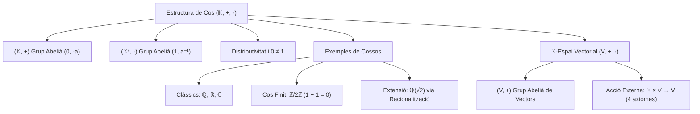

# Espais Vectorials

## 1. Introducció i Motivació

L'àlgebra lineal s'ocupa de l'estudi de sistemes geomètrics i algebraics que preserven combinacions lineals. Fins ara hem treballat amb matrius i vectors definits sobre nombres reals o sobre un cos genèric $\mathbb{K}$.

Per construir una teoria axiomàtica sòlida i general de l'àlgebra lineal, el primer pas consisteix a formalitzar l'estructura algebraica dels coeficients escalars (el concepte de **cos**) i, posteriorment, l'estructura dels vectors sobre els quals operen aquests escalars (el concepte d'**espai vectorial**).

---

## 2. L'Estructura Algebraica de Cos

> [!IMPORTANT] Definició Axiomàtica de Cos
> Un **cos** és un triplet $(\mathbb{K}, +, \cdot)$ format per un conjunt no buit $\mathbb{K}$ i dues operacions binàries internes:
> $$\begin{aligned}
> +: \mathbb{K} \times \mathbb{K} &\longrightarrow \mathbb{K}, \quad (a, b) \longmapsto a + b \quad \text{(suma)} \\
> \cdot: \mathbb{K} \times \mathbb{K} &\longrightarrow \mathbb{K}, \quad (a, b) \longmapsto a \cdot b \quad \text{(producte, sovint escrit } ab\text{)}
> \end{aligned}$$
> que compleixen les següents propietats per a qualssevol elements $a, b, c \in \mathbb{K}$:
> 
> ### I. Propietats de la Suma: $(\mathbb{K}, +)$ és un Grup Abelià
> 1. **Associativitat:** $a + (b + c) = (a + b) + c$
> 2. **Commutativitat:** $a + b = b + a$
> 3. **Element Neutre:** Existeix un element $0 \in \mathbb{K}$ tal que:
>    $$a + 0 = a \quad \forall a \in \mathbb{K}$$
> 4. **Element Oposat:** Per a cada $a \in \mathbb{K}$, existeix un element $-a \in \mathbb{K}$ tal que:
>    $$a + (-a) = 0$$
> 
> ### II. Propietats del Producte
> 1. **Associativitat:** $a \cdot (b \cdot c) = (a \cdot b) \cdot c$
> 2. **Commutativitat:** $a \cdot b = b \cdot a$
> 3. **Element Unitat (Neutre del Producte):** Existeix un element $1 \in \mathbb{K}$ tal que:
>    $$a \cdot 1 = a \quad \forall a \in \mathbb{K}$$
> 4. **Element Invers:** Per a cada element no nul $a \in \mathbb{K}$ ($a \neq 0$), existeix un element invers $a^{-1} \in \mathbb{K}$ (o $\frac{1}{a}$) tal que:
>    $$a \cdot a^{-1} = 1$$
>    *(Equivalentment, $(\mathbb{K} \setminus \{0\}, \cdot)$ és un grup abelià).*
> 
> ### III. Compatibilitat entre Operacions i No Degeneració
> 1. **Distributivitat del producte respecte de la suma:**
>    $$a \cdot (b + c) = a \cdot b + a \cdot c$$
> 2. **No trivialitat:** L'element neutre de la suma i el de la multiplicació són diferents:
>    $$0 \neq 1$$

---

## 3. Exemples Fonamentals de Cossos

### 3.1. Cossos Numèrics Clàssics
Els exemples més habituals en anàlisi i geometria són:
1. **$(\mathbb{Q}, +, \cdot)$:** El cos dels nombres racionals. És el cos de característica zero més petit (cos primer).
2. **$(\mathbb{R}, +, \cdot)$:** El cos dels nombres reals. A més de cos, és complet (axioma del suprem) i ordenat.
3. **$(\mathbb{C}, +, \cdot)$:** El cos dels nombres complexos, on $i^2 = -1$. És un cos algebraicament tancat (Teorema Fonamental de l'Àlgebra), però no admet una relació d'ordre compatible amb les seves operacions.

---

### 3.2. El Cos Finit $\mathbb{Z}/2\mathbb{Z}$ ($\mathbb{F}_2$)
Considerem el conjunt quocient format per les classes de restes mòdul 2:
$$\mathbb{Z}/2\mathbb{Z} = \{[0], [1]\} \quad \text{o simplement} \quad \{0, 1\}$$
Definim la suma i el producte mòdul 2 mitjançant les seves taules de Cayley:

| $+$ | $0$ | $1$ |
|:---:|:---:|:---:|
| **$0$** | $0$ | $1$ |
| **$1$** | $1$ | $0$ |

| $\cdot$ | $0$ | $1$ |
|:---:|:---:|:---:|
| **$0$** | $0$ | $0$ |
| **$1$** | $0$ | $1$ |

> [!NOTE] Característica 2
> En aquest cos es compleix que $1 + 1 = 0$, la qual cosa implica que tot element és el seu propi oposat: $-1 = 1$. Aquest cos és fonamental en teoria de la informació, criptografia i ciències de la computació.

---

### 3.3. L'Extensió Quadràtica $\mathbb{Q}(\sqrt{2})$
Definim el subconjunt dels nombres reals:
$$\mathbb{Q}(\sqrt{2}) = \{a + b\sqrt{2} \mid a, b \in \mathbb{Q}\} \subseteq \mathbb{R}$$

Comprovem que $\mathbb{Q}(\sqrt{2})$ té estructura de cos amb les operacions heretades de $\mathbb{R}$:
1. **Clausura per la suma:**
   $$(a + b\sqrt{2}) + (c + d\sqrt{2}) = (a + c) + (b + d)\sqrt{2} \in \mathbb{Q}(\sqrt{2})$$
   ja que $a+c \in \mathbb{Q}$ i $b+d \in \mathbb{Q}$.
2. **Clausura pel producte:**
   $$(a + b\sqrt{2}) \cdot (c + d\sqrt{2}) = (ac + 2bd) + (ad + bc)\sqrt{2} \in \mathbb{Q}(\sqrt{2})$$
   ja que $ac + 2bd \in \mathbb{Q}$ i $ad + bc \in \mathbb{Q}$.
3. **Elements neutres:**
   - Neutre de la suma: $0 = 0 + 0\sqrt{2} \in \mathbb{Q}(\sqrt{2})$.
   - Neutre del producte: $1 = 1 + 0\sqrt{2} \in \mathbb{Q}(\sqrt{2})$.
4. **Existència d'invers:**
   Sigui $x = a + b\sqrt{2} \in \mathbb{Q}(\sqrt{2})$ amb $x \neq 0$.
   Com que $\sqrt{2}$ és irracional ($\sqrt{2} \notin \mathbb{Q}$), és impossible que $a^2 - 2b^2 = 0$ llevat que $a = b = 0$. Per tant, $a^2 - 2b^2 \neq 0$.
   Racionalitzant el quocient:
   $$x^{-1} = \frac{1}{a + b\sqrt{2}} = \frac{a - b\sqrt{2}}{(a + b\sqrt{2})(a - b\sqrt{2})} = \frac{a - b\sqrt{2}}{a^2 - 2b^2} = \left(\frac{a}{a^2 - 2b^2}\right) - \left(\frac{b}{a^2 - 2b^2}\right)\sqrt{2}$$
   Com que $\frac{a}{a^2 - 2b^2} \in \mathbb{Q}$ i $-\frac{b}{a^2 - 2b^2} \in \mathbb{Q}$, tenim que $x^{-1} \in \mathbb{Q}(\sqrt{2})$.

Per tant, $(\mathbb{Q}(\sqrt{2}), +, \cdot)$ és un subcos de $\mathbb{R}$.

---

## 4. Definició Axiomàtica d'Espai Vectorial

Un cop fixat un cos de base $\mathbb{K}$, podem definir formalment l'estructura d'espai vectorial:

> [!IMPORTANT] Definició d'Espai Vectorial
> Sigui $\mathbb{K}$ un cos. Un **espai vectorial sobre $\mathbb{K}$** (o $\mathbb{K}$-espai vectorial) és un conjunt $V$ proveït de dues operacions:
> 1. Una operació interna anomenada **suma de vectors**:
>    $$+: V \times V \longrightarrow V, \quad (u, v) \longmapsto u + v$$
>    tal que $(V, +)$ és un grup commutatiu (associativa, commutativa, existència de vector nul $\vec{0}$, i existència de vector oposat $-u$).
> 2. Una operació externa anomenada **producte per escalars**:
>    $$\cdot: \mathbb{K} \times V \longrightarrow V, \quad (\lambda, v) \longmapsto \lambda \cdot v \quad (\text{o } \lambda v)$$
>    que satisfà els següents quatre axiomes de compatibilitat per a qualssevol $\lambda, \mu \in \mathbb{K}$ i $u, v \in V$:
>    - **Distributivitat respecte a la suma de vectors:** $\lambda(u + v) = \lambda u + \lambda v$
>    - **Distributivitat respecte a la suma d'escalars:** $(\lambda + \mu)u = \lambda u + \mu u$
>    - **Pseudoassociativitat dels escalars:** $(\lambda \mu)u = \lambda(\mu u)$
>    - **Normalització de la unitat:** $1 \cdot u = u$

Els elements de $V$ s'anomenen **vectors** i els elements de $\mathbb{K}$ s'anomenen **escalars**.

---

## 5. Esquema Resum

---

*Enllaços relacionats:*
- [[Índex|Tornar a l'Índex Principal]]
- [[Índex - Àlgebra 1|Tornar a l'Índex d'Àlgebra 1]]
- [[03. Determinants|Tema anterior: Determinants]]
