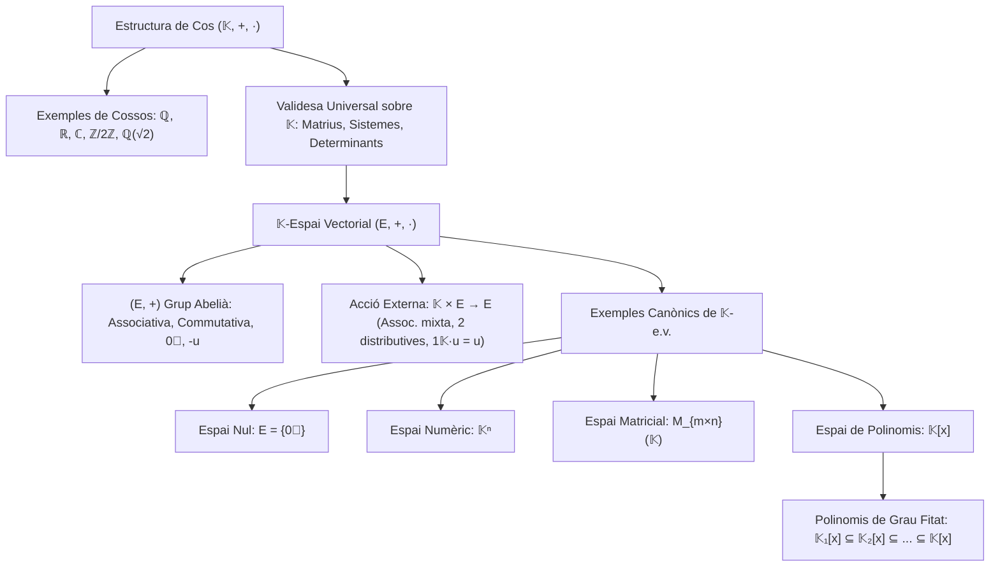

# Espais Vectorials

## 1. Introducció i Motivació

L'àlgebra lineal s'ocupa de l'estudi de sistemes geomètrics i algebraics que preserven combinacions lineals. Fins ara hem treballat amb matrius i vectors definits sobre nombres reals o sobre un cos genèric $\mathbb{K}$.

Per construir una teoria axiomàtica sòlida i general de l'àlgebra lineal, el primer pas consisteix a formalitzar l'estructura algebraica dels coeficients escalars (el concepte de **cos**) i, posteriorment, l'estructura dels vectors sobre els quals operen aquests escalars (el concepte d'**espai vectorial**).

---

## 2. L'Estructura Algebraica de Cos

> [!IMPORTANT] Definició Axiomàtica de Cos
> Un **cos** és un triplet $(\mathbb{K}, +, \cdot)$ format per un conjunt no buit $\mathbb{K}$ i dues operacions binàries internes:
> $$\begin{aligned}
> +: \mathbb{K} \times \mathbb{K} &\longrightarrow \mathbb{K}, \quad (a, b) \longmapsto a + b \quad \text{(suma)} \\
> \cdot: \mathbb{K} \times \mathbb{K} &\longrightarrow \mathbb{K}, \quad (a, b) \longmapsto a \cdot b \quad \text{(producte, sovint escrit } ab\text{)}
> \end{aligned}$$
> que compleixen les següents propietats per a qualssevol elements $a, b, c \in \mathbb{K}$:
> 
> ### I. Propietats de la Suma: $(\mathbb{K}, +)$ és un Grup Abelià
> 1. **Associativitat:** $a + (b + c) = (a + b) + c$
> 2. **Commutativitat:** $a + b = b + a$
> 3. **Element Neutre:** Existeix un element $0 \in \mathbb{K}$ tal que:
>    $$a + 0 = a \quad \forall a \in \mathbb{K}$$
> 4. **Element Oposat:** Per a cada $a \in \mathbb{K}$, existeix un element $-a \in \mathbb{K}$ tal que:
>    $$a + (-a) = 0$$
> 
> ### II. Propietats del Producte
> 1. **Associativitat:** $a \cdot (b \cdot c) = (a \cdot b) \cdot c$
> 2. **Commutativitat:** $a \cdot b = b \cdot a$
> 3. **Element Unitat (Neutre del Producte):** Existeix un element $1 \in \mathbb{K}$ tal que:
>    $$a \cdot 1 = a \quad \forall a \in \mathbb{K}$$
> 4. **Element Invers:** Per a cada element no nul $a \in \mathbb{K}$ ($a \neq 0$), existeix un element invers $a^{-1} \in \mathbb{K}$ (o $\frac{1}{a}$) tal que:
>    $$a \cdot a^{-1} = 1$$
>    *(Equivalentment, $(\mathbb{K} \setminus \{0\}, \cdot)$ és un grup abelià).*
> 
> ### III. Compatibilitat entre Operacions i No Degeneració
> 1. **Distributivitat del producte respecte de la suma:**
>    $$a \cdot (b + c) = a \cdot b + a \cdot c$$
> 2. **No trivialitat:** L'element neutre de la suma i el de la multiplicació són diferents:
>    $$0 \neq 1$$

---

## 3. Exemples Fonamentals de Cossos

### 3.1. Cossos Numèrics Clàssics
Els exemples més habituals en anàlisi i geometria són:
1. **$(\mathbb{Q}, +, \cdot)$:** El cos dels nombres racionals. És el cos de característica zero més petit (cos primer).
2. **$(\mathbb{R}, +, \cdot)$:** El cos dels nombres reals. A més de cos, és complet (axioma del suprem) i ordenat.
3. **$(\mathbb{C}, +, \cdot)$:** El cos dels nombres complexos, definit formalment com:
   $$\mathbb{C} \underset{\text{def}}{=} \{a + bi \mid a, b \in \mathbb{R}\} \quad \text{on } i^2 = -1$$
   proveït de les operacions:
   - Suma: $(a + bi) + (c + di) = (a + c) + (b + d)i$
   - Producte: $(a + bi)(c + di) = (ac - bd) + (ad + bc)i$
   - Element neutre de la suma: $0 = 0 + 0i \in \mathbb{C}$
   - Element unitat del producte: $1 = 1 + 0i \in \mathbb{C}$
   És un cos algebraicament tancat (Teorema Fonamental de l'Àlgebra), però no admet una relació d'ordre compatible amb les operacions.

---

### 3.2. El Cos Finit $\mathbb{Z}/2\mathbb{Z}$ ($\mathbb{F}_2$)
Considerem el conjunt quocient format per les classes de restes mòdul 2:
$$\mathbb{Z}/2\mathbb{Z} = \{[0], [1]\} \quad \text{o simplement} \quad \{0, 1\}$$
Definim la suma i el producte mòdul 2 mitjançant les seves taules de Cayley:

| $+$ | $0$ | $1$ |
|:---:|:---:|:---:|
| **$0$** | $0$ | $1$ |
| **$1$** | $1$ | $0$ |

| $\cdot$ | $0$ | $1$ |
|:---:|:---:|:---:|
| **$0$** | $0$ | $0$ |
| **$1$** | $0$ | $1$ |

> [!NOTE] Característica 2
> En aquest cos es compleix que $1 + 1 = 0$, la qual cosa implica que tot element és el seu propi oposat: $-1 = 1$. Aquest cos és fonamental en teoria de la informació, criptografia i ciències de la computació.

---

### 3.3. L'Extensió Quadràtica $\mathbb{Q}(\sqrt{2})$
Definim el subconjunt dels nombres reals:
$$\mathbb{Q}(\sqrt{2}) \underset{\text{def}}{=} \{a + b\sqrt{2} \mid a, b \in \mathbb{Q}\} \subseteq \mathbb{R}$$

Comprovem que $\mathbb{Q}(\sqrt{2})$ té estructura de cos amb les operacions heretades de $\mathbb{R}$:
1. **Clausura per la suma:**
   $$(a + b\sqrt{2}) + (c + d\sqrt{2}) = (a + c) + (b + d)\sqrt{2} \in \mathbb{Q}(\sqrt{2})$$
   ja que $a+c \in \mathbb{Q}$ i $b+d \in \mathbb{Q}$.
2. **Clausura pel producte:**
   $$(a + b\sqrt{2}) \cdot (c + d\sqrt{2}) = (ac + 2bd) + (ad + bc)\sqrt{2} \in \mathbb{Q}(\sqrt{2})$$
   ja que $ac + 2bd \in \mathbb{Q}$ i $ad + bc \in \mathbb{Q}$.
3. **Elements neutres:**
   - Neutre de la suma: $0 = 0 + 0\sqrt{2} \in \mathbb{Q}(\sqrt{2})$.
   - Neutre del producte: $1 = 1 + 0\sqrt{2} \in \mathbb{Q}(\sqrt{2})$.
4. **Existència d'invers:**
   Sigui $x = a + b\sqrt{2} \in \mathbb{Q}(\sqrt{2})$ amb $x \neq 0$.
   Com que $\sqrt{2}$ és irracional ($\sqrt{2} \notin \mathbb{Q}$), és impossible que $a^2 - 2b^2 = 0$ llevat que $a = b = 0$. Per tant, $a^2 - 2b^2 \neq 0$.
   Racionalitzant el quocient:
   $$x^{-1} = \frac{1}{a + b\sqrt{2}} = \frac{a - b\sqrt{2}}{(a + b\sqrt{2})(a - b\sqrt{2})} = \frac{a - b\sqrt{2}}{a^2 - 2b^2} = \left(\frac{a}{a^2 - 2b^2}\right) - \left(\frac{b}{a^2 - 2b^2}\right)\sqrt{2}$$
   Com que $\frac{a}{a^2 - 2b^2} \in \mathbb{Q}$ i $-\frac{b}{a^2 - 2b^2} \in \mathbb{Q}$, tenim que $x^{-1} \in \mathbb{Q}(\sqrt{2})$.

Per tant, $(\mathbb{Q}(\sqrt{2}), +, \cdot)$ és un subcos de $\mathbb{R}$.

---

## 4. Definició Axiomàtica d'Espai Vectorial

### 4.1. Exemple Motivador: $\mathbb{R}^n$
L'exemple intuïtiu i geomètric per excel·lència és l'espai numèric real $n$-dimensional:
$$\mathbb{R}^n = \{(a_1, \dots, a_n) \mid a_i \in \mathbb{R}\}$$
En aquest conjunt disposem de dues operacions fonamentals:
1. **Suma de vectors:**
   $$(a_1, \dots, a_n) + (b_1, \dots, b_n) = (a_1 + b_1, \dots, a_n + b_n)$$
   Geomètricament a $\mathbb{R}^2$ correspon a la coneguda regla del paral·lelogram per sumar $\vec{a} + \vec{b}$.
2. **Producte per escalars reals:**
   $$\forall \lambda \in \mathbb{R}, \quad \lambda(a_1, \dots, a_n) = (\lambda a_1, \dots, \lambda a_n)$$
   Geomètricament representa la dilatació ($\lambda > 1$), contracció ($0 < \lambda < 1$) o inversió de sentit ($\lambda < 0$) del vector original.

> [!NOTE] Observació Fonamental: Generalització a Cossos Arbitraris
> A partir d'ara treballarem prenent com a base un **cos arbitrari $\mathbb{K}$**.
> **Tot el que s'ha fet fins ara** en l'assignatura (matrius, sistemes d'equacions lineals, operacions elementals, PAQ-reducció, rang i determinants) **és plenament vàlid si agafem els coeficients en qualsevol cos $\mathbb{K}$**.

---

### 4.2. Els 8 Axiomes d'Espai Vectorial

> [!IMPORTANT] Definició d'Espai Vectorial sobre un Cos
> Sigui $\mathbb{K}$ un cos. Un **espai vectorial sobre $\mathbb{K}$** (o $\mathbb{K}$-espai vectorial, $\mathbb{K}$-e.v., o simplement e.v. si el cos se sobreentén) és un conjunt no buit $E$ proveït de dues operacions:
> 1. Una operació interna anomenada **suma de vectors**:
>    $$+: E \times E \longrightarrow E, \quad (u, v) \longmapsto u + v$$
> 2. Una operació externa anomenada **producte per escalars**:
>    $$\cdot: \mathbb{K} \times E \longrightarrow E, \quad (\lambda, u) \longmapsto \lambda \cdot u \quad (\text{o bé } \lambda u)$$
> 
> que compleixen les següents propietats:
> 
> #### I. Estructura de Grup Abelià per a $(E, +)$
> - **(i) Associativa:** $(u + v) + w = u + (v + w) \quad \forall u, v, w \in E$
> - **(ii) Commutativa:** $u + v = v + u \quad \forall u, v \in E$
> - **(iii) Element Neutre (Vector Nul):** $\exists \vec{0} \in E$ tal que $u + \vec{0} = u \quad \forall u \in E$
> - **(iv) Element Oposat:** $\forall u \in E, \; \exists -u \in E$ tal que $u + (-u) = \vec{0}$
> 
> #### II. Compatibilitat del Producte per Escalars de $\mathbb{K}$
> - **(i) Associativa Mixta (Pseudoassociativitat):** $(\lambda \mu) u = \lambda (\mu u) \quad \forall \lambda, \mu \in \mathbb{K}, \; \forall u \in E$
> - **(ii) Distributivitat respecte a la suma d'escalars:** $(\lambda + \mu) u = \lambda u + \mu u \quad \forall \lambda, \mu \in \mathbb{K}, \; \forall u \in E$
> - **(iii) Distributivitat respecte a la suma de vectors:** $\lambda(u + v) = \lambda u + \lambda v \quad \forall \lambda \in \mathbb{K}, \; \forall u, v \in E$
> - **(iv) Normalització per la Unitat del Cos:** $1_{\mathbb{K}} \cdot u = u \quad \forall u \in E$

Els elements d'$E$ s'anomenen **vectors** i els elements de $\mathbb{K}$ s'anomenen **escalars**.

---

## 5. Exemples Canònics d'Espais Vectorials

### Exemple 0: L'Espai Vectorial Nul (Trivial)
Sigui $\mathbb{K}$ un cos qualsevol. El conjunt format únicament pel vector zero:
$$E = \{\vec{0}\}$$
és un $\mathbb{K}$-espai vectorial amb les operacions òbvies:
$$\vec{0} + \vec{0} = \vec{0}, \qquad \lambda \vec{0} = \vec{0} \quad \forall \lambda \in \mathbb{K}$$

---

### Exemple 1: L'Espai Numèric $\mathbb{K}^n$ ($n \ge 1$)
Generalitzant $\mathbb{R}^n$, per a qualsevol enter $n \ge 1$ i qualsevol cos $\mathbb{K}$, definim:
$$\mathbb{K}^n = \{(a_1, \dots, a_n) \mid a_i \in \mathbb{K}\}$$
amb la suma i el producte definits component a component:
$$\begin{aligned}
(a_1, \dots, a_n) + (b_1, \dots, b_n) &= (a_1 + b_1, \dots, a_n + b_n) \\
\lambda(a_1, \dots, a_n) &= (\lambda a_1, \dots, \lambda a_n), \quad \lambda \in \mathbb{K}
\end{aligned}$$
El vector nul és $\vec{0} = (0, \dots, 0)$.

---

### Exemple 2: L'Espai de Matrius $\mathcal{M}_{m \times n}(\mathbb{K})$
El conjunt de totes les matrius de mida $m \times n$ amb coeficients al cos $\mathbb{K}$:
$$E = \mathcal{M}_{m \times n}(\mathbb{K})$$
és un $\mathbb{K}$-espai vectorial considerant:
- La suma usual de matrius: $(A + B)_{ij} = a_{ij} + b_{ij}$.
- El producte per escalars: $(\lambda A)_{ij} = \lambda a_{ij}$ per a tot $\lambda \in \mathbb{K}$.
- El vector nul és la matriu nul·la: $\vec{0} = (0)_{m \times n}$.

---

### Exemple 3: L'Espai dels Polinomis $\mathbb{K}[x]$
Definim el conjunt de tots els polinomis en la indeterminada $x$ amb coeficients al cos $\mathbb{K}$:
$$\mathbb{K}[x] \underset{\text{def}}{=} \{a_0 + a_1 x + a_2 x^2 + \dots + a_n x^n \mid n \ge 0, \; a_0, a_1, \dots, a_n \in \mathbb{K}\}$$
amb les operacions:
- **Suma de polinomis:** agrupant els coeficients del mateix grau:
  $$(a + bx + cx^2) + (d + ex) = (a + d) + (b + e)x + cx^2$$
- **Producte per escalars de $\mathbb{K}$:**
  $$\lambda (a_0 + a_1 x + \dots + a_n x^n) = (\lambda a_0) + (\lambda a_1)x + \dots + (\lambda a_n)x^n$$

#### Subconjunts de Polinomis de Grau Fitat $\mathbb{K}_n[x]$
Si fixem un grau màxim $n \ge 0$, considerem:
$$\mathbb{K}_n[x] = \{p(x) \in \mathbb{K}[x] \mid \operatorname{grau}(p(x)) \le n\}$$
Per exemple:
- $\mathbb{K}_1[x] = \{a + bx \mid a, b \in \mathbb{K}\}$ (polinomis de grau $\le 1$).
- $\mathbb{K}_2[x] = \{a + bx + cx^2 \mid a, b, c \in \mathbb{K}\}$ (polinomis de grau $\le 2$).

Com que la suma de polinomis de grau $\le n$ i el producte per un escalar no augmenten mai el grau, cadascun d'aquests conjunts és també un $\mathbb{K}$-espai vectorial, complint-se la cadena d'inclusions:
$$\mathbb{K}_1[x] \subseteq \mathbb{K}_2[x] \subseteq \dots \subseteq \mathbb{K}_n[x] \subseteq \dots \subseteq \mathbb{K}[x]$$

---

## 6. Esquema Resum

---

*Enllaços relacionats:*
- [[Índex|Tornar a l'Índex Principal]]
- [[Índex - Àlgebra 1|Tornar a l'Índex d'Àlgebra 1]]
- [[03. Determinants|Tema anterior: Determinants]]
