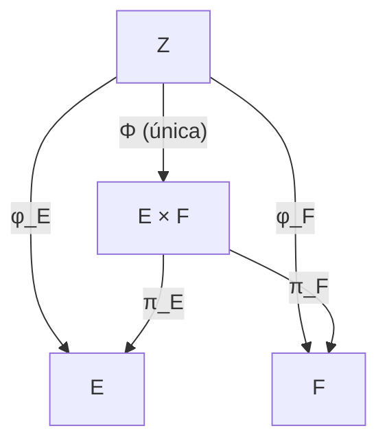
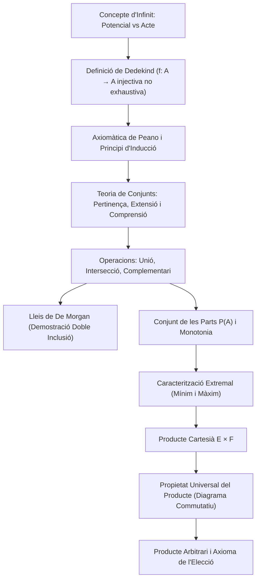

# Teoria de Conjunts i Construccions Fonamentals

## 1. El Concepte d'Infinit

### Els Dos Infinits: Potencial vs en Acte
La conceptualització de l'infinit ha estat un dels debats fonamentals en la història de la filosofia i la matemàtica:
- **Infinit potencial (Aristòtil):** Un procés inacabat que pot continuar indefinidament, on en qualsevol instant només es disposa d'una quantitat finita d'elements. Per exemple, la successió natural $1, 2, 3, \dots$ o el comportament asimptòtic:
  $$\lim_{n \to \infty} x_n = \infty$$
- **Infinit en acte (Georg Cantor):** La consideració de la totalitat dels elements infinits com una entitat matemàtica completa, actualitzada i acabada en si mateixa (per exemple, el conjunt $\mathbb{N}$ com a objecte matemàtic únic i ben definit).

---

### Repàs d'Aplicacions
Sigui $f: A \longrightarrow B$ una aplicació d'un conjunt $A$ (**domini**) en un conjunt $B$ (**codomini**):
1. **Injectiva:** Cada element de la imatge té un únic origen.
   $$\forall x, y \in A, \quad f(x) = f(y) \implies x = y$$
   (Equivalentment: $x \neq y \implies f(x) \neq f(y)$).
2. **Exhaustiva (o suprajectiva):** Tots els elements del codomini són imatge d'almenys un element del domini.
   $$\forall y \in B, \; \exists x \in A \quad \text{tal que} \quad f(x) = y \iff f(A) = B$$
3. **Bijectiva:** L'aplicació és simultàniament injectiva i exhaustiva. Estableix una correspondència unívoca biunívoca entre $A$ i $B$.

---

### Definició de Conjunt Infinit segons Dedekind (1888)
> [!IMPORTANT] Definició de Dedekind
> Un conjunt $A$ és **infinit** si i només si és equipotent a un subconjunt propi de si mateix.
> 
> És a dir, $A$ és infinit si existeix una aplicació **injectiva** $f: A \longrightarrow A$ que **no és exhaustiva**:
> $$f(A) \subsetneq A$$
> Un conjunt s'anomena **finit** si no és infinit segons la definició de Dedekind.

---

### Teorema: El Conjunt dels Nombres Naturals és Infinit
> [!NOTE] Teorema
> El conjunt $\mathbb{N} = \{0, 1, 2, 3, \dots\}$ és infinit en el sentit de Dedekind.

#### Demostració
Considerem l'aplicació que assigna a cada nombre natural el seu doble:
$$\begin{aligned}
f: \mathbb{N} &\longrightarrow \mathbb{N} \\
n &\longmapsto 2n
\end{aligned}$$

1. **Injectivitat:** Siguin $n, m \in \mathbb{N}$. Si $f(n) = f(m)$, aleshores:
   $$2n = 2m \implies n = m$$
   Per tant, $f$ és estrictament injectiva.
2. **No exhaustivitat:** La imatge de $f$ és el conjunt dels nombres parells:
   $$f(\mathbb{N}) = \{0, 2, 4, 6, \dots\}$$
   Com que existeixen nombres senars a $\mathbb{N}$ (per exemple, $1 \in \mathbb{N}$), observem que:
   $$1 \notin f(\mathbb{N}) \implies f(\mathbb{N}) \subsetneq \mathbb{N}$$
   
Com que existeix una aplicació injectiva de $\mathbb{N}$ en si mateix la imatge de la qual és un subconjunt estrictament propi, concloem que $\mathbb{N}$ és infinit. $\blacksquare$

*(Alternativament, l'aplicació successor $s(n) = n+1$ també és injectiva i la seva imatge no conté el $0$, demostrant idèntic resultat).*

---

## 2. Axiomàtica de Peano i Inducció Matemàtica

La fonamentació rigorosa dels nombres naturals va ser establerta per Giuseppe Peano (1889) mitjançant un sistema axiomàtic:

1. **Axioma 1:** $0 \in \mathbb{N}$ (el zero és un nombre natural).
2. **Axioma 2:** Per a tot $n \in \mathbb{N}$, existeix un únic element $s(n) \in \mathbb{N}$ anomenat el **successor** de $n$.
3. **Axioma 3:** Per a tot $n \in \mathbb{N}$, $s(n) \neq 0$ (el zero no és el successor de cap nombre natural).
4. **Axioma 4:** L'aplicació successor $s: \mathbb{N} \to \mathbb{N}$ és **injectiva**:
   $$\forall n, m \in \mathbb{N}, \quad s(n) = s(m) \implies n = m$$
5. **Axioma 5 (Axioma d'Inducció):** Sigui $S \subseteq \mathbb{N}$ un subconjunt que satisfà:
   - $0 \in S$, i
   - $\forall n \in \mathbb{N}, \; (n \in S \implies s(n) \in S)$.
   
   Aleshores $S = \mathbb{N}$.

### El Principi d'Inducció Matemàtica
L'Axioma 5 proporciona la base lògica de les demostracions per inducció. Per provar que una propietat $P(n)$ és certa per a tot $n \ge n_0$:
- **Pas base:** Comprovar directament que $P(n_0)$ és cert.
- **Pas inductiu:** Suposar cert $P(k)$ per a un $k \ge n_0$ arbitrari (**Hipòtesi d'Inducció**) i demostrar que aleshores $P(k+1)$ és cert.
- **Conclusió:** Per l'Axioma d'inducció, $P(n)$ és cert per a tot natural $n \ge n_0$.

---

## 3. Teoria Bàsica de Conjunts

### Noció de Conjunt i Pertinença
Un conjunt és una col·lecció d'objectes matemàtics distingibles considerats com un tot. Si un objecte $a$ forma part d'un conjunt $A$, escrivim $a \in A$ (**pertinença**); en cas contrari, $a \notin A$.

### Formes de Definir un Conjunt
1. **Per extensió (o enumeració):** Llistant un a un tots els seus elements entre claus:
   $$A = \{a, b, c\}$$
   L'ordre dels elements és irrellevant i les repeticions no afegeixen multiplicitat ($\{a, b\} = \{b, a\}$ i $\{a, a, b\} = \{a, b\}$).
2. **Per comprensió (especificació o separació):** Donat un conjunt referencial $A$ i una propietat o predicat $P(x)$, aïllem els elements que compleixen $P$:
   $$E = \{x \in A \mid P(x)\}$$
   *Nota lògica:* En la teoria axiomàtica de Zermelo-Fraenkel (ZF), l'Axioma de Separació exigeix que $x \in A$ per evitar paradoxes com la de Russell.
3. **Axioma de l'Infinit:** En ZF, postula directament l'existència d'un conjunt que conté el buit i és tancat sota l'operació successor, assegurant l'existència del conjunt dels nombres naturals $\mathbb{N}$.

---

## 4. Inclusió, Igualtat i Operacions Fonamentals

### Inclusió i Igualtat
- **Inclusió:** Donats dos conjunts $A$ i $B$, diem que $A$ és un subconjunt de $B$ ($A \subseteq B$) si tot element de $A$ pertany a $B$:
  $$A \subseteq B \iff \forall x, \; (x \in A \implies x \in B)$$
- **Igualtat (Doble Inclusió):** Dos conjunts són iguals si i només si tenen exactament els mateixos elements:
  $$A = B \iff A \subseteq B \land B \subseteq A$$

### Operacions entre Conjunts
Sigui $E$ un conjunt universal o referencial, i $A, B \subseteq E$:
1. **Unió:** Reuneix els elements que pertanyen a $A$, a $B$ o a tots dos:
   $$A \cup B = \{x \in E \mid x \in A \lor x \in B\}$$
2. **Intersecció:** Reuneix els elements comuns a $A$ i a $B$:
   $$A \cap B = \{x \in E \mid x \in A \land x \in B\}$$
   Si $A \cap B = \emptyset$, es diu que $A$ i $B$ són **disjunts**.
3. **Diferència:** Elements de $A$ que no pertanyen a $B$:
   $$A \setminus B = \{x \in E \mid x \in A \land x \notin B\}$$
4. **Complementari:** Donat un conjunt referencial $E$ i $A \subseteq E$, el complementari de $A$ respecte de $E$ és:
   $$\complement_E A = \{x \in E \mid x \notin A\} = E \setminus A$$

---

## 5. Propietats Algebraiques de les Operacions de Conjunts

Per a qualssevol subconjunts $A, B, C \subseteq E$:

| Propietat | Unió ($\cup$) | Intersecció ($\cap$) |
| :--- | :--- | :--- |
| **Idempotència** | $A \cup A = A$ | $A \cap A = A$ |
| **Commutativitat** | $A \cup B = B \cup A$ | $A \cap B = B \cap A$ |
| **Associativitat** | $(A \cup B) \cup C = A \cup (B \cup C)$ | $(A \cap B) \cap C = A \cap (B \cap C)$ |
| **Distributivitat** | $A \cup (B \cap C) = (A \cup B) \cap (A \cup C)$ | $A \cap (B \cup C) = (A \cap B) \cup (A \cap C)$ |
| **Element neutre** | $A \cup \emptyset = A$ | $A \cap E = A$ |
| **Element absorbent** | $A \cup E = E$ | $A \cap \emptyset = \emptyset$ |

### Propietats del Complementari
1. **Involució:** $\complement_E(\complement_E A) = A$.
2. **Totalitat i buit:** $\complement_E E = \emptyset \quad \text{i} \quad \complement_E \emptyset = E$.
3. **Lleis de tancament:** $A \cup \complement_E A = E \quad \text{i} \quad A \cap \complement_E A = \emptyset$.

---

## 6. Lleis de De Morgan

> [!IMPORTANT] Teorema (Lleis de De Morgan)
> Siguin $A, B \subseteq E$. Aleshores:
> 1. $\complement_E (A \cup B) = \complement_E A \cap \complement_E B$
> 2. $\complement_E (A \cap B) = \complement_E A \cup \complement_E B$

### Demostració Formal de la Primera Llei per Doble Inclusió
Demostrem $\complement_E (A \cup B) = \complement_E A \cap \complement_E B$:

- **$(\subseteq)$:** Sigui $x \in \complement_E (A \cup B)$.
  $$\begin{aligned}
  x \in \complement_E (A \cup B) &\implies x \in E \land x \notin (A \cup B) \\
  &\implies x \in E \land \neg(x \in A \lor x \in B) \\
  &\implies x \in E \land (x \notin A \land x \notin B) \\
  &\implies (x \in E \land x \notin A) \land (x \in E \land x \notin B) \\
  &\implies x \in \complement_E A \land x \in \complement_E B \\
  &\implies x \in \complement_E A \cap \complement_E B
  \end{aligned}$$
  Per tant, $\complement_E (A \cup B) \subseteq \complement_E A \cap \complement_E B$.

- **$(\supseteq)$:** Sigui $x \in \complement_E A \cap \complement_E B$.
  $$\begin{aligned}
  x \in \complement_E A \cap \complement_E B &\implies x \in \complement_E A \land x \in \complement_E B \\
  &\implies (x \in E \land x \notin A) \land (x \in E \land x \notin B) \\
  &\implies x \in E \land (x \notin A \land x \notin B) \\
  &\implies x \in E \land \neg(x \in A \lor x \in B) \\
  &\implies x \in E \land x \notin (A \cup B) \\
  &\implies x \in \complement_E (A \cup B)
  \end{aligned}$$
  Per tant, $\complement_E A \cap \complement_E B \subseteq \complement_E (A \cup B)$.

Per doble inclusió, la igualtat queda provada. $\blacksquare$

---

## 7. El Conjunt Buit i la seva Unicitat

El conjunt buit, denotat $\emptyset$, és aquell que no conté cap element ($\forall x, x \notin \emptyset$).

> [!NOTE] Teorema: Unicitat del Conjunt Buit
> El conjunt buit és únic.

#### Demostració
Suposem que existeixen dos conjunts buits, $\emptyset_1$ i $\emptyset_2$.
- Per demostrar $\emptyset_1 \subseteq \emptyset_2$, hem de provar la implicació:
  $$\forall x, \quad x \in \emptyset_1 \implies x \in \emptyset_2$$
  Com que la premissa $x \in \emptyset_1$ és sempre falsa (ja que $\emptyset_1$ no té elements), la implicació lògica $F \implies P$ és **vacúament certa** per a tot $x$. Per tant, $\emptyset_1 \subseteq \emptyset_2$.
- Pel mateix raonament, intercanviant els papers, la implicació:
  $$\forall x, \quad x \in \emptyset_2 \implies x \in \emptyset_1$$
  també és vacúament certa, d'on $\emptyset_2 \subseteq \emptyset_1$.

Per doble inclusió, concloem que $\emptyset_1 = \emptyset_2$. $\blacksquare$

---

## 8. Conjunt de les Parts (Conjunt Potència)

> [!IMPORTANT] Axioma i Definició
> Donat un conjunt $A$, el **conjunt de les parts** de $A$ (o conjunt potència), denotat $\mathcal{P}(A)$ o $2^A$, és el conjunt format per tots els subconjunts de $A$:
> $$\mathcal{P}(A) = \{X \mid X \subseteq A\}$$

### Propietats Fonamentals
1. Per a tot conjunt $A$, es té que $\emptyset \in \mathcal{P}(A)$ i $A \in \mathcal{P}(A)$.
2. Per al conjunt buit:
   $$\mathcal{P}(\emptyset) = \{\emptyset\} \neq \emptyset \quad (|\mathcal{P}(\emptyset)| = 2^0 = 1)$$
3. **Cardinalitat per a conjunts finits:** Si $|A| = n$, aleshores:
   $$|\mathcal{P}(A)| = 2^n$$
   *Exemple:* Si $A = \{1, 2\}$, aleshores $\mathcal{P}(A) = \{\emptyset, \{1\}, \{2\}, \{1, 2\}\}$, amb $|\mathcal{P}(A)| = 2^2 = 4$.

---

### Teorema de Monotonia del Conjunt de les Parts
> [!NOTE] Teorema
> Siguin $A$ i $B$ dos conjunts. Aleshores:
> $$A \subseteq B \iff \mathcal{P}(A) \subseteq \mathcal{P}(B)$$

#### Demostració
- **$(\implies)$:** Suposem que $A \subseteq B$.
  Sigui $X \in \mathcal{P}(A)$. Per definició de conjunt de les parts, $X \subseteq A$.
  Com que per hipòtesi $A \subseteq B$, per la transitivitat de la inclusió es té:
  $$X \subseteq A \land A \subseteq B \implies X \subseteq B$$
  Això implica que $X \in \mathcal{P}(B)$. Per tant, $\mathcal{P}(A) \subseteq \mathcal{P}(B)$.

- **$(\impliedby)$:** Suposem que $\mathcal{P}(A) \subseteq \mathcal{P}(B)$.
  Com que la relació d'inclusió és reflexiva, tot conjunt és subconjunt de si mateix: $A \subseteq A$.
  Això implica que $A \in \mathcal{P}(A)$.
  Aprofitant la hipòtesi $\mathcal{P}(A) \subseteq \mathcal{P}(B)$, deduïm immediatament:
  $$A \in \mathcal{P}(B)$$
  Per la definició de conjunt de les parts, que un element pertanyi a $\mathcal{P}(B)$ vol dir que és subconjunt de $B$:
  $$A \subseteq B$$

Això completa la doble implicació. $\blacksquare$

---

## 9. Caracterització Extremal de la Unió i la Intersecció

La unió i la intersecció es poden definir de manera unívoca a través de propietats extremals d'ordre respecte de la inclusió $\subseteq$:

1. **La Unió com a Conjunt Mínim:**
   - $A \subseteq A \cup B$ i $B \subseteq A \cup B$.
   - Si un conjunt $C$ conté simultàniament $A$ i $B$ ($A \subseteq C$ i $B \subseteq C$), aleshores:
     $$A \cup B \subseteq C$$
   *Conclusió:* $A \cup B$ és el **mínim** subconjunt (respecte de la inclusió) que conté tant $A$ com $B$.

2. **La Intersecció com a Conjunt Màxim:**
   - $A \cap B \subseteq A$ i $A \cap B \subseteq B$.
   - Si un conjunt $D$ està contingut simultàniament en $A$ i en $B$ ($D \subseteq A$ i $D \subseteq B$), aleshores:
     $$D \subseteq A \cap B$$
   *Conclusió:* $A \cap B$ és el **màxim** subconjunt (respecte de la inclusió) contingut alhora en $A$ i en $B$.

---

## 10. Producte Cartesià

### Parells Ordenats
En teoria de conjunts, un parell ordenat $(a, b)$ es formalitza habitualment mitjançant la construcció de Kuratowski:
$$(a, b) = \{\{a\}, \{a, b\}\}$$
Aquesta construcció garanteix el principi essencial de l'ordenació:
$$(a, b) = (c, d) \iff a = c \quad \text{i} \quad b = d$$

### Definició de Producte Cartesià
Donats dos conjunts $E$ i $F$, el seu **producte cartesià** $E \times F$ és el conjunt de tots els parells ordenats tals que la primera component pertany a $E$ i la segona a $F$:
$$E \times F = \{(e, f) \mid e \in E, \; f \in F\}$$

### Propietats Fonamentals
- **Generalització a $n$-tuples:** Donats $n$ conjunts $E_1, \dots, E_n$, definim:
  $$E_1 \times \dots \times E_n = \{(x_1, \dots, x_n) \mid x_i \in E_i, \, \forall i = 1, \dots, n\}$$
- **Producte amb el buit:** Si algun dels conjunts és buit, no és possible formar cap parell ordenat:
  $$E \times \emptyset = \emptyset \times F = \emptyset$$

---

## 11. Propietat Universal del Producte Cartesià

El producte cartesià admet una caracterització fonamental que defineix el concepte de *producte* en teoria de categories.

### Projeccions Canòniques
Definim les aplicacions projecció canònica:
$$\begin{aligned}
\pi_E: E \times F &\longrightarrow E \\
(e, f) &\longmapsto e
\end{aligned}
\qquad
\begin{aligned}
\pi_F: E \times F &\longrightarrow F \\
(e, f) &\longmapsto f
\end{aligned}$$

### Enunciat de la Propietat Universal
> [!IMPORTANT] Teorema (Propietat Universal del Producte Cartesià)
> Donat qualsevol conjunt $Z$ i qualsevol parell d'aplicacions $\varphi_E: Z \longrightarrow E$ i $\varphi_F: Z \longrightarrow F$:
> 
> **Existeix una única aplicació** $\Phi: Z \longrightarrow E \times F$ tal que el diagrama següent commuta:
> $$\pi_E \circ \Phi = \varphi_E \qquad \text{i} \qquad \pi_F \circ \Phi = \varphi_F$$

#### Demostració
1. **Existència:** Definim l'aplicació $\Phi: Z \to E \times F$ assignant a cada element $z \in Z$:
   $$\Phi(z) = (\varphi_E(z), \varphi_F(z))$$
   Comprovem la commutativitat:
   $$(\pi_E \circ \Phi)(z) = \pi_E(\Phi(z)) = \pi_E(\varphi_E(z), \varphi_F(z)) = \varphi_E(z)$$
   $$(\pi_F \circ \Phi)(z) = \pi_F(\Phi(z)) = \pi_F(\varphi_E(z), \varphi_F(z)) = \varphi_F(z)$$
   Per tant, $\pi_E \circ \Phi = \varphi_E$ i $\pi_F \circ \Phi = \varphi_F$.

2. **Unicitat:** Sigui $\Psi: Z \to E \times F$ una altra aplicació que satisfà les mateixes condicions:
   $$\pi_E \circ \Psi = \varphi_E \quad \text{i} \quad \pi_F \circ \Psi = \varphi_F$$
   Per a qualsevol $z \in Z$, com que la imatge $\Psi(z) \in E \times F$, aquesta és un parell ordenat $\Psi(z) = (u, v)$ amb $u \in E$ i $v \in F$.
   Aleshores:
   $$u = \pi_E(\Psi(z)) = (\pi_E \circ \Psi)(z) = \varphi_E(z)$$
   $$v = \pi_F(\Psi(z)) = (\pi_F \circ \Psi)(z) = \varphi_F(z)$$
   Per tant, necessàriament:
   $$\Psi(z) = (\varphi_E(z), \varphi_F(z)) = \Phi(z) \quad \forall z \in Z$$
   Això demostra que l'aplicació $\Phi$ és estrictament única. $\blacksquare$

---

### Unicitat del Producte llevat d'Isomorfisme
Una conseqüència directa de la propietat universal és que el producte cartesià queda caracteritzat de manera única fins a un isomorfisme canònic (bijecció unívoca). Si un altre conjunt $P$ amb projeccions $p_E, p_F$ satisfà la mateixa propietat universal, existeix una única bijecció $\theta: E \times F \to P$ compatible amb les projeccions.

---

### Generalització a Famílies Arbitràries i l'Axioma de l'Elecció
Sigui $\{E_i\}_{i \in I}$ una família de conjunts indexada per un conjunt d'índexs $I$ arbitrari:
- El **producte cartesià generalitzat** es defineix com:
  $$\prod_{i \in I} E_i = \left\{ f: I \longrightarrow \bigcup_{i \in I} E_i \;\middle|\; \forall i \in I, \; f(i) \in E_i \right\}$$
  on cada element es pot visualitzar com una tupla infinita $(x_i)_{i \in I}$ amb $x_i = f(i) \in E_i$, acompanyat de les projeccions canòniques $\pi_j: \prod_{i \in I} E_i \to E_j$, $\pi_j(f) = f(j)$.
- **Propietat Universal Generalitzada:** Donat un conjunt $Z$ i una família d'aplicacions $\{\varphi_i: Z \to E_i\}_{i \in I}$, existeix una **única** aplicació $\Phi: Z \to \prod_{i \in I} E_i$ tal que $\pi_i \circ \Phi = \varphi_i$ per a tot $i \in I$.
- **L'Axioma de l'Elecció (AC):** Si la família de conjunts és no buida ($I \neq \emptyset$) i cada conjunt és no buit ($E_i \neq \emptyset$ per a tot $i \in I$), aleshores:
  $$\prod_{i \in I} E_i \neq \emptyset$$
  L'axioma garanteix l'existència d'una "funció d'elecció" capaç d'escollir simultàniament un element de cada conjunt $E_i$.

---

## 12. Esquema Global del Tema

---

*Enllaços de navegació:*
- [[Índex|Tornar a l'Índex Principal]]
- [[01. Resolució d'Equacions i Mètodes de Demostració|Tema anterior: Resolució d'Equacions i Mètodes de Demostració]]
- [[03. Relacions Binàries, Equivalència i Ordre|Següent: Relacions Binàries, Equivalència i Ordre]]
