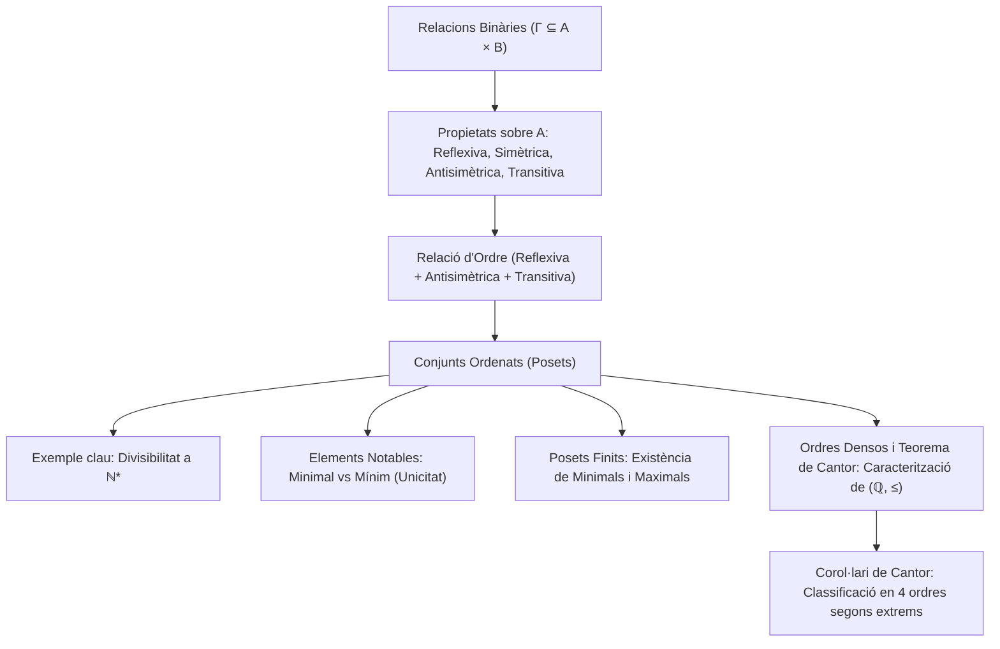

# Relacions Binàries i Ordre

## 1. Definició de Relació Binària

Donats dos conjunts $A$ i $B$, una **relació binària** $R$ de $A$ a $B$ és un triplet $(A, B, \Gamma)$, on $\Gamma$ és un subconjunt del producte cartesià $A \times B$:
$$\Gamma \subseteq A \times B$$
El conjunt $\Gamma$ rep el nom de **graf** de la relació.

- Si $(a, b) \in \Gamma$, escrivim $a \, R \, b$ (llegit "$a$ està relacionat amb $b$").
- Si $(a, b) \notin \Gamma$, escrivim $a \not R \, b$.

Quan el conjunt de sortida i d'arribada coincideixen ($A = B$), diem que $R$ és una **relació binària sobre el conjunt $A$** ($\Gamma \subseteq A \times A$).

### Casos Extrems de Relació
- **Relació buida:** $\Gamma = \emptyset$. Cap parell d'elements està relacionat.
- **Relació total (o universal):** $\Gamma = A \times B$. Tots els elements estan relacionats amb tots.

---

### Exemple: Relació de Disjunció a $\mathcal{P}(X)$
Sigui $X$ un conjunt no buit i considerem el conjunt de les seves parts $\mathcal{P}(X)$. Definim la relació $R$ sobre $\mathcal{P}(X)$ donada per:
$$A \, R \, B \iff A \subseteq \complement_X B$$
*(Observació: com que $A \subseteq \complement_X B \iff A \cap B = \emptyset$, la relació expressa que els conjunts $A$ i $B$ són disjunts).*

Analitzem els casos particulars amb els conjunts extrems $\emptyset$ i $X$:
1. **$\emptyset \, R \, X$:** Comprovem si $\emptyset \subseteq \complement_X X = \emptyset$. Com que $\emptyset \subseteq \emptyset$ és cert, tenim que $\emptyset \, R \, X$ és **cert**.
2. **$\emptyset \, R \, \emptyset$:** Comprovem si $\emptyset \subseteq \complement_X \emptyset = X$. Com que el buit és subconjunt de qualsevol conjunt, és **cert**.
3. **$X \, R \, \emptyset$:** Comprovem si $X \subseteq \complement_X \emptyset = X$. Com que tot conjunt és subconjunt de si mateix, és **cert**.
4. **$X \, R \, X$:** Comprovem si $X \subseteq \complement_X X = \emptyset$. Com que per hipòtesi $X \neq \emptyset$, és impossible que $X \subseteq \emptyset$. Per tant, és **fals**.

---

## 2. Representació de Relacions

1. **Llistat o Graf ($\Gamma$):** Enumeració explícita de tots els parells ordenats $(a, b) \in \Gamma$.
2. **Diagrama sagital:** Diagrames de Venn dels conjunts $A$ i $B$ amb fletxes que parteixen de cada element $a \in A$ cap als elements $b \in B$ amb els quals està relacionat.
3. **Graf dirigit (Dígraf):** Quan la relació és sobre un sol conjunt $A$ finit, es dibuixen els elements de $A$ com a vèrtexs o nodes, i es traça una aresta dirigida $x \longrightarrow y$ si i només si $x \, R \, y$.
4. **Matriu d'adjacència (Matriu booleana):** Si $A = \{a_1, \dots, a_n\}$ i $B = \{b_1, \dots, b_m\}$, la matriu booleana $M \in \mathcal{M}_{n \times m}(\{0, 1\})$ es defineix per:
   $$M_{ij} = \begin{cases} 1 & \text{si } a_i \, R \, b_j \\ 0 & \text{en cas contrari} \end{cases}$$

---

## 3. Propietats de les Relacions sobre un Conjunt

Sigui $R$ una relació binària sobre un conjunt $A$ ($\Gamma \subseteq A \times A$):

1. **Reflexivitat:**
   $$\forall x \in A, \quad x \, R \, x$$
   *(En el dígraf: tot vèrtex té un bucle sobre si mateix. En la matriu d'adjacència: la diagonal principal és tota 1).*

2. **Simetria:**
   $$\forall x, y \in A, \quad x \, R \, y \implies y \, R \, x$$
   *(En el dígraf: sempre que hi ha una fletxa $x \to y$, també hi ha una fletxa $y \to x$, fent les arestes bidireccionals. En la matriu: $M = M^t$).*

3. **Antisimetria:**
   $$\forall x, y \in A, \quad (x \, R \, y \land y \, R \, x) \implies x = y$$
   *(O de manera equivalent pel contrarrecíproc: si $x \neq y$ i $x \, R \, y$, aleshores $y \not R \, x$. En el dígraf: mai no hi ha dues arestes oposades entre dos vèrtexs diferents; és a dir, si hi ha una fletxa $x \to y$ amb $x \neq y$, no pot haver-hi $y \to x$. En la matriu: si $i \neq j$ i $M_{ij} = 1$, aleshores $M_{ji} = 0$).*

4. **Transitivitat:**
   $$\forall x, y, z \in A, \quad (x \, R \, y \land y \, R \, z) \implies x \, R \, z$$
   *(En el dígraf: sempre que hi ha un camí directe de dos passos $x \to y \to z$, també existeix l'aresta dreta directa $x \to z$).*

---

## 4. Relacions d'Ordre

> [!IMPORTANT] Definició de Relació d'Ordre
> Una relació binària $R$ sobre un conjunt $A$ (sovint denotada per $\le$, $\preceq$ o $\preccurlyeq$) s'anomena una **relació d'ordre** (o ordre parcial) si satisfà simultàniament les tres propietats següents:
> 1. **Reflexiva:** $\forall x \in A, \; x \le x$
> 2. **Antisimètrica:** $\forall x, y \in A, \; (x \le y \land y \le x) \implies x = y$
> 3. **Transitiva:** $\forall x, y, z \in A, \; (x \le y \land y \le z) \implies x \le z$
> 
> El parell $(A, \le)$ rep el nom de **conjunt ordenat** (o *poset*).

### Lògica de l'Antisimetria
- **Definició formal:**
  $$\forall x, y \in A, \quad (x \le y \land y \le x) \implies x = y$$
- **Negació lògica de l'antisimetria:**
  Una relació **no** és antisimètrica si i només si:
  $$\exists x, y \in A \quad \text{tals que} \quad x \le y \quad \land \quad y \le x \quad \land \quad x \neq y$$
  És a dir, existeixen almenys dos elements diferents que estan relacionats en ambdós sentits simultàniament.

---

### Exemples Fonamentals de Conjunts Ordenats
1. **L'ordre estàndard dels nombres reals:** $(\mathbb{R}, \le)$ amb l'ordre usual.
2. **L'ordre per inclusió en les parts:** $(\mathcal{P}(X), \subseteq)$ per a qualsevol conjunt $X$.
3. **La relació de divisibilitat a $\mathbb{N}^* = \mathbb{N} \setminus \{0\}$:**
   $$a \mid b \iff \exists k \in \mathbb{N}^* \quad \text{tal que} \quad b = ka$$

#### Demostració Completa: La Divisibilitat a $\mathbb{N}^*$ és una Relació d'Ordre
- **1. Reflexivitat:**
  Sigui $a \in \mathbb{N}^*$. Com que $a = 1 \cdot a$ i $1 \in \mathbb{N}^*$, triant $k = 1$ comprovem que:
  $$a \mid a$$
- **2. Antisimetria:**
  Siguin $a, b \in \mathbb{N}^*$ tals que $a \mid b$ i $b \mid a$.
  Per definició, existeixen $k, l \in \mathbb{N}^*$ tals que:
  $$b = ka \qquad \text{i} \qquad a = lb$$
  Substituint la primera igualtat a la segona:
  $$a = l(ka) = (lk)a$$
  Com que $a \neq 0$, podem simplificar dividint per $a$:
  $$lk = 1$$
  Com que $k, l \in \mathbb{N}^*$ són nombres naturals positius ($k, l \ge 1$), l'única descomposició possible del producte d'enters positius igual a 1 és:
  $$k = 1 \quad \text{i} \quad l = 1$$
  Substituint $k = 1$ a $b = ka$, obtenim $b = 1 \cdot a = a$. Per tant, la relació és estrictament antisimètrica.
- **3. Transitivitat:**
  Siguin $a, b, c \in \mathbb{N}^*$ tals que $a \mid b$ i $b \mid c$.
  Aleshores existeixen $k, l \in \mathbb{N}^*$ tals que:
  $$b = ka \qquad \text{i} \qquad c = lb$$
  Substituint $b$ a la segona equació:
  $$c = l(ka) = (lk)a$$
  Com que el producte de dos naturals positius és un natural positiu ($lk \in \mathbb{N}^*$), triant $m = lk \in \mathbb{N}^*$ tenim $c = ma$, d'on deduïm que:
  $$a \mid c$$
Concloem que $(\mathbb{N}^*, \mid)$ és un conjunt parcialment ordenat. $\blacksquare$

---

## 5. Vocabulari i Tipologia dels Conjunts Ordenats

Sigui $(A, \le)$ un conjunt ordenat:

### Elements Comparables
- Dos elements $x, y \in A$ s'anomenen **comparables** si es compleix $x \le y$ o bé $y \le x$.
- Si no es compleix cap de les dues condicions, diem que $x$ i $y$ són **incomparables**.

### Ordre Total vs Ordre Parcial
- **Ordre Total:** Es diu que $\le$ és un ordre total si **qualssevol dos elements** del conjunt són comparables:
  $$\forall x, y \in A, \quad x \le y \quad \lor \quad y \le x$$
  *Exemple:* $(\mathbb{R}, \le)$ és un ordre total (qualssevol dos reals es poden comparar).
- **Ordre Parcial no Total:** Quan existeixen com a mínim dos elements no comparables.
  *Exemples:*
  - A $(\mathcal{P}(\{1, 2\}), \subseteq)$, els conjunts $\{1\}$ i $\{2\}$ no són comparables.
  - A $(\mathbb{N}^*, \mid)$, els nombres $2$ i $3$ no són comparables ja que $2 \nmid 3$ i $3 \nmid 2$.

---

## 6. Elements Notables d'un Conjunt Ordenat

Sigui $(A, \le)$ un conjunt parcialment ordenat:

### Minimal vs Mínim
- **Element Minimal:** Un element $m \in A$ és **minimal** si cap altre element és estrictament menor que ell:
  $$\forall x \in A, \quad x \le m \implies x = m$$
  *(No hi ha cap $x \in A$ amb $x < m$).*
- **Element Mínim (o Primer Element):** Un element $m \in A$ és el **mínim** si és menor o igual que **tots** els elements de $A$:
  $$\forall x \in A, \quad m \le x$$

### Maximal vs Màxim
- **Element Maximal:** Un element $M \in A$ és **maximal** si cap altre element és estrictament major que ell:
  $$\forall x \in A, \quad M \le x \implies x = M$$
  *(No hi ha cap $x \in A$ amb $M < x$).*
- **Element Màxim (o Últim Element):** Un element $M \in A$ és el **màxim** si és major o igual que **tots** els elements de $A$:
  $$\forall x \in A, \quad x \le M$$

---

### Exemple Il·lustratiu: Els Nombres Primers i la Divisibilitat
Considerem el conjunt $A = \mathbb{N} \setminus \{0, 1\} = \{2, 3, 4, 5, 6, \dots\}$ amb la relació de divisibilitat $\mid$:
1. **Elements minimals:**
   Sigui $p \in A$ un nombre primer ($2, 3, 5, 7, 11, \dots$). Si $x \in A$ compleix $x \mid p$, com que els únics divisors de $p$ són $1$ i $p$, i $1 \notin A$, necessàriament $x = p$.
   Per tant, **tots els nombres primers són elements minimals**. Hi ha infinits elements minimals diferents!
2. **Existència de mínim:**
   El conjunt $A$ **no té mínim**, perquè no existeix cap nombre a $A$ que divideixi tots els altres alhora (per exemple, cap nombre divideix simultàniament a 2 i a 3).
3. **Cas de $\mathbb{N}^* = \{1, 2, 3, \dots\}$:**
   Si reintegrem l'element $1$, com que $1 \mid x$ per a tot $x \in \mathbb{N}^*$, aleshores $1$ és el **mínim absolut**.

---

### Teorema: Unicitat del Mínim i del Màxim
> [!NOTE] Teorema d'Unicitat
> Si un conjunt ordenat $(A, \le)$ posseeix mínim (respectivament màxim), aquest és **estrictament únic**.

#### Demostració
Suposem que existeixen dos elements mínims, $e$ i $e'$ a $A$:
1. Com que $e$ és mínim, compleix $e \le x$ per a tot $x \in A$. Prenent en particular $x = e'$:
   $$e \le e'$$
2. Com que $e'$ és mínim, compleix $e' \le x$ per a tot $x \in A$. Prenent en particular $x = e$:
   $$e' \le e$$
3. Per la propietat antisimètrica de la relació d'ordre $\le$:
   $$(e \le e' \land e' \le e) \implies e = e'$$

Per tant, no poden existir dos mínims diferents. El mateix raonament és vàlid per al màxim. $\blacksquare$

### Proposició: Existència d'Elements Minimals i Maximals en Posets Finits
> [!IMPORTANT] Proposició
> Sigui $(A, \le)$ un conjunt parcialment ordenat finit i no buit ($A \neq \emptyset$, $|A| < \infty$). Aleshores, $A$ posseeix com a mínim un element minimal i com a mínim un element maximal.

#### Demostració
Com que $A \neq \emptyset$, podem escollir un element inicial $x_0 \in A$.
1. Si $x_0$ és minimal, hem acabat.
2. Si $x_0$ no és minimal, per definició existeix un element $x_1 \in A$ tal que $x_1 < x_0$ (és a dir, $x_1 \le x_0$ i $x_1 \neq x_0$).
3. Si $x_1$ és minimal, hem acabat. Si no ho és, existeix $x_2 \in A$ amb $x_2 < x_1$.
4. Reiterant aquest procés, generem una cadena descendent estricta:
   $$\dots < x_k < \dots < x_2 < x_1 < x_0$$
5. Per la transitivitat de l'ordre estricte ($x_i < x_j \implies x_i \neq x_j$ per a tot $i > j$), tots els elements $x_0, x_1, x_2, \dots$ d'aquesta successió són dos a dos diferents.
6. Com que el conjunt $A$ és finit ($|A| = n < \infty$), la cadena no pot contenir infinits elements diferents. Per tant, el procés ha d'aturar-se necessàriament en un nombre finit de passos $k \le n - 1$.
7. En aquest pas $k$, l'element $x_k$ no té cap element menor que ell a $A$: és a dir, $x_k$ és un element minimal de $A$.

El raonament per a l'existència d'un element maximal és totalment anàleg considerant cadenes ascendents estrictes $x_0 < x_1 < x_2 < \dots$. $\blacksquare$

> [!NOTE] Observació
> La hipòtesi de finitud de $A$ és fonamental:
> - El conjunt ordenat $(\mathbb{Z}, \le)$ o $(\mathbb{R}, \le)$ no té cap element minimal ni maximal.
> - El conjunt $(\mathbb{N}, \le)$ té mínim (el $0$), però no té cap element maximal.

---

## 7. Isomorfismes d'Ordre i el Teorema de Caracterització de Cantor

Quan comparem dos conjunts ordenats, ens interessa determinar si comparteixen exactament la mateixa "estructura d'ordre", més enllà de la naturalesa concreta dels seus elements.

### Isomorfisme de Posets
> [!IMPORTANT] Definició d'Isomorfisme d'Ordre
> Siguin $(A, \le_A)$ i $(B, \le_B)$ dos conjunts parcialment ordenats. Una aplicació $f: A \to B$ s'anomena un **isomorfisme d'ordre** si:
> 1. $f$ és bijectiva.
> 2. $f$ preserva l'ordre en ambdós sentits:
>    $$\forall x, y \in A, \quad x \le_A y \iff f(x) \le_B f(y)$$
> Si existeix un tal isomorfisme, diem que $(A, \le_A)$ i $(B, \le_B)$ són **isomorfs com a ordres**, i escrivim $(A, \le_A) \cong (B, \le_B)$.

### Ordre Dens i Ordre Sense Extrems
> [!NOTE] Definicions
> Sigui $(A, \le)$ un conjunt linealment ordenat (ordre total):
> 1. **Ordre dens:** Diem que l'ordre és **dens** si entre qualssevol dos elements diferents sempre n'hi ha un altre:
>    $$\forall x, y \in A \text{ amb } x < y, \quad \exists z \in A \text{ tal que } x < z < y$$
> 2. **Sense extrems (sense primer ni darrer element):**
>    - No té mínim: $\forall x \in A, \; \exists y \in A \text{ tal que } y < x$.
>    - No té màxim: $\forall x \in A, \; \exists z \in A \text{ tal que } x < z$.

Exemple fonamental: el conjunt dels nombres racionals $(\mathbb{Q}, \le)$ és un ordre lineal, numerable, dens (ja que si $p < q$, la mitjana $\frac{p+q}{2} \in \mathbb{Q}$ compleix $p < \frac{p+q}{2} < q$) i sense extrems.

---

### Teorema de Cantor (Caracterització de $(\mathbb{Q}, \le)$)
Georg Cantor va demostrar el 1895 que aquestes senzilles propietats d'ordre caracteritzen de manera única els racionals llevat d'isomorfisme.

> [!IMPORTANT] Teorema de Cantor (1895)
> Tot conjunt parcialment ordenat $(A, \le)$ que sigui:
> 1. **Linealment ordenat** (ordre total),
> 2. **Numerable** ($|A| = \aleph_0$),
> 3. **Dens**,
> 4. **Sense extrems** (sense mínim ni màxim),
> 
> és **isomorf com a ordre** al conjunt dels nombres racionals $(\mathbb{Q}, \le)$:
> $$(A, \le) \cong (\mathbb{Q}, \le)$$

#### Demostració (Mètode "Back-and-Forth" o d'Anada i Tornada)
Aquest mètode constructiu és una tècnica clau en teoria de models i lògica matemàtica:

1. **Enumeració dels conjunts:**
   Com que tant $A$ com $\mathbb{Q}$ són numerables, podem fixar enumeracions exhaustives dels seus elements:
   $$A = \{a_0, a_1, a_2, \dots\}, \qquad \mathbb{Q} = \{q_0, q_1, q_2, \dots\}$$

2. **Construcció inductiva d'isomorfismes parcials:**
   Construirem recursivament una successió d'aplicacions $f_0 \subseteq f_1 \subseteq f_2 \subseteq \dots \subseteq f_n \subseteq \dots$ tals que cada $f_n$ és un isomorfisme d'ordre entre un subconjunt finit $A_n \subset A$ i un subconjunt finit $Q_n \subset \mathbb{Q}$.
   
   - **Pas base ($n=0$):**
     Definim $A_0 = \{a_0\}$ i $Q_0 = \{q_0\}$, assignant $f_0(a_0) = q_0$. La preservació de l'ordre és trivial.
   
   - **Pas inductiu ($n \to n+1$):**
     Suposem que tenim construïda $f_n: A_n \to Q_n$ bijectiva i que preserva l'ordre, on:
     $$A_n = \{u_1 < u_2 < \dots < u_n\} \subset A, \quad Q_n = \{v_1 < v_2 < \dots < v_n\} \subset \mathbb{Q}$$
     amb $f_n(u_i) = v_i$. Alternem entre dos tipus de passos segons la paritat del pas:
     
     - **Pas d'anada ("Forth", per a $n$ parell):**
       Volem garantir que tot element de $A$ entri al domini. Sigui $a \in A$ el primer element de l'enumeració $\{a_k\}$ que encara no pertany a $A_n$.
       Analitzem la posició relativa de $a$ respecte als elements ordenats $u_1 < u_2 < \dots < u_n$:
       - *Si $a < u_1$:* Com que $\mathbb{Q}$ no té mínim, existeix algun element a $\mathbb{Q}$ estrictament menor que $v_1$. Triem $q$ com el primer element de $\{q_k\}$ tal que $q < v_1$.
       - *Si $u_n < a$:* Com que $\mathbb{Q}$ no té màxim, existeix algun element a $\mathbb{Q}$ estrictament major que $v_n$. Triem $q$ com el primer element de $\{q_k\}$ tal que $v_n < q$.
       - *Si $u_i < a < u_{i+1}$:* Com que $\mathbb{Q}$ és dens, l'interval obert $(v_i, v_{i+1}) \subset \mathbb{Q}$ és no buit. Triem $q$ com el primer element de $\{q_k\}$ tal que $v_i < q < v_{i+1}$.
       Definim $A_{n+1} = A_n \cup \{a\}$, $Q_{n+1} = Q_n \cup \{q\}$ i estenem la funció posant $f_{n+1}(a) = q$. L'aplicació $f_{n+1}$ continua sent un isomorfisme d'ordre.
     
     - **Pas de tornada ("Back", per a $n$ senar):**
       Volem garantir la exhaustivitat (sobrejectivitat) sobre $\mathbb{Q}$. Sigui $q \in \mathbb{Q}$ el primer element de la llista $\{q_k\}$ que encara no pertany a $Q_n$.
       Anàlogament, usant que $A$ no té mínim, no té màxim i és dens, podem trobar un element $a \in A \setminus A_n$ que manté la mateixa posició d'ordre respecte als $u_i$ que $q$ respecte als $v_i$.
       Definim $f_{n+1}(a) = q$.

3. **Límit i conclusió:**
   Definim $f: A \to \mathbb{Q}$ com la unió de tots els isomorfismes finits:
   $$f = \bigcup_{n=0}^\infty f_n$$
   - **Domini complet:** A cada pas d'anada incorporem el següent element lliure de $A$, per la qual cosa $a_i \in \operatorname{dom}(f)$ a tot tardar en el pas $2i$. Així, $\operatorname{dom}(f) = A$.
   - **Sobrejectivitat:** A cada pas de tornada incorporem el següent element lliure de $\mathbb{Q}$, per la qual cosa $q_j \in \operatorname{im}(f)$ a tot tardar en el pas $2j+1$. Per tant, $\operatorname{im}(f) = \mathbb{Q}$.
   - **Isomorfisme d'ordre:** Si $x, y \in A$ compleixen $x < y$, existeix un cert estadi finit $N$ on $x, y \in A_N$. Com que $f_N$ és un isomorfisme d'ordre, $f(x) = f_N(x) < f_N(y) = f(y)$.
   - **Injectivitat:** Com que $f$ preserva estrictament l'ordre ($x < y \implies f(x) < f(y)$), tota aplicació estrictament creixent és sempre automàticament injectiva.
   
   En conseqüència, $f: (A, \le) \to (\mathbb{Q}, \le)$ és un isomorfisme d'ordre bijectiu. $\blacksquare$

### Corol·lari: Classificació dels Ordres Lineals Densos Numerables

Com a conseqüència directa del Teorema de Cantor, podem classificar completament tots els conjunts ordenats numerables i densos en exactament quatre tipus d'ordres possibles, depenent exclusivament de la presència o absència d'extrems (mínim o màxim):

> [!NOTE] Corol·lari del Teorema de Cantor
> Sigui $(L, \le)$ un conjunt totalment ordenat, numerable ($|L| = \aleph_0$) i d'ordre dens. Aleshores $(L, \le)$ és isomorf com a ordre a un dels quatre conjunts següents:
> 
> 1. $(\mathbb{Q}, \le)$ $\iff$ $L$ **no és acotat** (no té mínim ni màxim).
> 2. $(\mathbb{Q} \cap [0, 1[, \le)$ $\iff$ $L$ **admet un mínim**, però no màxim.
> 3. $(\mathbb{Q} \cap ]0, 1], \le)$ $\iff$ $L$ **admet un màxim**, però no mínim.
> 4. $(\mathbb{Q} \cap [0, 1], \le)$ $\iff$ $L$ **és acotat** (admet tant mínim com màxim).

#### Teorema Auxiliar: $(\mathbb{Q} \cap ]0, 1[, \le) \cong (\mathbb{Q}, \le)$
L'interval obert de racionals $\mathbb{Q} \cap ]0, 1[$ és:
1. Totalment ordenat.
2. Numerable ($|\mathbb{Q} \cap ]0, 1[| = \aleph_0$).
3. Dens.
4. Sense extrems (per a qualsevol $q \in ]0, 1[$, existeixen racionals més petits i més grans dins l'interval).

Pel Teorema de Cantor, existeix una **bijecció creixent** (isomorfisme d'ordre):
$$\mathbb{Q} \cap ]0, 1[ \overset{\sim}{\longrightarrow} \mathbb{Q}$$
*(Observació: aquesta bijecció no és la inclusió canònica $\mathbb{Q} \cap ]0, 1[ \hookrightarrow \mathbb{Q}$, la qual no seria sobrejectiva, sinó una bijecció que 'estira' l'interval a tota la recta racional).*

#### Demostració del Corol·lari
- **Cas 1 ($L$ sense extrems):** És exactament l'enunciat directe del Teorema de Cantor: $L \cong \mathbb{Q}$.
- **Cas 2 ($L$ amb mínim $m = \min(L)$ i sense màxim):**
  Considerem el conjunt $L \setminus \{m\}$. Aquest subconjunt és linealment ordenat, numerable, dens i no té ni mínim ni màxim. Pel Teorema de Cantor i el resultat auxiliar:
  $$L \setminus \{m\} \cong \mathbb{Q} \cong \mathbb{Q} \cap ]0, 1[$$
  Sigui $\varphi: L \setminus \{m\} \xrightarrow{\sim} \mathbb{Q} \cap ]0, 1[$ aquest isomorfisme d'ordre. Podem estendre $\varphi$ a una aplicació $\tilde{\varphi}: L \longrightarrow \mathbb{Q} \cap [0, 1[$ assignant la imatge del mínim a $0$:
  $$\tilde{\varphi}(x) = \begin{cases} 0 & \text{si } x = m \\ \varphi(x) & \text{si } x \in L \setminus \{m\} \end{cases}$$
  Com que per a tot $x \in L \setminus \{m\}$ tenim $m < x$, i d'altra banda $0 < \varphi(x) < 1$, l'aplicació $\tilde{\varphi}$ és una bijecció que preserva estrictament l'ordre. Per tant:
  $$L \cong \mathbb{Q} \cap [0, 1[$$
- **Cas 3 ($L$ amb màxim $M = \max(L)$ i sense mínim):**
  De manera completament anàloga, assignant $L \setminus \{M\} \cong \mathbb{Q} \cap ]0, 1[$ i estenent amb $M \mapsto 1$, s'obté $L \cong \mathbb{Q} \cap ]0, 1]$.
- **Cas 4 ($L$ acotat, amb mínim $m$ i màxim $M$):**
  Extraient ambdós extrems, $L \setminus \{m, M\} \cong \mathbb{Q} \cap ]0, 1[$. Assignant $m \mapsto 0$ i $M \mapsto 1$, s'obté $L \cong \mathbb{Q} \cap [0, 1]$. $\blacksquare$

---

## 8. Esquema Resum

---

*Enllaços de navegació:*
- [[Índex|Tornar a l'Índex Principal]]
- [[Índex - Fonaments 1|Tornar a l'Índex de Fonaments 1]]
- [[02. Teoria de Conjunts i Construccions Fonamentals|Tema anterior: Teoria de Conjunts i Construccions Fonamentals]]
- [[04. Relacions d'Equivalència|Tema següent: Relacions d'Equivalència]]
