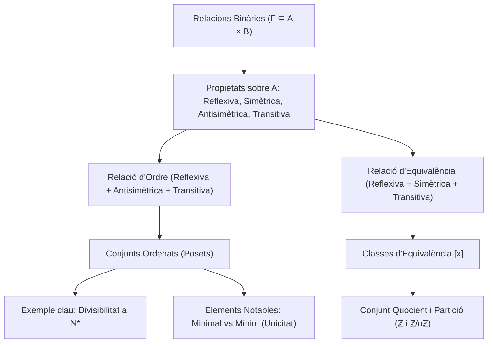

# Relacions Binàries, Equivalència i Ordre

## 1. Definició de Relació Binària

Donats dos conjunts $A$ i $B$, una **relació binària** $R$ de $A$ a $B$ és un triplet $(A, B, \Gamma)$, on $\Gamma$ és un subconjunt del producte cartesià $A \times B$:
$$\Gamma \subseteq A \times B$$
El conjunt $\Gamma$ rep el nom de **graf** de la relació.

- Si $(a, b) \in \Gamma$, escrivim $a \, R \, b$ (llegit "$a$ està relacionat amb $b$").
- Si $(a, b) \notin \Gamma$, escrivim $a \not R \, b$.

Quan el conjunt de sortida i d'arribada coincideixen ($A = B$), diem que $R$ és una **relació binària sobre el conjunt $A$** ($\Gamma \subseteq A \times A$).

### Casos Extrems de Relació
- **Relació buida:** $\Gamma = \emptyset$. Cap parell d'elements està relacionat.
- **Relació total (o universal):** $\Gamma = A \times B$. Tots els elements estan relacionats amb tots.

---

### Exemple: Relació de Disjunció a $\mathcal{P}(X)$
Sigui $X$ un conjunt no buit i considerem el conjunt de les seves parts $\mathcal{P}(X)$. Definim la relació $R$ sobre $\mathcal{P}(X)$ donada per:
$$A \, R \, B \iff A \subseteq \complement_X B$$
*(Observació: com que $A \subseteq \complement_X B \iff A \cap B = \emptyset$, la relació expressa que els conjunts $A$ i $B$ són disjunts).*

Analitzem els casos particulars amb els conjunts extrems $\emptyset$ i $X$:
1. **$\emptyset \, R \, X$:** Comprovem si $\emptyset \subseteq \complement_X X = \emptyset$. Com que $\emptyset \subseteq \emptyset$ és cert, tenim que $\emptyset \, R \, X$ és **cert**.
2. **$\emptyset \, R \, \emptyset$:** Comprovem si $\emptyset \subseteq \complement_X \emptyset = X$. Com que el buit és subconjunt de qualsevol conjunt, és **cert**.
3. **$X \, R \, \emptyset$:** Comprovem si $X \subseteq \complement_X \emptyset = X$. Com que tot conjunt és subconjunt de si mateix, és **cert**.
4. **$X \, R \, X$:** Comprovem si $X \subseteq \complement_X X = \emptyset$. Com que per hipòtesi $X \neq \emptyset$, és impossible que $X \subseteq \emptyset$. Per tant, és **fals**.

---

## 2. Representació de Relacions

1. **Llistat o Graf ($\Gamma$):** Enumeració explícita de tots els parells ordenats $(a, b) \in \Gamma$.
2. **Diagrama sagital:** Diagrames de Venn dels conjunts $A$ i $B$ amb fletxes que parteixen de cada element $a \in A$ cap als elements $b \in B$ amb els quals està relacionat.
3. **Graf dirigit (Dígraf):** Quan la relació és sobre un sol conjunt $A$ finit, es dibuixen els elements de $A$ com a vèrtexs o nodes, i es traça una aresta dirigida $x \longrightarrow y$ si i només si $x \, R \, y$.
4. **Matriu d'adjacència (Matriu booleana):** Si $A = \{a_1, \dots, a_n\}$ i $B = \{b_1, \dots, b_m\}$, la matriu booleana $M \in \mathcal{M}_{n \times m}(\{0, 1\})$ es defineix per:
   $$M_{ij} = \begin{cases} 1 & \text{si } a_i \, R \, b_j \\ 0 & \text{en cas contrari} \end{cases}$$

---

## 3. Propietats de les Relacions sobre un Conjunt

Sigui $R$ una relació binària sobre un conjunt $A$ ($\Gamma \subseteq A \times A$):

1. **Reflexivitat:**
   $$\forall x \in A, \quad x \, R \, x$$
   *(En el dígraf: tot vèrtex té un bucle sobre si mateix. En la matriu d'adjacència: la diagonal principal és tota 1).*

2. **Simetria:**
   $$\forall x, y \in A, \quad x \, R \, y \implies y \, R \, x$$
   *(En el dígraf: sempre que hi ha una fletxa $x \to y$, també hi ha una fletxa $y \to x$, fent les arestes bidireccionals. En la matriu: $M = M^t$).*

3. **Transitivitat:**
   $$\forall x, y, z \in A, \quad (x \, R \, y \land y \, R \, z) \implies x \, R \, z$$
   *(En el dígraf: sempre que hi ha un camí directe de dos passos $x \to y \to z$, també existeix l'aresta dreta directa $x \to z$).*

---

## 4. Relacions d'Ordre

> [!IMPORTANT] Definició de Relació d'Ordre
> Una relació binària $R$ sobre un conjunt $A$ (sovint denotada per $\le$, $\preceq$ o $\preccurlyeq$) s'anomena una **relació d'ordre** (o ordre parcial) si satisfà simultàniament les tres propietats següents:
> 1. **Reflexiva:** $\forall x \in A, \; x \le x$
> 2. **Antisimètrica:** $\forall x, y \in A, \; (x \le y \land y \le x) \implies x = y$
> 3. **Transitiva:** $\forall x, y, z \in A, \; (x \le y \land y \le z) \implies x \le z$
> 
> El parell $(A, \le)$ rep el nom de **conjunt ordenat** (o *poset*).

### Lògica de l'Antisimetria
- **Definició formal:**
  $$\forall x, y \in A, \quad (x \le y \land y \le x) \implies x = y$$
- **Negació lògica de l'antisimetria:**
  Una relació **no** és antisimètrica si i només si:
  $$\exists x, y \in A \quad \text{tals que} \quad x \le y \quad \land \quad y \le x \quad \land \quad x \neq y$$
  És a dir, existeixen almenys dos elements diferents que estan relacionats en ambdós sentits simultàniament.

---

### Exemples Fonamentals de Conjunts Ordenats
1. **L'ordre estàndard dels nombres reals:** $(\mathbb{R}, \le)$ amb l'ordre usual.
2. **L'ordre per inclusió en les parts:** $(\mathcal{P}(X), \subseteq)$ per a qualsevol conjunt $X$.
3. **La relació de divisibilitat a $\mathbb{N}^* = \mathbb{N} \setminus \{0\}$:**
   $$a \mid b \iff \exists k \in \mathbb{N}^* \quad \text{tal que} \quad b = ka$$

#### Demostració Completa: La Divisibilitat a $\mathbb{N}^*$ és una Relació d'Ordre
- **1. Reflexivitat:**
  Sigui $a \in \mathbb{N}^*$. Com que $a = 1 \cdot a$ i $1 \in \mathbb{N}^*$, triant $k = 1$ comprovem que:
  $$a \mid a$$
- **2. Antisimetria:**
  Siguin $a, b \in \mathbb{N}^*$ tals que $a \mid b$ i $b \mid a$.
  Per definició, existeixen $k, l \in \mathbb{N}^*$ tals que:
  $$b = ka \qquad \text{i} \qquad a = lb$$
  Substituint la primera igualtat a la segona:
  $$a = l(ka) = (lk)a$$
  Com que $a \neq 0$, podem simplificar dividint per $a$:
  $$lk = 1$$
  Com que $k, l \in \mathbb{N}^*$ són nombres naturals positius ($k, l \ge 1$), l'única descomposició possible del producte d'enters positius igual a 1 és:
  $$k = 1 \quad \text{i} \quad l = 1$$
  Substituint $k = 1$ a $b = ka$, obtenim $b = 1 \cdot a = a$. Per tant, la relació és estrictament antisimètrica.
- **3. Transitivitat:**
  Siguin $a, b, c \in \mathbb{N}^*$ tals que $a \mid b$ i $b \mid c$.
  Aleshores existeixen $k, l \in \mathbb{N}^*$ tals que:
  $$b = ka \qquad \text{i} \qquad c = lb$$
  Substituint $b$ a la segona equació:
  $$c = l(ka) = (lk)a$$
  Com que el producte de dos naturals positius és un natural positiu ($lk \in \mathbb{N}^*$), triant $m = lk \in \mathbb{N}^*$ tenim $c = ma$, d'on deduïm que:
  $$a \mid c$$
Concloem que $(\mathbb{N}^*, \mid)$ és un conjunt parcialment ordenat. $\blacksquare$

---

## 5. Vocabulari i Tipologia dels Conjunts Ordenats

Sigui $(A, \le)$ un conjunt ordenat:

### Elements Comparables
- Dos elements $x, y \in A$ s'anomenen **comparables** si es compleix $x \le y$ o bé $y \le x$.
- Si no es compleix cap de les dues condicions, diem que $x$ i $y$ són **incomparables**.

### Ordre Total vs Ordre Parcial
- **Ordre Total:** Es diu que $\le$ és un ordre total si **qualssevol dos elements** del conjunt són comparables:
  $$\forall x, y \in A, \quad x \le y \quad \lor \quad y \le x$$
  *Exemple:* $(\mathbb{R}, \le)$ és un ordre total (qualssevol dos reals es poden comparar).
- **Ordre Parcial no Total:** Quan existeixen com a mínim dos elements no comparables.
  *Exemples:*
  - A $(\mathcal{P}(\{1, 2\}), \subseteq)$, els conjunts $\{1\}$ i $\{2\}$ no són comparables.
  - A $(\mathbb{N}^*, \mid)$, els nombres $2$ i $3$ no són comparables ja que $2 \nmid 3$ i $3 \nmid 2$.

---

## 6. Elements Notables d'un Conjunt Ordenat

Sigui $(A, \le)$ un conjunt parcialment ordenat:

### Minimal vs Mínim
- **Element Minimal:** Un element $m \in A$ és **minimal** si cap altre element és estrictament menor que ell:
  $$\forall x \in A, \quad x \le m \implies x = m$$
  *(No hi ha cap $x \in A$ amb $x < m$).*
- **Element Mínim (o Primer Element):** Un element $m \in A$ és el **mínim** si és menor o igual que **tots** els elements de $A$:
  $$\forall x \in A, \quad m \le x$$

### Maximal vs Màxim
- **Element Maximal:** Un element $M \in A$ és **maximal** si cap altre element és estrictament major que ell:
  $$\forall x \in A, \quad M \le x \implies x = M$$
  *(No hi ha cap $x \in A$ amb $M < x$).*
- **Element Màxim (o Últim Element):** Un element $M \in A$ és el **màxim** si és major o igual que **tots** els elements de $A$:
  $$\forall x \in A, \quad x \le M$$

---

### Exemple Il·lustratiu: Els Nombres Primers i la Divisibilitat
Considerem el conjunt $A = \mathbb{N} \setminus \{0, 1\} = \{2, 3, 4, 5, 6, \dots\}$ amb la relació de divisibilitat $\mid$:
1. **Elements minimals:**
   Sigui $p \in A$ un nombre primer ($2, 3, 5, 7, 11, \dots$). Si $x \in A$ compleix $x \mid p$, com que els únics divisors de $p$ són $1$ i $p$, i $1 \notin A$, necessàriament $x = p$.
   Per tant, **tots els nombres primers són elements minimals**. Hi ha infinits elements minimals diferents!
2. **Existència de mínim:**
   El conjunt $A$ **no té mínim**, perquè no existeix cap nombre a $A$ que divideixi tots els altres alhora (per exemple, cap nombre divideix simultàniament a 2 i a 3).
3. **Cas de $\mathbb{N}^* = \{1, 2, 3, \dots\}$:**
   Si reintegrem l'element $1$, com que $1 \mid x$ per a tot $x \in \mathbb{N}^*$, aleshores $1$ és el **mínim absolut**.

---

### Teorema: Unicitat del Mínim i del Màxim
> [!NOTE] Teorema d'Unicitat
> Si un conjunt ordenat $(A, \le)$ posseeix mínim (respectivament màxim), aquest és **estrictament únic**.

#### Demostració
Suposem que existeixen dos elements mínims, $e$ i $e'$ a $A$:
1. Com que $e$ és mínim, compleix $e \le x$ per a tot $x \in A$. Prenent en particular $x = e'$:
   $$e \le e'$$
2. Com que $e'$ és mínim, compleix $e' \le x$ per a tot $x \in A$. Prenent en particular $x = e$:
   $$e' \le e$$
3. Per la propietat antisimètrica de la relació d'ordre $\le$:
   $$(e \le e' \land e' \le e) \implies e = e'$$

Per tant, no poden existir dos mínims diferents. El mateix raonament és vàlid per al màxim. $\blacksquare$

---

## 7. Relacions d'Equivalència

> [!IMPORTANT] Definició de Relació d'Equivalència
> Una relació binària $R$ sobre un conjunt $A$ (sovint denotada per $\sim$ o $\equiv$) és una **relació d'equivalència** si compleix:
> 1. **Reflexiva:** $\forall x \in A, \; x \sim x$
> 2. **Simètrica:** $\forall x, y \in A, \; x \sim y \implies y \sim x$
> 3. **Transitiva:** $\forall x, y, z \in A, \; (x \sim y \land y \sim z) \implies x \sim z$

### Classes d'Equivalència
Donat un element $x \in A$, la seva **classe d'equivalència** $[x]$ (o $\bar{x}$) és el conjunt de tots els elements que estan relacionats amb $x$:
$$[x] = \{y \in A \mid x \sim y\}$$
Qualsevol element que pertany a la classe s'anomena un **representant** de la classe.

#### Propietats Fonamentals:
1. $[x] \neq \emptyset$, ja que per reflexivitat $x \in [x]$.
2. $x \sim y \iff [x] = [y]$.
3. Dues classes d'equivalència o bé són idèntiques o bé són completament disjuntes:
   $$[x] \cap [y] \neq \emptyset \implies [x] = [y]$$

---

### Conjunt Quocient i Particions
El **conjunt quocient** de $A$ per la relació $\sim$, denotat $A/\sim$, és el conjunt de totes les classes d'equivalència:
$$A/\sim \; = \{[x] \mid x \in A\}$$

> [!NOTE] Teorema Fonamental de les Relacions d'Equivalència
> 1. Les classes d'equivalència de $A/\sim$ formen una **partició** de $A$:
>    - Cada classe és no buida: $[x] \neq \emptyset$.
>    - Són disjuntes dues a dues: si $[x] \neq [y]$, aleshores $[x] \cap [y] = \emptyset$.
>    - La unió de totes les classes recobreix $A$: $\bigcup_{[x] \in A/\sim} [x] = A$.
> 2. Recíprocament, tota partició d'un conjunt $A$ indueix una única relació d'equivalència on dos elements estan relacionats si i només si pertanyen al mateix subconjunt de la partició.

---

### Exemples d'Estructures Algebraiques Quocient
1. **Construcció dels Enters $\mathbb{Z}$ a partir de $\mathbb{N} \times \mathbb{N}$:**
   Definim sobre $\mathbb{N} \times \mathbb{N}$ la relació:
   $$(a, b) \sim (c, d) \iff a + d = b + c$$
   La classe $[(a, b)]$ representa formalment l'enter $a - b$. El conjunt quocient $(\mathbb{N} \times \mathbb{N})/\sim$ és canònicament isomorf a $\mathbb{Z}$.
2. **Aritmètica Modular ($\mathbb{Z}/n\mathbb{Z}$):**
   Fixat $n \in \mathbb{N}^*$, sobre $\mathbb{Z}$ definim la congruència:
   $$x \equiv y \pmod n \iff n \mid (x - y)$$
   El conjunt quocient consta exactament de $n$ classes d'equivalència:
   $$\mathbb{Z}/n\mathbb{Z} = \{[0], [1], [2], \dots, [n-1]\}$$

---

## 8. Esquema Resum

---

*Enllaços de navegació:*
- [[Índex|Tornar a l'Índex Principal]]
- [[01. Resolució d'Equacions i Mètodes de Demostració|Tema anterior: Resolució d'Equacions i Mètodes de Demostració]]
- [[02. Teoria de Conjunts i Construccions Fonamentals|Tema anterior: Teoria de Conjunts i Construccions Fonamentals]]
