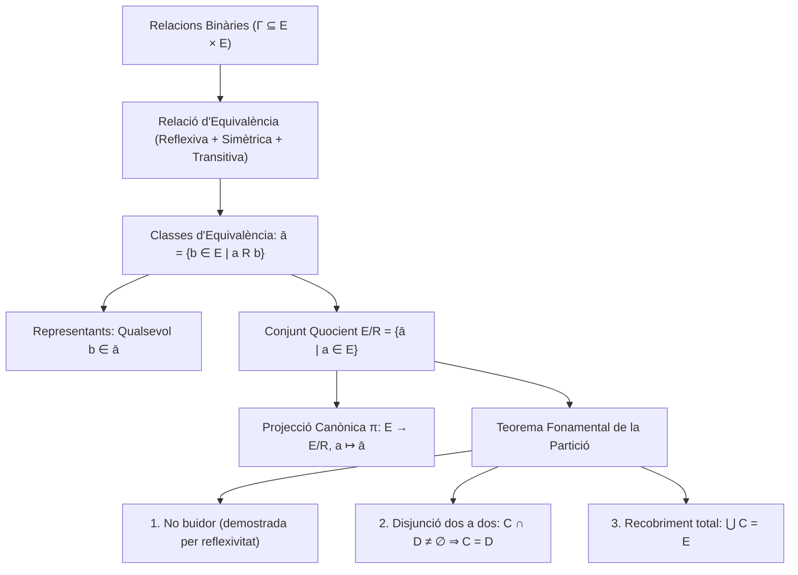

# Relacions d'Equivalència

## 1. Definició de Relació d'Equivalència

> [!IMPORTANT] Definició de Relació d'Equivalència
> Sigui $E$ un conjunt i sigui $R$ una relació binària sobre $E$ ($R \subseteq E \times E$).
> Diem que $R$ és una **relació d'equivalència** si i només si compleix simultàniament les tres propietats següents:
> 1. **Reflexiva:** $\forall a \in E, \; a \, R \, a$
> 2. **Simètrica:** $\forall a, b \in E, \; a \, R \, b \implies b \, R \, a$
> 3. **Transitiva:** $\forall a, b, c \in E, \; (a \, R \, b \land b \, R \, c) \implies a \, R \, c$
> 
> **Notacions usuals:** Per indicar una relació d'equivalència s'acostuma a emprar símbols com $\simeq$, $\sim$ o $\equiv$.

### Motivació: Més enllà de la Igualtat
La relació d'igualtat formal ($=$) sovint és **massa forta**: dos objectes matemàtics poden ser formalment diferents però compartir una mateixa propietat rellevant.

*Exemple de classe:*
Considerem dos conjunts dibuixats $C_1$ (format per $\{1, \text{casa}, \text{arbre}\}$) i $C_2$ (format per $\{\text{arbre}, 1, \text{casa}\}$). Com a dibuixos o representacions ordenades són diferents ($C_1 \neq C_2$). Tanmateix, existeix una aplicació canònica (bijecció) que fa equivalents aquests dos conjunts des del punt de vista conjuntista. Una relació d'equivalència permet formalitzar aquesta identificació.

---

## 2. Classes d'Equivalència

> [!IMPORTANT] Definició de Classe d'Equivalència
> Sigui $(E, R)$ un conjunt dotat d'una relació d'equivalència $R$, i sigui $a \in E$.
> La **classe d'equivalència de $a$** és el conjunt de tots els elements de $E$ relacionats amb $a$:
> $$\bar{a} = \{b \in E \mid a \, R \, b\}$$
> Per simetria de $R$, també s'expressa com $\bar{a} = \{b \in E \mid b \, R \, a\}$.
> 
> Una **classe d'equivalència** en $E$ és qualsevol subconjunt $S \subseteq E$ tal que existeix un $a \in E$ amb $S = \bar{a}$.

### Notacions Habituals per a les Classes
La classe d'un element $a$ es pot denotar segons el text per:
$$\bar{a}, \quad \bar{a}^R, \quad \mathcal{C}(a), \quad \mathcal{C}_R(a), \quad \dot{a}, \quad [a]$$

### Observació: Classes per a Relacions Generals
La noció de "classe d'un element $a$" té sentit per a qualsevol relació binària $R$ sobre $E$, però si $R$ no és simètrica cal distingir:
- **Classe a la dreta:** $\bar{a}^{\rightarrow R} = \{b \in E \mid a \, R \, b\}$
- **Classe a l'esquerra:** $\bar{a}^{R \leftarrow} = \{b \in E \mid b \, R \, a\}$
- **Classes bilaterals:** $\bar{a}^{\rightarrow R} \cap \bar{a}^{R \leftarrow}$

En una relació d'equivalència, per la propietat simètrica, les classes a la dreta i a l'esquerra coincideixen exactament.

### Concepte de Representant
- Les classes d'equivalència són **subconjunts** de $E$ ($S \subseteq E$). Són objectes "amorfs" (conjunts purs sense elements internament preferits).
- Qualsevol element $b \in \bar{a}$ s'anomena un **representant** de la classe d'equivalència $\bar{a}$.

---

## 3. Conjunt Quocient i Projecció Canònica

> [!IMPORTANT] Definició de Conjunt Quocient
> Sigui $E$ un conjunt i $R$ una relació d'equivalència sobre $E$.
> El conjunt format per totes les classes d'equivalència s'anomena **conjunt quocient** de $E$ per $R$, i es denota per $E/R$:
> $$E/R = \{\bar{a} \mid a \in E\}$$
> 
> Aquest conjunt ve dotat d'una **projecció canònica**:
> $$\pi: E \longrightarrow E/R, \quad a \longmapsto \bar{a}$$
> que a cada element de $E$ li assigna la seva classe d'equivalència.

---

## 4. Teorema Fonamental de la Partició

> [!IMPORTANT] Teorema: Les Classes d'Equivalència Formen una Partició
> Sigui $E$ un conjunt i $R$ una relació d'equivalència sobre $E$.
> Les classes d'equivalència satisfan les tres propietats següents:
> 1. **No buidor:** $\forall C \in E/R, \; C \neq \emptyset$.
> 2. **Disjunció dos a dos:** $\forall C, D \in E/R, \; C \cap D \neq \emptyset \implies C = D$.
> 3. **Recobriment total:** $\bigcup_{C \in E/R} C = E$.
> 
> En conseqüència, les classes d'equivalència formen una **partició** del conjunt $E$.

### Demostració
1. **No buidor:**
   Sigui $C \in E/R$. Per definició de quocient, existeix un element $a \in E$ tal que $C = \bar{a}$.
   Com que la relació $R$ és **reflexiva**, es compleix $a \, R \, a$.
   Per tant, $a \in \bar{a} = C$, la qual cosa demostra que $C \neq \emptyset$. $\blacksquare$

---

## 5. Esquema Resum

---

*Enllaços de navegació:*
- [[Índex|Tornar a l'Índex Principal]]
- [[Índex - Fonaments 1|Tornar a l'Índex de Fonaments 1]]
- [[03. Relacions Binàries i Ordre|Tema anterior: Relacions Binàries i Ordre]]
