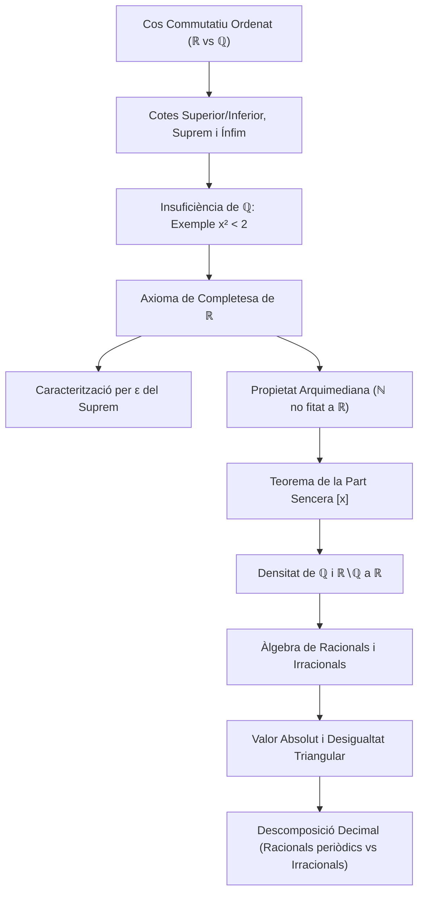

# Els Nombres Reals i Propietats Fonamentals

## 1. El Cos Ordenat dels Nombres Reals

Un **cos commutatiu ordenat** $(K, +, \cdot, \le)$ és una estructura algebraica dotada de dues operacions internes i una relació d'ordre total que compleix:
1. $(K, +, \cdot)$ és un cos: associativitat, commutativitat, existència d'elements neutres ($0$ i $1$), inversos per a la suma (oposats) i inversos per al producte dels elements no nuls, i distributivitat del producte respecte de la suma.
2. L'ordre $\le$ és un **ordre total compatible** amb les operacions algebraiques:
   - **Monotonia de la suma:** $\forall x, y, z \in K, \; x \le y \implies x + z \le y + z$.
   - **Regla dels signes per al producte:** $\forall x, y \in K, \; (0 \le x \land 0 \le y) \implies 0 \le x \cdot y$.

Tant $\mathbb{Q}$ com $\mathbb{R}$ són cossos commutatius ordenats. No obstant això, $\mathbb{Q}$ presenta "forats" o buits analítics que motiven la construcció rigorosa de $\mathbb{R}$.

---

## 2. Cotes, Suprem, Ínfim i l'Axioma de Completesa

Sigui $K$ un cos ordenat i $A \subseteq K$ un subconjunt no buit.

- **Cota superior:** Un element $M \in K$ és una cota superior de $A$ si:
  $$\forall x \in A, \quad x \le M$$
  Si existeix una tal cota, diem que $A$ està **acotat superiorment**.
- **Cota inferior:** Un element $m \in K$ és una cota inferior de $A$ si:
  $$\forall x \in A, \quad m \le x$$
  Si existeix una tal cota, diem que $A$ està **acotat inferiorment**.
- **Conjunt acotat:** Un conjunt està acotat si està simultàniament acotat superiorment i inferiorment.

---

### Definició de Suprem i Ínfim
> [!IMPORTANT] Definició de Suprem i Ínfim
> - El **suprem** de $A$ ($\sup A$), o *cota superior mínima*, és l'element $\alpha \in K$ que satisfà:
>   1. $\alpha$ és cota superior de $A$: $\forall x \in A, \; x \le \alpha$.
>   2. $\alpha$ és la menor de les cotes superiors: si $M \in K$ és una cota superior de $A$, aleshores $\alpha \le M$.
> - L'**ínfim** de $A$ ($\inf A$), o *cota inferior màxima*, és l'element $\beta \in K$ que satisfà:
>   1. $\beta$ és cota inferior de $A$: $\forall x \in A, \; \beta \le x$.
>   2. $\beta$ és la major de les cotes inferiors: si $m \in K$ és una cota inferior de $A$, aleshores $m \le \beta$.
> 
> Si a més $\sup A \in A$, aleshores s'anomena **màxim** ($\max A = \sup A$). Si $\inf A \in A$, s'anomena **mínim** ($\min A = \inf A$).

> [!NOTE] Unicitat del Suprem
> Si el suprem d'un conjunt existeix, és **únic**.
> 
> *Demostració:* Si $\alpha_1$ i $\alpha_2$ són dos suprems de $A$: com que $\alpha_1$ és cota superior i $\alpha_2$ és suprem, $\alpha_2 \le \alpha_1$. Invertint els papers, com que $\alpha_2$ és cota superior i $\alpha_1$ és suprem, $\alpha_1 \le \alpha_2$. Per l'antisimetria de l'ordre, $\alpha_1 = \alpha_2$. $\blacksquare$

---

### Insuficiència de $\mathbb{Q}$: Exemple Fonamental
El cos dels racionals $\mathbb{Q}$ no satisfà la propietat del suprem: existeixen conjunts de racionals acotats superiorment que no tenen suprem a $\mathbb{Q}$.

> [!IMPORTANT] Exemple (M. Spivak, Cap. 28)
> Considerem el subconjunt:
> $$A = \{x \in \mathbb{Q} \mid x > 0 \land x^2 < 2\} \subset \mathbb{Q}$$
> - $A \neq \emptyset$ (ja que $1 \in \mathbb{Q}$, $1 > 0$ i $1^2 = 1 < 2$).
> - $A$ està acotat superiorment a $\mathbb{Q}$ (per exemple, per $2$, ja que si $x \ge 2 \implies x^2 \ge 4 > 2$, per tant $x \notin A$).
> 
> Tanmateix, **$A$ no té suprem a $\mathbb{Q}$**.

#### Demostració Analítica
Suposem per reducció a l'absurd que existeix $s = \sup A \in \mathbb{Q}$. Per la tricotomia de l'ordre a $\mathbb{Q}$, només poden donar-se tres casos: $s^2 = 2$, $s^2 < 2$ o $s^2 > 2$.
1. **Cas $s^2 = 2$:** Impossible, ja que hem demostrat que no existeix cap fracció racional el quadrat de la qual sigui 2 ($\sqrt{2} \notin \mathbb{Q}$).
2. **Cas $s^2 < 2$:** Si $s^2 < 2$, construïm un nombre racional $s + h$ amb $h > 0$ racional tal que $(s+h)^2 < 2$. Triant:
   $$h = \frac{2 - s^2}{2s + 1} > 0$$
   Es comprova que $(s+h)^2 < 2$, la qual cosa implica que $s + h \in A$. Però com que $h > 0$, $s + h > s$, contradient que $s$ fos cota superior de $A$.
3. **Cas $s^2 > 2$:** Construïm un racional més petit $s - h > 0$ que continua sent cota superior de $A$. Triant:
   $$h = \frac{s^2 - 2}{2s} > 0$$
   Es té $(s - h)^2 > 2$, la qual cosa implica que per a tot $x \in A$, $x^2 < 2 < (s-h)^2 \implies x < s - h$. Per tant, $s - h$ és una cota superior de $A$ estrictament menor que $s$, contradient que $s$ fos la *menor* de les cotes superiors.

Com que cap dels tres casos és possible a $\mathbb{Q}$, el conjunt $A$ no té suprem a $\mathbb{Q}$. $\blacksquare$

---

### L'Axioma de Completesa de $\mathbb{R}$
> [!IMPORTANT] Teorema de Completesa
> $\mathbb{R}$ és l'**únic cos commutatiu ordenat complet** (llevat d'isomorfisme).
> 
> **Axioma de Completesa (o de la Cota Superior Mínima):**
> Tot subconjunt no buit $A \subseteq \mathbb{R}$ acotat superiorment té suprem a $\mathbb{R}$ ($\sup A \in \mathbb{R}$).
> 
> *Conseqüència:* Anàlogament, tot subconjunt no buit $A \subseteq \mathbb{R}$ acotat inferiorment té ínfim a $\mathbb{R}$ ($\inf A \in \mathbb{R}$).
> En particular, a $\mathbb{R}$ es té que $\sup A = \sqrt{2} \in \mathbb{R}$.

---

### Exemple de Càlcul de Suprem i Ínfim
Considerem el conjunt:
$$B = \left\{\frac{n}{n+1} \;\middle|\; n \in \mathbb{N}^*\right\} \cup \{1\} = \left\{\frac{1}{2}, \frac{2}{3}, \frac{3}{4}, \frac{4}{5}, \dots, 1\right\}$$
- Com que $1 \in B$ i per a tot $n \ge 1$ es compleix $\frac{n}{n+1} < 1$, tenim que $1$ és cota superior i pertany al conjunt:
  $$\sup B = \max B = 1$$
- D'altra banda, la successió $\frac{n}{n+1}$ és creixent: $\frac{1}{2} \le \frac{n}{n+1}$ per a tot $n \ge 1$. Com que $\frac{1}{2} \le 1$ i $\frac{1}{2} \in B$:
  $$\inf B = \min B = \frac{1}{2}$$

---

### Caracterització per $\varepsilon$ del Suprem i de l'Ínfim
> [!IMPORTANT] Lema de Caracterització per $\varepsilon$
> Sigui $A \subseteq \mathbb{R}$ no buit i acotat superiorment. Aleshores $\alpha = \sup A$ si i només si:
> 1. $\forall x \in A, \; x \le \alpha$ ($\alpha$ és cota superior).
> 2. $\forall \varepsilon > 0, \; \exists x \in A$ tal que $\alpha - \varepsilon < x \le \alpha$ (no hi ha cap cota superior menor que $\alpha$).
> 
> Equivalentment: per a tot $\varepsilon > 0$, $(\alpha - \varepsilon, \alpha] \cap A \neq \emptyset$.

#### Demostració
- **$(\implies)$:** Suposem que $\alpha = \sup A$. Per definició, la condició 1 és directa. Sigui $\varepsilon > 0$. L'element $\alpha - \varepsilon < \alpha$ no pot ser cota superior de $A$ (perquè $\alpha$ és la menor de les cotes superiors). Per tant, existeix algun element $x \in A$ tal que $x > \alpha - \varepsilon$. Com que $\alpha$ és cota superior, $x \le \alpha$, d'on $\alpha - \varepsilon < x \le \alpha$.
- **$(\impliedby)$:** Suposem que es compleixen les condicions 1 i 2. La condició 1 diu que $\alpha$ és cota superior. Sigui ara $M$ una cota superior qualsevol de $A$. Volem veure que $\alpha \le M$. Si fos $M < \alpha$, prendríem $\varepsilon = \alpha - M > 0$. Per la condició 2, existiria $x \in A$ tal que $\alpha - (\alpha - M) < x \implies M < x$, la qual cosa contradiu que $M$ sigui cota superior de $A$. Per tant, necessàriament $\alpha \le M$, demostrant que $\alpha = \sup A$. $\blacksquare$

> [!NOTE] Caracterització Anàloga per a l'Ínfim
> Sigui $A \subseteq \mathbb{R}$ no buit i acotat inferiorment. Aleshores $\beta = \inf A$ si i només si:
> 1. $\forall x \in A, \; \beta \le x$.
> 2. $\forall \varepsilon > 0, \; \exists x \in A$ tal que $\beta \le x < \beta + \varepsilon$ (és a dir, $[\beta, \beta + \varepsilon) \cap A \neq \emptyset$).

---

## 3. Propietat Arquimediana i Funció Part Sencera

> [!IMPORTANT] Propietat Arquimediana de $\mathbb{R}$
> El conjunt dels nombres naturals $\mathbb{N}$ no està acotat superiorment a $\mathbb{R}$:
> $$\forall x \in \mathbb{R}, \; \exists n \in \mathbb{N} \quad \text{tal que} \quad n > x$$

#### Demostració
Suposem per reducció a l'absurd que $\mathbb{N}$ està acotat superiorment a $\mathbb{R}$.
Com que $\mathbb{N} \neq \emptyset$, per l'Axioma de Completesa existeix $\alpha = \sup \mathbb{N} \in \mathbb{R}$.
Prenem $\varepsilon = 1 > 0$. Per la caracterització del caràcter suprem, existeix un nombre natural $m \in \mathbb{N}$ tal que:
$$\alpha - 1 < m \le \alpha$$
Sumant 1 a ambdós costats:
$$\alpha < m + 1$$
Com que $m \in \mathbb{N}$, el seu successor $m + 1 \in \mathbb{N}$. Però llavors hem trobat un element de $\mathbb{N}$ estrictament més gran que el suprem $\alpha$, la qual cosa és una contradicció manifesta. Concloem que $\mathbb{N}$ no està acotat superiorment. $\blacksquare$

> [!NOTE] Lema Corol·lari
> Per a qualssevol $x, y \in \mathbb{R}$ amb $x < y$:
> $$\exists n \in \mathbb{N}^* \quad \text{tal que} \quad \frac{1}{n} < y - x$$
> 
> *Demostració:* Com que $y - x > 0$, el real $\frac{1}{y-x} > 0$ està ben definit. Per la propietat arquimediana, existeix $n \in \mathbb{N}$ tal que $n > \frac{1}{y-x} \iff \frac{1}{n} < y - x$. $\blacksquare$

---

### Teorema de la Part Sencera
> [!IMPORTANT] Teorema de la Part Sencera
> Per a tot nombre real $x \in \mathbb{R}$, **existeix un únic enter** $n \in \mathbb{Z}$, denotat $n = [x]$ (o $\lfloor x \rfloor$), tal que:
> $$n \le x < n + 1$$

#### Demostració
- **Existència per a $x \ge 0$:**
  Considerem el conjunt d'enters no negatius:
  $$A = \{m \in \mathbb{N} \cup \{0\} \mid m \le x\}$$
  1. $A \neq \emptyset$ ja que $0 \le x \implies 0 \in A$.
  2. Per la propietat arquimediana, existeix un natural $k > x$. Per tant, cap natural superior o igual a $k$ pertany a $A$. Això implica que $A$ és un subconjunt **finit** de $\mathbb{N} \cup \{0\}$.
  3. Tot subconjunt finit i no buit de nombres naturals té un màxim absolut. Definim:
     $$n = \max A \in \mathbb{Z}$$
  4. Com que $n \in A$, es compleix $n \le x$.
  5. A més, com que $n$ és el màxim de $A$, el nombre $n + 1 > n$ no pot pertànyer a $A$, la qual cosa vol dir que $n + 1 > x \iff x < n + 1$.
  Per tant, $n \le x < n + 1$.
- **Existència per a $x < 0$:** S'obté reflectint la construcció considerant $[-x]$.
- **Unicitat:** Si existissin dos enters $n_1 < n_2$ que compleixen la condició, llavors $n_1 + 1 \le n_2$, d'on $x < n_1 + 1 \le n_2 \le x$, contradicció $x < x$. Per tant, l'enter $n$ és estrictament únic. $\blacksquare$

---

## 4. Estructura de $\mathbb{R}$ i Densitat de $\mathbb{Q}$ i dels Irracionals

El conjunt dels reals es descompon com la unió disjunta:
$$\mathbb{R} = \mathbb{Q} \;\cup\; (\mathbb{R} \setminus \mathbb{Q})$$

### Teorema: Densitat de $\mathbb{Q}$ a $\mathbb{R}$
> [!IMPORTANT] Teorema de Densitat dels Racionals
> Entre qualssevol dos nombres reals diferents existeix almenys un nombre racional:
> $$\forall x, y \in \mathbb{R} \text{ amb } x < y, \quad \exists r \in \mathbb{Q} \quad \text{tal que} \quad x < r < y$$

#### Demostració
Com que $y - x > 0$, pel corol·lari arquimedià existeix un enter positiu $n \in \mathbb{N}^*$ tal que:
$$\frac{1}{n} < y - x \iff 1 < ny - nx \iff nx + 1 < ny$$
Considerem la part sencera de $nx$, i definim l'enter:
$$m = [nx] + 1 \in \mathbb{Z}$$
Per la definició de part sencera:
$$[nx] \le nx < [nx] + 1 = m \implies nx < m$$
A més:
$$m = [nx] + 1 \le nx + 1 < ny \implies m < ny$$
Combinant ambdues desigualtats:
$$nx < m < ny$$
Dividint per $n > 0$, obtenim:
$$x < \frac{m}{n} < y$$
Prenent $r = \frac{m}{n} \in \mathbb{Q}$, comprovem que $r \in (x, y)$. $\blacksquare$

---

### Teorema: Densitat dels Irracionals a $\mathbb{R}$
> [!IMPORTANT] Teorema de Densitat dels Irracionals
> Entre qualssevol dos nombres reals diferents existeix almenys un nombre irracional:
> $$\forall x, y \in \mathbb{R} \text{ amb } x < y, \quad \exists \beta \in \mathbb{R} \setminus \mathbb{Q} \quad \text{tal que} \quad x < \beta < y$$

#### Demostració
Dividim la desigualtat $x < y$ pel nombre real positiu $\sqrt{2} > 0$:
$$\frac{x}{\sqrt{2}} < \frac{y}{\sqrt{2}}$$
Pel teorema de densitat de $\mathbb{Q}$, existeix un racional $r \in \mathbb{Q}$ no nul tal que:
$$\frac{x}{\sqrt{2}} < r < \frac{y}{\sqrt{2}}$$
Multiplicant tota la desigualtat per $\sqrt{2} > 0$:
$$x < r\sqrt{2} < y$$
Definim $\beta = r\sqrt{2}$. Com que $r \in \mathbb{Q} \setminus \{0\}$ i $\sqrt{2} \notin \mathbb{Q}$, el producte $\beta = r\sqrt{2}$ és un nombre irracional ($\beta \in \mathbb{R} \setminus \mathbb{Q}$). Concloem que $\beta \in (x, y)$. $\blacksquare$

---

## 5. Àlgebra dels Nombres Racionals i Irracionals

1. **Racional amb Racional:**
   Com que $\mathbb{Q}$ és un subcos de $\mathbb{R}$:
   $$q_1, q_2 \in \mathbb{Q} \implies q_1 + q_2 \in \mathbb{Q}, \quad q_1 \cdot q_2 \in \mathbb{Q}$$
2. **Racional amb Irracional:**
   - **Suma:** Si $q \in \mathbb{Q}$ i $x \notin \mathbb{Q}$, aleshores $q + x \notin \mathbb{Q}$.
     *(Si fos $q + x = q' \in \mathbb{Q}$, llavors $x = q' - q \in \mathbb{Q}$, contradicció).*
   - **Producte:** Si $q \in \mathbb{Q} \setminus \{0\}$ i $x \notin \mathbb{Q}$, aleshores $q \cdot x \notin \mathbb{Q}$.
     *(Si fos $q \cdot x = q' \in \mathbb{Q}$, llavors $x = q'/q \in \mathbb{Q}$, contradicció).*
3. **Irracional amb Irracional (Comportament No Determinat):**
   Les operacions entre irracionals poden donar tant nombres racionals com irracionals:
   - **Suma:**
     - $\sqrt{2} + (-\sqrt{2}) = 0 \in \mathbb{Q}$ (racional).
     - $\sqrt{2} + \sqrt{2} = 2\sqrt{2} \notin \mathbb{Q}$ (irracional).
   - **Producte:**
     - $\sqrt{2} \cdot \sqrt{2} = 2 \in \mathbb{Q}$ (racional).
     - $\sqrt{2} \cdot \sqrt{3} = \sqrt{6} \notin \mathbb{Q}$ (irracional).

---

## 6. El Valor Absolut i les seves Propietats

El **valor absolut** d'un nombre real $x \in \mathbb{R}$ es defineix com:
$$|x| = \max\{x, -x\} = \begin{cases} x & \text{si } x \ge 0 \\ -x & \text{si } x < 0 \end{cases}$$

### Propietats Fonamentals
1. **No-negativitat:** $|x| \ge 0 \quad \forall x \in \mathbb{R}$, amb $|x| = 0 \iff x = 0$.
2. **Simetria:** $|-x| = |x|$.
3. **Cota per components:** $-|x| \le x \le |x|$.
4. **Relació amb intervals:** Per a qualsevol constant $c > 0$:
   $$|x| \le c \iff -c \le x \le c \iff x \in [-c, c]$$
5. **Multiplicativitat:** $|xy| = |x| \cdot |y|$ i $\left|\frac{x}{y}\right| = \frac{|x|}{|y|}$ (per a $y \neq 0$).
6. **Desigualtat Triangular:**
   $$|x + y| \le |x| + |y|$$
   *Demostració:* Sumant les desigualtats $-|x| \le x \le |x|$ i $-|y| \le y \le |y|$ obtenim:
   $$-(|x| + |y|) \le x + y \le |x| + |y|$$
   Aplicant la propietat 4, això equival exactament a $|x + y| \le |x| + |y|$. $\blacksquare$
7. **Desigualtat Triangular Inversa:**
   $$\big| |x| - |y| \big| \le |x - y|$$
   *Demostració:*
   $$|x| = |(x - y) + y| \le |x - y| + |y| \implies |x| - |y| \le |x - y|$$
   Intercanviant els papers de $x$ i $y$:
   $$|y| - |x| \le |y - x| = |x - y| \implies -(|x| - |y|) \le |x - y|$$
   Combinant ambdues expressions: $-|x-y| \le |x| - |y| \le |x-y|$, d'on $\big| |x| - |y| \big| \le |x - y|$. $\blacksquare$

---

## 7. Descomposició Decimal dels Nombres Reals

Tot nombre real $x \in \mathbb{R}$ admet una representació en base 10 de la forma:
$$x = a_0.a_1 a_2 a_3 \dots a_n \dots$$
on:
- $a_0 = [x] \in \mathbb{Z}$ és la part sencera de $x$.
- Cada $a_i \in \{0, 1, 2, \dots, 9\}$ per a $i \ge 1$ són les xifres decimals successives, definides inductivament per:
  $$a_1 = [10(x - a_0)], \quad a_2 = [100(x - a_0) - 10a_1], \quad \dots$$
Aquest desenvolupament correspon a la sèrie convergent:
$$x = a_0 + \sum_{n=1}^\infty \frac{a_n}{10^n}$$

### Caracterització dels Conjunts Numèrics
1. **Nombres Racionals ($\mathbb{Q}$):**
   Un nombre real és racional si i només si el seu desenvolupament decimal és:
   - **Finit (decimal exacte):** Té un nombre finit de xifres decimals no nul·les (per exemple, $\frac{1}{4} = 0.25$).
   - **Periòdic:** A partir d'una certa xifra, un bloc de dígits es repeteix indefinidament:
     - Periòdic pur: $\frac{1}{3} = 0.333\dots = 0.\bar{3}$.
     - Periòdic mixt: $\frac{1}{6} = 0.1666\dots = 0.1\bar{6}$.
2. **Nombres Irracionals ($\mathbb{R} \setminus \mathbb{Q}$):**
   Són aquells nombres el desenvolupament decimal dels quals és **infinit i no periòdic** (per exemple, $\sqrt{2} = 1.41421356\dots$ o $\pi = 3.14159265\dots$).

### Condició d'Unicitat del Desenvolupament Decimal
Alguns nombres racionals admeten dues representacions decimals diferents a causa de les sèries geomètriques amb el dígit 9:
$$1 = 0.9999\dots \qquad \left(\sum_{n=1}^\infty \frac{9}{10^n} = \frac{9/10}{1 - 1/10} = 1\right)$$
Per garantir la **unicitat** de la representació decimal per a cada nombre real, s'adopta el conveni formal de **prohibir les cues infinites de nous** (és a dir, s'exclouen desenvolupaments on existeixi un índex $N$ tal que $a_n = 9$ per a tot $n \ge N$). Amb aquest conveni, la bijecció entre $\mathbb{R}$ i els seus desenvolupaments decimals és estricta.

---

## 8. Esquema Resum

---

*Enllaços de navegació:*
- [[Índex|Tornar a l'Índex Principal]]
- [[02. Cardinalitat i Numerabilitat|Següent: Cardinalitat i Numerabilitat]]
- [[03. Successions de Nombres Reals|Tema 3: Successions de Nombres Reals]]
