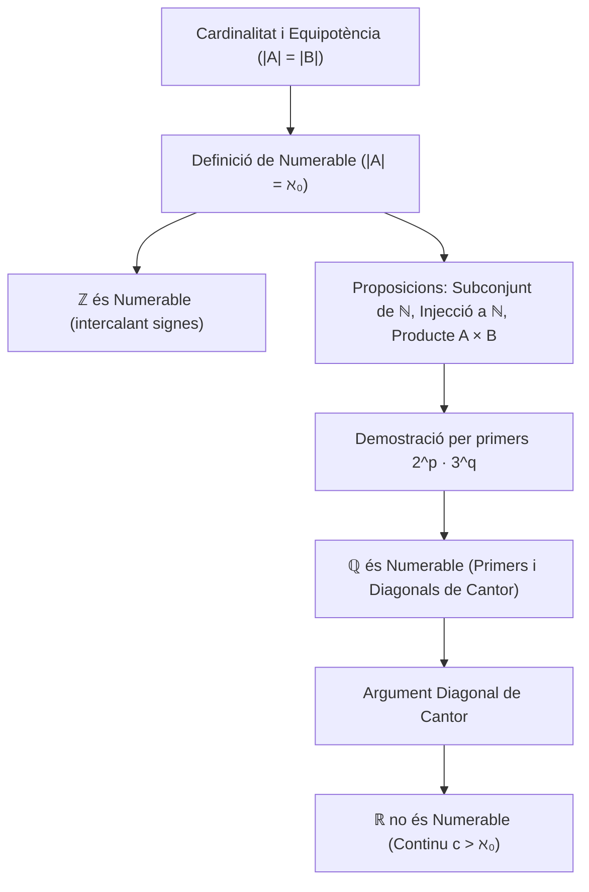

# Cardinalitat i Numerabilitat

## 1. Concepte de Cardinalitat

La noció de cardinalitat formalitza la idea de la "mida" o nombre d'elements d'un conjunt, estenent-la tant a conjunts finits com a conjunts infinits.

### Repàs d'Aplicacions
Sigui $f: A \longrightarrow B$ una aplicació:
1. **Injectiva:** Elements diferents tenen imatges diferents:
   $$\forall x, y \in A, \quad f(x) = f(y) \implies x = y$$
2. **Exhaustiva (Sobrejectiva):** Tots els elements del conjunt d'arribada són coberts:
   $$\forall y \in B, \; \exists x \in A \quad \text{tal que} \quad f(x) = y \iff f(A) = B$$
3. **Bijectiva:** L'aplicació és alhora injectiva i exhaustiva. L'existència d'una bijecció garanteix una correspondència biunívoca un a un entre els elements de $A$ i de $B$, i l'existència d'una aplicació inversa $f^{-1}: B \to A$.

### Equipotència
> [!IMPORTANT] Definició d'Equipotència
> Dos conjunts $A$ i $B$ s'anomenen **equipotents** (o es diu que tenen la mateixa cardinalitat, notació: $|A| = |B|$ o $A \sim B$) si **existeix una aplicació bijectiva** entre ells:
> $$|A| = |B| \iff \exists f: A \longrightarrow B \quad \text{bijectiva}$$

---

## 2. Conjunts Numerables

> [!IMPORTANT] Definició de Conjunt Numerable
> Un conjunt $A$ s'anomena **numerable** (o denumerable) si és equipotent al conjunt dels nombres naturals $\mathbb{N}$:
> $$|A| = |\mathbb{N}| \iff \exists f: A \longrightarrow \mathbb{N} \quad \text{bijectiva}$$
> 
> El cardinal d'un conjunt numerable es denota amb la primera lletra de l'alfabet hebreu: **àlef-zero** ($\aleph_0$):
> $$|\mathbb{N}| = \aleph_0$$
> Un conjunt és **com a màxim numerable** si és finit o numerable. Si un conjunt no és finit ni numerable, s'anomena **no numerable** (incomptable).

---

### Teorema: El Conjunt dels Enters $\mathbb{Z}$ és Numerable
> [!NOTE] Teorema
> El conjunt dels nombres enters $\mathbb{Z}$ és numerable: $|\mathbb{Z}| = \aleph_0$.

#### Demostració
Podem construir explícitament una bijecció $f: \mathbb{Z} \to \mathbb{N}$ intercalant els enters positius i negatius:
$$f(n) = \begin{cases}
2n & \text{si } n \ge 0 \\
-2n - 1 & \text{si } n < 0
\end{cases}$$
Visualització gràfica de l'assignació:
$$\begin{array}{rccccccc}
n \in \mathbb{Z}: & 0 & -1 & 1 & -2 & 2 & -3 & 3 & \dots \\
f(n) \in \mathbb{N}: & 0 & 1 & 2 & 3 & 4 & 5 & 6 & \dots
\end{array}$$
- **Injectivitat:** Si $n \ge 0$, la imatge és un nombre parell; si $n < 0$, la imatge és un nombre senar. Dins de cada paritat, la funció és lineal estricta, per tant $f(n_1) = f(n_2) \implies n_1 = n_2$.
- **Exhaustivitat:** Tot nombre natural parell $2k$ és la imatge de $k \ge 0$, i tot nombre senar $2k+1$ és la imatge de $-(k+1) < 0$.
Com que $f$ és bijectiva, concloem que $\mathbb{Z}$ és numerable. $\blacksquare$

---

## 3. Proposicions Fonamentals sobre la Numerabilitat

### Proposició 1: Subconjunts Infinits de $\mathbb{N}$
> [!NOTE] Proposició 1
> Tot subconjunt infinit de $\mathbb{N}$ és numerable.

#### Demostració
Sigui $A \subseteq \mathbb{N}$ un subconjunt infinit.
Pel Principi del Bon Ordre de $\mathbb{N}$, tot subconjunt no buit de nombres naturals té un element mínim ben definit.
Construïm inductivament una bijecció $\varphi: \mathbb{N} \to A$:
$$\begin{aligned}
\varphi(0) &= \min A \\
\varphi(1) &= \min(A \setminus \{\varphi(0)\}) \\
&\;\;\vdots \\
\varphi(n+1) &= \min(A \setminus \{\varphi(0), \dots, \varphi(n)\})
\end{aligned}$$
Com que $A$ és infinit, el conjunt $A \setminus \{\varphi(0), \dots, \varphi(n)\}$ mai és buit, de manera que el procés està definit per a tot $n \in \mathbb{N}$.
Per construcció, $\varphi(0) < \varphi(1) < \dots < \varphi(n) < \dots$, la qual cosa garanteix la injectivitat.
A més, cap element $a \in A$ pot quedar fora (ja que hi ha a tot estirar $a$ nombres naturals inferiors a ell), demostrant l'exhaustivitat.
Per tant, $\varphi$ és una bijecció i $A$ és numerable. $\blacksquare$

---

### Proposició 2: Subconjunts Infinits de Conjunts Numerables
> [!NOTE] Proposició 2
> Tot subconjunt infinit d'un conjunt numerable és numerable.

#### Demostració
Sigui $X$ un conjunt numerable i sigui $B \subseteq X$ un subconjunt infinit.
Com que $X$ és numerable, existeix una bijecció $g: X \to \mathbb{N}$.
Considerem la restricció de $g$ al subconjunt $B$:
$$g|_B: B \longrightarrow g(B) \subseteq \mathbb{N}$$
Com que $g$ és injectiva, la seva restricció $g|_B$ és una bijecció entre $B$ i la seva imatge $g(B) \subseteq \mathbb{N}$.
Com que $B$ és infinit, $g(B)$ és un subconjunt infinit de $\mathbb{N}$.
Per la Proposició 1, $g(B)$ és numerable. Com que $B$ és equipotent a $g(B)$, concloem que $B$ és numerable. $\blacksquare$

---

### Proposició 3: Criteri d'Injectivitat a $\mathbb{N}$
> [!NOTE] Proposició 3
> Si $A$ és un conjunt infinit i existeix una aplicació **injectiva** $f: A \to \mathbb{N}$, aleshores $A$ és numerable.

#### Demostració
L'aplicació $f$ indueix de manera natural una bijecció entre $A$ i la seva imatge:
$$f: A \longrightarrow f(A) \subseteq \mathbb{N}$$
Com que $A$ és infinit i $f$ és injectiva, la imatge $f(A)$ és un subconjunt infinit de $\mathbb{N}$.
Per la Proposició 1, $f(A)$ és numerable. Com que $A$ és bijectiu amb $f(A)$, concloem immediatament que $A$ és numerable. $\blacksquare$

---

### Proposició 4: Producte Cartesià de Conjunts Numerables
> [!IMPORTANT] Proposició 4
> Si $A$ i $B$ són conjunts numerables, el seu producte cartesià $A \times B$ és numerable.

#### Demostració
Com que $A$ i $B$ són numerables, existeixen aplicacions bijectives $i: A \to \mathbb{N}^*$ i $j: B \to \mathbb{N}^*$, on $\mathbb{N}^* = \{1, 2, 3, \dots\}$.
Definim l'aplicació:
$$\begin{aligned}
F: A \times B &\longrightarrow \mathbb{N}^* \\
(a, b) &\longmapsto 2^{i(a)} \cdot 3^{j(b)}
\end{aligned}$$
Comprovem que $F$ és injectiva:
Siguin $(a, b), (a', b') \in A \times B$ tals que:
$$F(a, b) = F(a', b') \iff 2^{i(a)} \cdot 3^{j(b)} = 2^{i(a')} \cdot 3^{j(b')}$$
Pel **Teorema Fonamental de l'Aritmètica** (la descomposició d'un enter en factors primers és única):
$$i(a) = i(a') \quad \text{i} \quad j(b) = j(b')$$
Com que les aplicacions $i$ i $j$ són bijeccions (i per tant injectives):
$$a = a' \quad \text{i} \quad b = b' \implies (a, b) = (a', b')$$
Això demostra que $F$ és estrictament injectiva.
Com que $A \times B$ és infinit i admet una injecció cap a $\mathbb{N}$, per la Proposició 3 es dedueix que $A \times B$ és numerable. $\blacksquare$

---

## 4. Teorema: El Conjunt dels Racionals $\mathbb{Q}$ és Numerable

> [!IMPORTANT] Teorema
> El conjunt dels nombres racionals $\mathbb{Q}$ és numerable:
> $$|\mathbb{Q}| = \aleph_0$$

### Demostració 1 (via Descomposició en Factors Primers)
Tot nombre racional no nul $r \in \mathbb{Q}^*$ es pot escriure de forma única com una fracció irreductible:
$$r = \frac{p}{q} \quad \text{o bé} \quad r = -\frac{p}{q}$$
on $p, q \in \mathbb{N}^* = \{1, 2, 3, \dots\}$ amb $\operatorname{mcd}(p, q) = 1$.
Definim l'aplicació $f: \mathbb{Q} \to \mathbb{N}$ assignant:
$$f(r) = \begin{cases}
1 & \text{si } r = 0 \\
2^p \cdot 3^q & \text{si } r = \frac{p}{q} > 0 \\
5 \cdot 2^p \cdot 3^q & \text{si } r = -\frac{p}{q} < 0
\end{cases}$$
1. Si $r = 0$, $f(0) = 1$.
2. Si $r > 0$, la descomposició en factors primers de $f(r)$ només conté els primers $2$ i $3$. L'exponent de 2 determina de forma unívoca el numerador $p$ i l'exponent de 3 determina el denominador $q$.
3. Si $r < 0$, la factorització conté el factor $5$, que distingeix de forma absoluta els nombres negatius dels positius.

Pel Teorema Fonamental de l'Aritmètica, si $f(r_1) = f(r_2)$, els exponents de 2, 3 i 5 han de coincidir exactament, la qual cosa implica $r_1 = r_2$. Per tant, $f$ és una aplicació **injectiva**.
Com que $\mathbb{Q}$ és un conjunt infinit i injecta a $\mathbb{N}$, per la Proposició 3 concloem que $\mathbb{Q}$ és numerable. $\blacksquare$

---

### Demostració 2 (Ordenació Diagonal de Cantor en Ziga-Zaga)
Podem disposar tots els racionals positius $\mathbb{Q}^+$ en una taula infinita de files (numerador $p$) i columnes (denominador $q$):
$$\begin{array}{c|ccccc}
p \setminus q & 1 & 2 & 3 & 4 & \dots \\
\hline
1 & 1/1 & 1/2 & 1/3 & 1/4 & \dots \\
2 & 2/1 & 2/2 & 2/3 & 2/4 & \dots \\
3 & 3/1 & 3/2 & 3/3 & 3/4 & \dots \\
4 & 4/1 & 4/2 & 4/3 & 4/4 & \dots \\
\vdots & \vdots & \vdots & \vdots & \vdots & \ddots
\end{array}$$

Recorrent la taula seguint les diagonals transversals de suma constant $p+q = 2, 3, 4, \dots$ en ziga-zaga:
$$\frac{1}{1} \longrightarrow \frac{1}{2} \longrightarrow \frac{2}{1} \longrightarrow \frac{3}{1} \longrightarrow \frac{2}{2} \longrightarrow \frac{1}{3} \longrightarrow \frac{1}{4} \longrightarrow \dots$$
Ometent aquelles fraccions que no siguin irreductibles (com $\frac{2}{2} = 1$, $\frac{2}{4} = \frac{1}{2}$, etc.) per no repetir cap valor, s'obté una llista exhaustiva i sense repeticions de tots els racionals positius. Això defineix una bijecció explícita amb $\mathbb{N}^*$.
Intercalant posteriorment el 0 i els racionals negatius (de forma anàloga a com es fa per a $\mathbb{Z}$), s'estableix una bijecció entre tot $\mathbb{Q}$ i $\mathbb{N}$. $\blacksquare$

---

## 5. Teorema: Els Nombres Reals $\mathbb{R}$ no són Numerables

> [!IMPORTANT] Teorema de Cantor (Incomptabilitat del Continu)
> El conjunt dels nombres reals $\mathbb{R}$ **no és numerable**.
> $$|\mathbb{R}| = \mathfrak{c} = 2^{\aleph_0} > \aleph_0$$

### Demostració per l'Argument Diagonal de Cantor
N'hi ha prou amb demostrar que l'interval $[0, 1)$ no és numerable.
Suposem per reducció a l'absurd que $[0, 1)$ és numerable.
Aleshores existiria una bijecció de $\mathbb{N}^*$ a $[0, 1)$, la qual cosa permetria escriure tots els elements de $[0, 1)$ en una llista ordenada exhaustiva:
$$[0, 1) = \{x_1, x_2, x_3, x_4, \dots\}$$
Escrivim el desenvolupament decimal infinit de cada element de la llista (adoptant el conveni estàndard d'excloure les cues infinites de nous per garantir la unicitat de la representació):
$$\begin{aligned}
x_1 &= 0.{\mathbf a_{11}} a_{12} a_{13} a_{14} \dots \\
x_2 &= 0.a_{21} {\mathbf a_{22}} a_{23} a_{24} \dots \\
x_3 &= 0.a_{31} a_{32} {\mathbf a_{33}} a_{34} \dots \\
x_4 &= 0.a_{41} a_{42} a_{43} {\mathbf a_{44}} \dots \\
&\;\;\vdots
\end{aligned}$$
on cada $a_{ij} \in \{0, 1, 2, \dots, 9\}$ és el $j$-èsim dígit decimal del nombre $x_i$.

Construïm ara un nombre real $y \in [0, 1)$ definint les seves xifres decimals $y = 0.d_1 d_2 d_3 d_4 \dots$ a partir dels elements de la diagonal principal segons la regla:
$$d_k = \begin{cases}
4 & \text{si } a_{kk} \neq 4 \\
5 & \text{si } a_{kk} = 4
\end{cases}$$

Analitzem les propietats d'aquest nou nombre $y$:
1. Com que totes les seves xifres decimals són $4$ o $5$, el nombre $y$ no conté cap dígit 9 ni cap dígit 0; per tant, el seu desenvolupament decimal és completament unívoc (no admet representació alternativa).
2. Clarament $0 < y < 1$, de manera que $y \in [0, 1)$.
3. Comparem $y$ amb cadascun dels nombres $x_n$ de la llista: per a qualsevol $n \in \mathbb{N}^*$, el $n$-èsim dígit decimal de $y$ és $d_n$, mentre que el $n$-èsim dígit decimal de $x_n$ és $a_{nn}$. Per construcció:
   $$d_n \neq a_{nn} \implies y \neq x_n \quad \forall n \in \mathbb{N}^*$$

Això implica que el nombre $y \in [0, 1)$ **no coincideix amb cap nombre de la llista**.
Això contradiu frontalment la hipòtesi que la llista $\{x_1, x_2, x_3, \dots\}$ contenia tots els nombres reals de l'interval $[0, 1)$.

Per tant, l'interval $[0, 1)$ no és numerable.
Com que $[0, 1) \subset \mathbb{R}$, concloem necessàriament que **$\mathbb{R}$ no és numerable**. $\blacksquare$

---

## 6. Esquema Resum

---

*Enllaços de navegació:*
- [[Índex|Tornar a l'Índex Principal]]
- [[01. Els Nombres Reals i Propietats Fonamentals|Tema anterior: Els Nombres Reals i Propietats Fonamentals]]
- [[03. Successions de Nombres Reals|Següent: Successions de Nombres Reals]]
