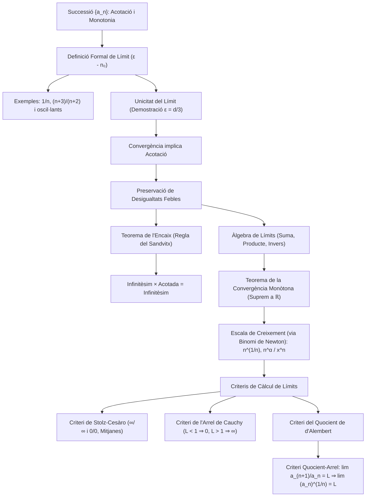

# Successions de Nombres Reals

## 1. Concepte de Successió i Propietats Bàsiques

Una **successió de nombres reals** és una aplicació que a cada nombre natural li associa un únic nombre real:
$$\begin{aligned}
a: \mathbb{N} &\longrightarrow \mathbb{R} \\
n &\longmapsto a(n) = a_n
\end{aligned}$$
Habitualment es denota com $(a_n)_{n \in \mathbb{N}}$, $(a_n)_{n \ge 1}$ o simplement $\{a_n\}$, on $a_n$ rep el nom de **terme general** o $n$-èsim terme de la successió.

---

### Acotació de Successions
Sigui $\{a_n\}$ una successió de nombres reals:
- **Acotada superiorment:** Si existeix un nombre real $M \in \mathbb{R}$ tal que:
  $$\forall n \in \mathbb{N}, \quad a_n \le M$$
- **Acotada inferiorment:** Si existeix un nombre real $m \in \mathbb{R}$ tal que:
  $$\forall n \in \mathbb{N}, \quad a_n \ge m$$
- **Acotada:** Si ho està superiorment i inferiorment alhora:
  $$\exists m, M \in \mathbb{R} \quad \text{tals que} \quad m \le a_n \le M \quad \forall n \in \mathbb{N}$$
  Equivalentment, existeix una constant $K > 0$ tal que $|a_n| \le K$ per a tot $n \in \mathbb{N}$.

*Exemple d'acotació:* La successió $a_n = \frac{1}{n}$ ($n \ge 1$) és acotada, ja que $0 < \frac{1}{n} \le 1$ per a tot $n \ge 1$ (fita inferior 0, fita superior 1).

---

### Monotonia de Successions
Una successió $\{a_n\}$ es diu:
- **Creixent:** Si $a_{n+1} \ge a_n$ per a tot $n \in \mathbb{N}$.
- **Estrictament creixent:** Si $a_{n+1} > a_n$ per a tot $n \in \mathbb{N}$.
- **Decreixent:** Si $a_{n+1} \le a_n$ per a tot $n \in \mathbb{N}$.
- **Estrictament decreixent:** Si $a_{n+1} < a_n$ per a tot $n \in \mathbb{N}$.
- **Constant:** Si $a_{n+1} = a_n$ per a tot $n \in \mathbb{N}$.

---

## 2. Definició Formal de Límit (Convergència)

> [!IMPORTANT] Definició de Límit ($\varepsilon$-$n_0$)
> Diem que una successió $\{a_n\}$ **convergeix cap a un límit** $L \in \mathbb{R}$ (notació: $\lim_{n \to \infty} a_n = L$ o $a_n \to L$) si:
> $$\forall \varepsilon > 0, \; \exists n_0 \in \mathbb{N} \quad \text{tal que} \quad \forall n > n_0, \; |a_n - L| < \varepsilon$$

### Interpretació Geomètrica
Fixat qualsevol entorn de radi $\varepsilon > 0$ al voltant de $L$, l'interval obert $(L - \varepsilon, L + \varepsilon)$ conté **tots els infinits termes** de la successió llevat com a màxim d'una quantitat finita inicial de termes ($a_1, a_2, \dots, a_{n_0}$).

---

## 3. Exemples de Demostració de Límits per Definició

### Exemple 1: Demostració de $\lim_{n \to \infty} \frac{1}{n} = 0$
Volem provar que per a tot $\varepsilon > 0$ existeix $n_0 \in \mathbb{N}$ tal que si $n > n_0$, aleshores $\left|\frac{1}{n} - 0\right| < \varepsilon$.
- Desenvolupem la condició:
  $$\left|\frac{1}{n} - 0\right| = \frac{1}{n} < \varepsilon \iff n > \frac{1}{\varepsilon}$$
- Per la propietat arquimediana dels reals, prenem l'enter de tall:
  $$n_0 = \left[ \frac{1}{\varepsilon} \right] + 1 \in \mathbb{N}$$
  on $[\cdot]$ denota la part sencera.
- **Comprovació:** Per a qualsevol $n > n_0$, es té:
  $$n > \left[\frac{1}{\varepsilon}\right] + 1 > \frac{1}{\varepsilon} \implies \frac{1}{n} < \varepsilon \implies \left|\frac{1}{n} - 0\right| < \varepsilon \quad \blacksquare$$

---

### Exemple 2: Demostració de $\lim_{n \to \infty} \frac{n+3}{n+2} = 1$
Volem provar que $|a_n - 1| < \varepsilon$ a partir d'un cert índex $n_0$:
- Desenvolupem la distància al límit candidat:
  $$\left| \frac{n+3}{n+2} - 1 \right| = \left| \frac{n+3 - (n+2)}{n+2} \right| = \frac{1}{n+2}$$
- Com que $n + 2 > n > 0$, tenim la fitació:
  $$\frac{1}{n+2} < \frac{1}{n}$$
- Fixat $\varepsilon > 0$, exigint que $\frac{1}{n} < \varepsilon \iff n > \frac{1}{\varepsilon}$, triem:
  $$n_0 = \left[\frac{1}{\varepsilon}\right] + 1$$
- Per a tot $n > n_0$:
  $$\left| \frac{n+3}{n+2} - 1 \right| = \frac{1}{n+2} < \frac{1}{n} < \varepsilon \quad \blacksquare$$

---

### Exemple 3: Successió No Convergent (Oscil·lant)
Considerem la successió $a_n = (-1)^n = \{-1, 1, -1, 1, \dots\}$.
Aquesta successió **no convergeix** a cap valor real $L \in \mathbb{R}$.
*Raonament:* Si convergís cap a $L$, triant $\varepsilon = \frac{1}{2}$, a partir d'un cert índex $n_0$ tant $1$ com $-1$ haurien de distar menys d'$\frac{1}{2}$ de $L$. No obstant això:
$$2 = |1 - (-1)| \le |1 - L| + |L - (-1)| < \frac{1}{2} + \frac{1}{2} = 1$$
contradit perquè $2 < 1$ és absurd.

---

## 4. Teorema d'Unicitat del Límit

> [!IMPORTANT] Teorema d'Unicitat
> Si una successió $\{a_n\}$ és convergent, el seu límit és **estrictament únic**.

#### Demostració (per reducció a l'absurd)
Suposem que $\{a_n\}$ posseeix dos límits diferents, $L_1, L_2 \in \mathbb{R}$ amb $L_1 \neq L_2$.
La distància entre ells és estrictament positiva:
$$d = |L_1 - L_2| > 0$$
Triem un radi d'entorn $\varepsilon$ prou petit perquè els entorns no solapin:
$$\varepsilon = \frac{d}{3} > 0$$

- Com que $a_n \to L_1$, existeix $n_1 \in \mathbb{N}$ tal que per a tot $n > n_1$: $|a_n - L_1| < \varepsilon$.
- Com que $a_n \to L_2$, existeix $n_2 \in \mathbb{N}$ tal que per a tot $n > n_2$: $|a_n - L_2| < \varepsilon$.

Definim l'índex $n_0 = \max\{n_1, n_2\}$. Per a tot $n > n_0$, ambdues desigualtats són simultàniament certes.
Aplicant la desigualtat triangular:
$$|L_1 - L_2| = |(L_1 - a_n) + (a_n - L_2)| \le |L_1 - a_n| + |a_n - L_2| < \varepsilon + \varepsilon = 2\varepsilon = \frac{2d}{3}$$
Això implica:
$$d < \frac{2d}{3} \iff 1 < \frac{2}{3}$$
la qual cosa és una contradicció manifesta.
Per tant, és impossible que $L_1 \neq L_2$, concloent que $L_1 = L_2$. $\blacksquare$

---

## 5. Relació entre Convergència i Acotació

> [!IMPORTANT] Proposició
> 1. Tota successió convergent és **acotada**.
> 2. El recíproc no és cert: que una successió sigui **acotada** no implica que sigui convergent.

### Contraexemple per al Recíproc
La successió $a_n = (-1)^n$ està acotada per $-1 \le a_n \le 1$ ($|a_n| = 1 \le 1$), però com hem provat anteriorment, no és convergent.

### Demostració: Convergent implica Acotada
Sigui $\{a_n\}$ una successió convergent amb límit $L$ ($a_n \to L$).
Fixem $\varepsilon = \frac{1}{2} > 0$. Per definició de límit, existeix un índex de tall $n_0 \in \mathbb{N}$ tal que per a tot $n > n_0$:
$$|a_n - L| < \frac{1}{2} \iff L - \frac{1}{2} < a_n < L + \frac{1}{2}$$
Això garanteix que tots els termes de la successió posteriors a $n_0$ estan acotats dins de l'interval $(L - 1/2, L + 1/2)$.

Per controlar tant els termes finals com el conjunt finit de termes inicials $\{a_1, a_2, \dots, a_{n_0}\}$, formem el conjunt finit:
$$M = \left\{ a_1, a_2, \dots, a_{n_0}, L - \frac{1}{2}, L + \frac{1}{2} \right\}$$
Com que $M$ és un conjunt no buit i finit ($n_0 + 2$ elements reals), té màxim i mínim absoluts ben definits:
$$A = \max(M) \quad \text{i} \quad B = \min(M)$$

- **Fita superior:** Si $n \le n_0$, $a_n \le A$ per pertànyer a $M$. Si $n > n_0$, $a_n < L + 1/2 \le A$. Per tant, $a_n \le A$ per a tot $n$.
- **Fita inferior:** Si $n \le n_0$, $a_n \ge B$ per pertànyer a $M$. Si $n > n_0$, $a_n > L - 1/2 \ge B$. Per tant, $a_n \ge B$ per a tot $n$.

Així, $B \le a_n \le A$ per a tot $n \in \mathbb{N}$. Prenent $K = \max\{|A|, |B|\}$, obtenim $|a_n| \le K$ per a tot $n$, provant que $\{a_n\}$ és acotada. $\blacksquare$

---

## 6. Preservació de Desigualtats pel Límit

> [!NOTE] Proposició: Preservació de Desigualtats Febles
> Sigui $\{a_n\}$ una successió convergent amb $\lim_{n \to \infty} a_n = a$.
> Si existeixen constants $L, K \in \mathbb{R}$ tals que $L \le a_n \le K$ per a tot $n$, aleshores:
> $$L \le a \le K$$

> [!WARNING] Desigualtats Estrictes
> Si la successió satisfà desigualtats estrictes ($L < a_n < K$), el límit només preserva desigualtats febles ($L \le a \le K$).
> *Exemple:* $0 < \frac{1}{n} \le 1$, però $\lim_{n \to \infty} \frac{1}{n} = 0$ (el límit assoleix la fita).

#### Demostració per a la Fita Superior $K$ (per reducció a l'absurd)
Suposem que $a > K$, de manera que $a - K > 0$.
Triem com a radi:
$$\varepsilon = \frac{a - K}{2} > 0$$
Com que $a_n \to a$, existeix $n_0 \in \mathbb{N}$ tal que per a tot $n > n_0$:
$$|a_n - a| < \varepsilon \iff a - \varepsilon < a_n < a + \varepsilon$$
En particular, per a qualsevol $n > n_0$:
$$a_n > a - \varepsilon = a - \frac{a - K}{2} = \frac{a + K}{2} > \frac{K + K}{2} = K$$
D'on $a_n > K$ per a tot $n > n_0$. Això contradiu directament la premissa que $a_n \le K$ per a tot $n$.
Concloem que necessàriament $a \le K$. *(La prova per a la fita inferior $L \le a$ és idèntica triant $\varepsilon = \frac{L - a}{2}$).* $\blacksquare$

---

## 7. Àlgebra de Límits i Càlcul d'Indeterminacions

> [!IMPORTANT] Teorema: Àlgebra de Límits
> Siguin $\{a_n\}$ i $\{b_n\}$ dues successions convergents amb $\lim_{n \to \infty} a_n = a$ i $\lim_{n \to \infty} b_n = b$. Aleshores:
> 1. **Límit de la suma:** $\lim_{n \to \infty} (a_n + b_n) = a + b$
> 2. **Límit del producte:** $\lim_{n \to \infty} (a_n \cdot b_n) = a \cdot b$
> 3. **Límit de l'invers:** Si $a \neq 0$ i $a_n \neq 0$ per a tot $n$, $\lim_{n \to \infty} \frac{1}{a_n} = \frac{1}{a}$
> 4. **Límit del quocient:** Si $b \neq 0$, $\lim_{n \to \infty} \frac{a_n}{b_n} = \frac{a}{b}$

---

### Exemple Clàssic: Resolució de la Indeterminació $\infty - \infty$ pel Conjugat
Calculem el límit de la successió:
$$a_n = \sqrt{n^2 + 1} - n$$
Quan $n \to \infty$, observem una indeterminació del tipus $\infty - \infty$.
Multipliquem i dividim per l'expressió conjugada $\sqrt{n^2 + 1} + n$:
$$\begin{aligned}
\sqrt{n^2 + 1} - n &= \frac{(\sqrt{n^2 + 1} - n)(\sqrt{n^2 + 1} + n)}{\sqrt{n^2 + 1} + n} \\
&= \frac{(n^2 + 1) - n^2}{\sqrt{n^2 + 1} + n} \\
&= \frac{1}{\sqrt{n^2 + 1} + n}
\end{aligned}$$
Com que $n \ge 1$:
$$0 < \frac{1}{\sqrt{n^2 + 1} + n} < \frac{1}{\sqrt{n^2} + n} = \frac{1}{2n}$$
Com que $\lim_{n \to \infty} \frac{1}{2n} = 0$, pel teorema d'acotació deduïm immediatament:
$$\lim_{n \to \infty} \left( \sqrt{n^2 + 1} - n \right) = 0$$

---

## 8. Demostracions Formals de l'Àlgebra de Límits

### I. Demostració del Límit de la Suma
Volem provar que $|(a_n + b_n) - (a + b)| < \varepsilon$ a partir d'un cert índex.
Per la desigualtat triangular:
$$|(a_n + b_n) - (a + b)| = |(a_n - a) + (b_n - b)| \le |a_n - a| + |b_n - b|$$
Fixat un $\varepsilon > 0$ arbitrari, considerem $\varepsilon' = \frac{\varepsilon}{2} > 0$:
- Com que $a_n \to a$, existeix $n_1 \in \mathbb{N}$ tal que per a tot $n > n_1$: $|a_n - a| < \frac{\varepsilon}{2}$.
- Com que $b_n \to b$, existeix $n_2 \in \mathbb{N}$ tal que per a tot $n > n_2$: $|b_n - b| < \frac{\varepsilon}{2}$.

Prenent $n_0 = \max\{n_1, n_2\}$, per a tot $n > n_0$:
$$|(a_n + b_n) - (a + b)| \le |a_n - a| + |b_n - b| < \frac{\varepsilon}{2} + \frac{\varepsilon}{2} = \varepsilon \quad \blacksquare$$

---

### II. Demostració del Límit del Producte
Descomponem sumant i restant el terme creuat $a_n b$:
$$|a_n b_n - ab| = |a_n b_n - a_n b + a_n b - ab| \le |a_n| |b_n - b| + |b| |a_n - a|$$
Com que la successió $\{a_n\}$ és convergent, per la Secció 5 és **acotada**, és a dir, existeix una constant $M > 0$ tal que $|a_n| \le M$ per a tot $n$.
Aleshores:
$$|a_n b_n - ab| \le M |b_n - b| + |b| |a_n - a|$$
Fixat $\varepsilon > 0$:
- Existeix $n_1 \in \mathbb{N}$ tal que $\forall n > n_1$, $|b_n - b| < \frac{\varepsilon}{2M}$.
- Existeix $n_2 \in \mathbb{N}$ tal que $\forall n > n_2$, $|a_n - a| < \frac{\varepsilon}{2(|b| + 1)}$.

Prenent $n_0 = \max\{n_1, n_2\}$, per a tot $n > n_0$:
$$|a_n b_n - ab| < M \left(\frac{\varepsilon}{2M}\right) + |b| \left(\frac{\varepsilon}{2(|b| + 1)}\right) < \frac{\varepsilon}{2} + \frac{\varepsilon}{2} = \varepsilon \quad \blacksquare$$

---

### III. Demostració del Límit de l'Invers
Suposem $a \neq 0$. Desenvolupem:
$$\left| \frac{1}{a_n} - \frac{1}{a} \right| = \left| \frac{a - a_n}{a \cdot a_n} \right| = \frac{|a_n - a|}{|a| \cdot |a_n|}$$
Per acotar inferiorment el denominador $|a_n|$, prenem un radi $\varepsilon_1 = \frac{|a|}{2} > 0$.
Com que $a_n \to a$, existeix $n_1 \in \mathbb{N}$ tal que per a tot $n > n_1$:
$$|a_n - a| < \frac{|a|}{2}$$
Per la desigualtat triangular inversa:
$$|a| - |a_n| \le |a - a_n| < \frac{|a|}{2} \implies |a_n| > |a| - \frac{|a|}{2} = \frac{|a|}{2} > 0$$
D'on $\frac{1}{|a_n|} < \frac{2}{|a|}$. Substituint aquesta fita:
$$\left| \frac{1}{a_n} - \frac{1}{a} \right| < \frac{2}{|a|^2} |a_n - a|$$
Fixat qualsevol $\varepsilon > 0$, per la convergència de $a_n \to a$ existeix $n_2 \in \mathbb{N}$ tal que per a tot $n > n_2$:
$$|a_n - a| < \frac{|a|^2 \varepsilon}{2}$$
Prenent $n_0 = \max\{n_1, n_2\}$, per a tot $n > n_0$:
$$\left| \frac{1}{a_n} - \frac{1}{a} \right| < \frac{2}{|a|^2} \left( \frac{|a|^2 \varepsilon}{2} \right) = \varepsilon \quad \blacksquare$$

---

## 9. Teorema de la Convergència Monòtona

Aquest teorema constitueix un dels resultats centrals de l'anàlisi real, ja que permet assegurar l'existència del límit sense conèixer-ne el valor a priori.

> [!IMPORTANT] Teorema de la Convergència Monòtona
> 1. Tota successió **creixent** ($a_n \le a_{n+1}$) i **acotada superiorment** és **convergent**, i el seu límit és el suprem del conjunt dels seus termes:
>    $$\lim_{n \to \infty} a_n = \sup \{a_n \mid n \in \mathbb{N}\}$$
> 2. Tota successió **decreixent** ($a_n \ge a_{n+1}$) i **acotada inferiorment** és **convergent**, i el seu límit és l'ínfim del conjunt dels seus termes:
>    $$\lim_{n \to \infty} a_n = \inf \{a_n \mid n \in \mathbb{N}\}$$

#### Demostració Rigorosa (Cas Creixent)
Sigui $\{a_n\}_{n \in \mathbb{N}}$ una successió creixent i acotada superiorment a $\mathbb{R}$.
Considerem el conjunt dels valors de la successió:
$$A = \{a_n \mid n \in \mathbb{N}\} \subseteq \mathbb{R}$$
1. $A \neq \emptyset$ ja que $a_1 \in A$.
2. Com que $\{a_n\}$ és acotada superiorment, el conjunt $A$ és un subconjunt acotat superiorment a $\mathbb{R}$.
3. Pel **Principi del Suprem (Axioma de Completesa de $\mathbb{R}$)**, el conjunt $A$ posseeix un suprem a $\mathbb{R}$. Definim:
   $$\alpha = \sup(A) \in \mathbb{R}$$

Volem provar que $\lim_{n \to \infty} a_n = \alpha$.
Fixem un $\varepsilon > 0$ arbitrari:
- Com que $\alpha$ és la menor de les cotes superiors, $\alpha - \varepsilon < \alpha$ no pot ser cota superior de $A$.
- Per tant, existeix com a mínim un terme de la successió, que denotem $a_{n_0} \in A$, tal que:
  $$\alpha - \varepsilon < a_{n_0}$$
- Com que $\{a_n\}$ és una successió creixent, per a tot $n > n_0$ tenim $a_n \ge a_{n_0}$. Així:
  $$\alpha - \varepsilon < a_{n_0} \le a_n$$
- D'altra banda, com que $\alpha$ és cota superior de tot el conjunt $A$, per a tot $n \in \mathbb{N}$ es té $a_n \le \alpha < \alpha + \varepsilon$.

Enllaçant ambdues desigualtats, per a tot $n > n_0$:
$$\alpha - \varepsilon < a_n < \alpha + \varepsilon \iff |a_n - \alpha| < \varepsilon$$
Això demostra de forma exacta que $\lim_{n \to \infty} a_n = \alpha = \sup \{a_n \mid n \in \mathbb{N}\}$. $\blacksquare$

---

## 10. El Teorema de l'Encaix (Regla del Sandvitx) i Infinitèsims

### Formes Indeterminades Fonamentals
En el càlcul de límits ens trobem sovint operacions no definides directament per l'àlgebra de límits, conegudes com a **formes indeterminades**:
$$\left[\frac{\infty}{\infty}\right], \quad \left[\frac{0}{0}\right], \quad [0 \cdot \infty], \quad [1^\infty], \quad [0^0], \quad [\infty - \infty], \quad [\infty^0]$$
Aquestes expressions no tenen un valor determinat a priori; el seu resultat depèn de la velocitat relativa de convergència o divergència dels termes.

---

### Proposició: Criteri de l'Encaix (Regla de l'Entrepà / Sandvitx)
> [!IMPORTANT] Teorema de l'Encaix
> Siguin $\{a_n\}, \{b_n\}, \{c_n\} \subset \mathbb{R}$ tres successions tals que, a partir d'un cert índex $n_0 \in \mathbb{N}$:
> $$a_n \le b_n \le c_n \quad \forall n > n_0$$
> Si $\{a_n\}$ i $\{c_n\}$ convergeixen al mateix límit $\ell \in \mathbb{R}$:
> $$\lim_{n \to \infty} a_n = \lim_{n \to \infty} c_n = \ell$$
> Aleshores $\{b_n\}$ també és convergent i el seu límit és exactament $\ell$:
> $$\lim_{n \to \infty} b_n = \ell$$

#### Demostració Rigorosa ($\varepsilon - n_0$)
Fixem un $\varepsilon > 0$ arbitrari:
1. Com que $\lim_{n \to \infty} a_n = \ell$, existeix $n_1 \in \mathbb{N}$ tal que per a tot $n > n_1$:
   $$|a_n - \ell| < \varepsilon \iff \ell - \varepsilon < a_n < \ell + \varepsilon$$
2. Com que $\lim_{n \to \infty} c_n = \ell$, existeix $n_2 \in \mathbb{N}$ tal que per a tot $n > n_2$:
   $$|c_n - \ell| < \varepsilon \iff \ell - \varepsilon < c_n < \ell + \varepsilon$$
3. Sigui $n_3 = \max\{n_0, n_1, n_2\}$. Per a tot $n > n_3$, es verifiquen simultàniament les fites de convergència i la relació d'ordre $a_n \le b_n \le c_n$:
   $$\ell - \varepsilon < a_n \le b_n \le c_n < \ell + \varepsilon$$
   D'on es dedueix directament:
   $$\ell - \varepsilon < b_n < \ell + \varepsilon \iff |b_n - \ell| < \varepsilon$$
Això demostra que $\lim_{n \to \infty} b_n = \ell$. $\blacksquare$

#### Exemple d'Aplicació
Calculem el límit de la successió oscil·lant acotada pel denominador:
$$b_n = \frac{1 + \sin^2 n + \sin n \cos n}{n}$$
Com que $|\sin x| \le 1$ i $|\cos x| \le 1$, acotem el numerador:
$$|1 + \sin^2 n + \sin n \cos n| \le 1 + |\sin^2 n| + |\sin n \cos n| \le 1 + 1 + 1 = 3$$
Per tant, per a tot $n \ge 1$:
$$-3 \le 1 + \sin^2 n + \sin n \cos n \le 3 \implies -\frac{3}{n} \le b_n \le \frac{3}{n}$$
Com que $\lim_{n \to \infty} \left(-\frac{3}{n}\right) = 0$ i $\lim_{n \to \infty} \left(\frac{3}{n}\right) = 0$, pel Teorema de l'Encaix:
$$\lim_{n \to \infty} b_n = 0$$

---

### Proposició: Producte d'un Infinitèsim per una Successió Acotada
> [!NOTE] Infinitèsim $\times$ Acotada
> Sigui $\{a_n\}$ un **infinitèsim** ($\lim_{n \to \infty} a_n = 0$) i sigui $\{b_n\}$ una successió **acotada** (existeix $M > 0$ tal que $|b_n| \le M$ per a tot $n$).
> Aleshores el producte $\{a_n b_n\}$ convergeix a $0$:
> $$\lim_{n \to \infty} (a_n b_n) = 0$$

#### Demostració Formal
Fixem $\varepsilon > 0$. Com que $\{a_n\}$ tendeix a 0, podem prendre el radi $\varepsilon' = \frac{\varepsilon}{M} > 0$.
Existeix $n_0 \in \mathbb{N}$ tal que per a tot $n > n_0$:
$$|a_n| < \frac{\varepsilon}{M}$$
Aleshores, per a tot $n > n_0$:
$$|a_n b_n - 0| = |a_n| |b_n| \le |a_n| M < \left(\frac{\varepsilon}{M}\right) M = \varepsilon$$
Això prova estrictament que $\lim_{n \to \infty} (a_n b_n) = 0$. $\blacksquare$

#### Exemples Notables
1. **Funció trigonomètrica sobre potència:**
   $$c_n = \frac{\sin n}{\sqrt{n}} = \left(\frac{1}{\sqrt{n}}\right) \cdot \sin n$$
   Com que $\frac{1}{\sqrt{n}} \to 0$ i $|\sin n| \le 1$ és acotada, immediatament $\lim_{n \to \infty} c_n = 0$.
2. **Producte de fraccions decreixents:**
   $$\lim_{n \to \infty} \frac{1 \cdot 3 \cdot 5 \cdots (2n-1)}{(2n)^n}$$
   Descomponem el terme general com a producte de $n$ factors:
   $$\frac{1 \cdot 3 \cdot 5 \cdots (2n-1)}{(2n)^n} = \frac{1}{2n} \cdot \left(\frac{3}{2n} \cdot \frac{5}{2n} \cdots \frac{2n-1}{2n}\right)$$
   - El factor $a_n = \frac{1}{2n}$ tendeix a $0$ quan $n \to \infty$.
   - El producte restant $b_n = \prod_{k=2}^n \frac{2k-1}{2n}$ satisfà $0 < \frac{2k-1}{2n} < 1$ per a cada factor, de manera que $0 < b_n < 1$. Per tant, $\{b_n\}$ és una successió acotada.
   
   En aplicar la proposició, deduïm:
   $$\lim_{n \to \infty} \frac{1 \cdot 3 \cdot 5 \cdots (2n-1)}{(2n)^n} = 0$$

---

## 11. Límits Infinits i Escala de Creixement Fonamental (via Binomi de Newton)

### Definició Formal de Límit Infinit
> [!NOTE] Definicions de Divergència a l'Infinit
> 1. $\lim_{n \to \infty} a_n = +\infty \iff \forall M > 0, \; \exists n_0 \in \mathbb{N} \text{ tal que } \forall n > n_0, \; a_n > M$
> 2. $\lim_{n \to \infty} a_n = -\infty \iff \forall M > 0, \; \exists n_0 \in \mathbb{N} \text{ tal que } \forall n > n_0, \; a_n < -M$

### Proposició de Comparació a l'Infinit
Siguin $\{a_n\}, \{b_n\}$ dues successions amb $a_n \le b_n$ per a tot $n \ge n_0$.
1. Si $\lim_{n \to \infty} a_n \le \lim_{n \to \infty} b_n$ quan ambdues són convergents.
2. Si $\lim_{n \to \infty} a_n = +\infty \implies \lim_{n \to \infty} b_n = +\infty$.

#### Demostració de (2)
Fixat qualsevol $M > 0$, com que $a_n \to +\infty$, existeix $n_1 \in \mathbb{N}$ tal que per a tot $n > n_1$, $a_n > M$.
Prenent $n_2 = \max\{n_0, n_1\}$, per a tot $n > n_2$:
$$b_n \ge a_n > M \implies b_n > M$$
Per tant, $\lim_{n \to \infty} b_n = +\infty$. $\blacksquare$

> [!WARNING] Observació Asimètrica
> Si $a_n \le b_n$ i $b_n \to +\infty$, de $\{a_n\}$ no en podem deduir absolutament res (pot convergir, divergir a $\pm\infty$ o oscil·lar).

---

### Lema: Límits Fonamentals Demostrats amb el Binomi de Newton
El desenvolupament binomial $(a+b)^n = \sum_{k=0}^n \binom{n}{k} a^k b^{n-k}$ permet obtenir fites inferiors molt precises per a potències i arrels:

1. **Invers de potències positives:**
   $$\text{Si } p > 0, \quad \lim_{n \to \infty} \frac{1}{n^p} = 0$$
   *Demostració:* Fixat $\varepsilon > 0$, $\frac{1}{n^p} < \varepsilon \iff n^p > \frac{1}{\varepsilon} \iff n > \sqrt[p]{\frac{1}{\varepsilon}}$. N'hi ha prou prenent $n_0 = \left\lfloor \sqrt[p]{\frac{1}{\varepsilon}} \right\rfloor + 1$. $\blacksquare$

2. **Arrel $n$-èsima d'una constant positiva:**
   $$\text{Si } p > 0, \quad \lim_{n \to \infty} \sqrt[n]{p} = 1$$
   *Demostració:*
   - *Cas $p > 1$:* Posem $\sqrt[n]{p} = 1 + x_n$ amb $x_n > 0$. Llavors $p = (1 + x_n)^n$. Desenvolupant pel binomi:
     $$p = (1 + x_n)^n = 1 + n x_n + \binom{n}{2} x_n^2 + \dots > n x_n \implies 0 < x_n < \frac{p}{n}$$
     Com que $\lim \frac{p}{n} = 0$, per l'encaix $x_n \to 0$, d'on $\sqrt[n]{p} = 1 + x_n \to 1$.
   - *Cas $0 < p < 1$:* Aleshores $\frac{1}{p} > 1$. Per l'apartat anterior, $\sqrt[n]{1/p} \to 1 \implies \sqrt[n]{p} = \frac{1}{\sqrt[n]{1/p}} \to 1$. $\blacksquare$

3. **Arrel $n$-èsima de $n$ (Indeterminació $\infty^0$):**
   $$\lim_{n \to \infty} \sqrt[n]{n} = 1$$
   *Demostració:* Definim $x_n = \sqrt[n]{n} - 1 \ge 0$. Llavors $n = (1 + x_n)^n$. Per a tot $n \ge 2$, utilitzant el segon terme del binomi:
   $$n = (1 + x_n)^n > \binom{n}{2} x_n^2 = \frac{n(n-1)}{2} x_n^2$$
   Dividint per $n$:
   $$1 > \frac{n-1}{2} x_n^2 \implies x_n^2 < \frac{2}{n-1} \implies 0 \le x_n < \sqrt{\frac{2}{n-1}}$$
   Com que $\lim_{n \to \infty} \sqrt{\frac{2}{n-1}} = 0$, per l'encaix $x_n \to 0$, i per tant $\lim_{n \to \infty} \sqrt[n]{n} = 1$. $\blacksquare$

4. **Potència polinòmica enfront d'exponencial:**
   $$\text{Si } x > 1 \text{ i } \alpha \in \mathbb{R}, \quad \lim_{n \to \infty} \frac{n^\alpha}{x^n} = 0$$
   *Demostració:* Com que $x > 1$, escrivim $x = 1 + a$ amb $a > 0$. Triem un enter $k \in \mathbb{N}$ tal que $k > \alpha$. Per a $n > 2k$:
   $$x^n = (1 + a)^n > \binom{n}{k} a^k = \frac{n(n-1)\cdots(n-k+1)}{k!} a^k$$
   Com que cada un dels $k$ factors satisfà $n - j > \frac{n}{2}$ (per a tot $j < k$ quan $n > 2k$):
   $$x^n > \left(\frac{n}{2}\right)^k \frac{a^k}{k!} = \frac{n^k a^k}{2^k k!}$$
   Invertint i acotant:
   $$0 < \frac{n^\alpha}{x^n} < \frac{n^\alpha}{\frac{n^k a^k}{2^k k!}} = \frac{2^k k!}{a^k} \cdot \frac{1}{n^{k-\alpha}}$$
   Com que $k - \alpha > 0$, $\lim_{n \to \infty} \frac{1}{n^{k-\alpha}} = 0$. Pel Teorema de l'Encaix: $\lim_{n \to \infty} \frac{n^\alpha}{x^n} = 0$. $\blacksquare$

5. **Exponencial amb base inferior a 1:**
   $$\text{Si } |x| < 1, \quad \lim_{n \to \infty} x^n = 0$$

6. **Factorial enfront de potència $n^n$:**
   $$\lim_{n \to \infty} \frac{n!}{n^n} = 0$$

7. **Exponencial enfront de factorial:**
   $$\forall x \in \mathbb{R}, \quad \lim_{n \to \infty} \frac{x^n}{n!} = 0$$

---

### Escala de Creixement Jeràrquic (Ordres de Magnitud)
Per a $n \to \infty$, fixats $\alpha > 0$ i $x > 1$, es compleix la següent jerarquia de creixement:
$$\ln n \ll n^\alpha \ll x^n \ll n! \ll n^n$$
El quocient de qualsevol terme dividit per un de situat a la seva dreta tendeix a $0$.

---

## 12. Criteris Avançats per al Càlcul de Límits

### 1. Criteri de Stolz-Cesàro (l'Anàleg Discret de la Regla de L'Hôpital)
> [!IMPORTANT] Teorema de Stolz-Cesàro
> Siguin $\{a_n\}$ i $\{b_n\}$ successions de nombres reals, on $\{b_n\}$ és **estrictament monòtona** i $\lim_{n \to \infty} b_n = +\infty$ (o bé totes dues tendeixen a $0$).
> Si existeix el límit:
> $$\lim_{n \to \infty} \frac{a_{n+1} - a_n}{b_{n+1} - b_n} = \ell \in \overline{\mathbb{R}}$$
> Aleshores també existeix el límit del quocient original i val $\ell$:
> $$\lim_{n \to \infty} \frac{a_n}{b_n} = \ell$$

#### Exemples d'Aplicació
- **Exemple 1 ($\lim \frac{\ln n}{n}$):**
  Indeterminació $\left[\frac{\infty}{\infty}\right]$. Prenem $a_n = \ln n$ i $b_n = n$ (que és estrictament creixent i $b_n \to +\infty$):
  $$\lim_{n \to \infty} \frac{\ln(n+1) - \ln n}{(n+1) - n} = \lim_{n \to \infty} \ln\left(\frac{n+1}{n}\right) = \lim_{n \to \infty} \ln\left(1 + \frac{1}{n}\right) = \ln(1) = 0$$
  Pel Criteri de Stolz: $\lim_{n \to \infty} \frac{\ln n}{n} = 0$.

- **Exemple 2 (Mitjana Harmònica):**
  $$\lim_{n \to \infty} \frac{1 + \frac{1}{2} + \frac{1}{3} + \dots + \frac{1}{n}}{n} = \left[\frac{\infty}{\infty}\right]$$
  Prenem $a_n = \sum_{k=1}^n \frac{1}{k}$ i $b_n = n$:
  $$\lim_{n \to \infty} \frac{a_{n+1} - a_n}{b_{n+1} - b_n} = \lim_{n \to \infty} \frac{\frac{1}{n+1}}{1} = \lim_{n \to \infty} \frac{1}{n+1} = 0$$
  Per tant, el límit és $0$.

#### Corol·laris de Mitjanes de Stolz-Cesàro:
- **Mitjana Aritmètica:** Si $\lim_{n \to \infty} x_n = \ell$, aleshores $\lim_{n \to \infty} \frac{x_1 + x_2 + \dots + x_n}{n} = \ell$.
- **Mitjana Geomètrica:** Si $x_n > 0$ i $\lim_{n \to \infty} x_n = \ell$, aleshores $\lim_{n \to \infty} \sqrt[n]{x_1 x_2 \cdots x_n} = \ell$.

---

### 2. Criteri de l'Arrel (Criteri de Cauchy)
> [!NOTE] Criteri de l'Arrel
> Sigui $a_n > 0$ una successió de termes positius. Suposem que existeix el límit:
> $$\lim_{n \to \infty} \sqrt[n]{a_n} = \ell$$
> 1. Si $\ell < 1 \implies \lim_{n \to \infty} a_n = 0$.
> 2. Si $\ell > 1 \implies \lim_{n \to \infty} a_n = +\infty$.
> 3. Si $\ell = 1 \implies$ el criteri no decideix (cal utilitzar un altre mètode).

#### Exemple d'Aplicació
Calculem $\lim_{n \to \infty} (\sqrt[n]{n} - 1)^n$, que presenta la indeterminació $[0^\infty]$:
Sigui $a_n = (\sqrt[n]{n} - 1)^n > 0$ (per a $n > 1$). Apliquem el criteri de l'arrel:
$$\lim_{n \to \infty} \sqrt[n]{a_n} = \lim_{n \to \infty} \sqrt[n]{(\sqrt[n]{n} - 1)^n} = \lim_{n \to \infty} (\sqrt[n]{n} - 1) = 1 - 1 = 0 = \ell$$
Com que $\ell = 0 < 1$, concloem:
$$\lim_{n \to \infty} (\sqrt[n]{n} - 1)^n = 0$$

---

### 3. Criteri del Quocient (Criteri de d'Alembert)
> [!NOTE] Criteri del Quocient
> Sigui $a_n > 0$. Suposem que existeix el límit:
> $$\lim_{n \to \infty} \frac{a_{n+1}}{a_n} = \ell$$
> 1. Si $\ell < 1 \implies \lim_{n \to \infty} a_n = 0$.
> 2. Si $\ell > 1 \implies \lim_{n \to \infty} a_n = +\infty$.
> 3. Si $\ell = 1 \implies$ el criteri no decideix.

#### Exemples d'Aplicació
- **Exemple 1 ($\lim \frac{n!}{n^n}$):**
  Indeterminació $\left[\frac{\infty}{\infty}\right]$. Sigui $a_n = \frac{n!}{n^n} > 0$:
  $$\frac{a_{n+1}}{a_n} = \frac{(n+1)!}{(n+1)^{n+1}} \cdot \frac{n^n}{n!} = \frac{(n+1) n! n^n}{(n+1)(n+1)^n n!} = \frac{n^n}{(n+1)^n} = \frac{1}{\left(1 + \frac{1}{n}\right)^n}$$
  Prenent el límit:
  $$\lim_{n \to \infty} \frac{a_{n+1}}{a_n} = \lim_{n \to \infty} \frac{1}{\left(1 + \frac{1}{n}\right)^n} = \frac{1}{e}$$
  Com que $\ell = \frac{1}{e} < 1$, pel criteri del quocient:
  $$\lim_{n \to \infty} \frac{n!}{n^n} = 0$$

- **Exemple 2 ($\lim \frac{x^n}{n!}$ per a $x > 1$):**
  Sigui $a_n = \frac{x^n}{n!} > 0$:
  $$\lim_{n \to \infty} \frac{a_{n+1}}{a_n} = \lim_{n \to \infty} \frac{x^{n+1}}{(n+1)!} \cdot \frac{n!}{x^n} = \lim_{n \to \infty} \frac{x}{n+1} = 0 < 1$$
  Per tant, $\lim_{n \to \infty} \frac{x^n}{n!} = 0$.

- **Exemple 3 ($\lim \frac{2^{n^2}}{n!}$):**
  Sigui $a_n = \frac{2^{n^2}}{n!}$. Apliquem el quocient consecutiu:
  $$\frac{a_{n+1}}{a_n} = \frac{2^{(n+1)^2}}{(n+1)!} \cdot \frac{n!}{2^{n^2}} = \frac{2^{n^2+2n+1} n!}{(n+1) n! 2^{n^2}} = \frac{2 \cdot 2^{2n}}{n+1} = \frac{2 \cdot 4^n}{n+1}$$
  Com que $\lim_{n \to \infty} \frac{4^n}{n+1} = +\infty$ (per escala de creixement exponencial vs lineal o reaplicant quocient: $\frac{4^{n+1}}{n+2}\frac{n+1}{4^n} \to 4 > 1$), tenim:
  $$\lim_{n \to \infty} \frac{a_{n+1}}{a_n} = +\infty > 1 \implies \lim_{n \to \infty} \frac{2^{n^2}}{n!} = +\infty$$

---

### 4. Criteri Quocient-Arrel
> [!IMPORTANT] Teorema de Relació Quocient-Arrel
> Sigui $a_n > 0$. Si existeix el límit del quocient consecutiu:
> $$\lim_{n \to \infty} \frac{a_{n+1}}{a_n} = \ell \in [0, +\infty]$$
> Aleshores també existeix el límit de l'arrel $n$-èsima i coincideix amb el mateix valor:
> $$\lim_{n \to \infty} \sqrt[n]{a_n} = \ell$$
> *(El recíproc no és cert en general: l'arrel pot convergir fins i tot quan el quocient no té límit).*

#### Exemple d'Aplicació
Calculem $\lim_{n \to \infty} \sqrt[n]{n!}$, que té forma indeterminada $[\infty^0]$:
Considerem $a_n = n! > 0$. Calculem el límit del quocient:
$$\lim_{n \to \infty} \frac{a_{n+1}}{a_n} = \lim_{n \to \infty} \frac{(n+1)!}{n!} = \lim_{n \to \infty} (n+1) = +\infty$$
Pel Criteri Quocient-Arrel:
$$\lim_{n \to \infty} \sqrt[n]{n!} = +\infty$$

---

## 13. Esquema Resum

---

*Enllaços de navegació:*
- [[Índex|Tornar a l'Índex Principal]]
- [[01. Els Nombres Reals i Propietats Fonamentals|Tema 1: Els Nombres Reals i Propietats Fonamentals]]
- [[02. Cardinalitat i Numerabilitat|Tema 2: Cardinalitat i Numerabilitat]]

