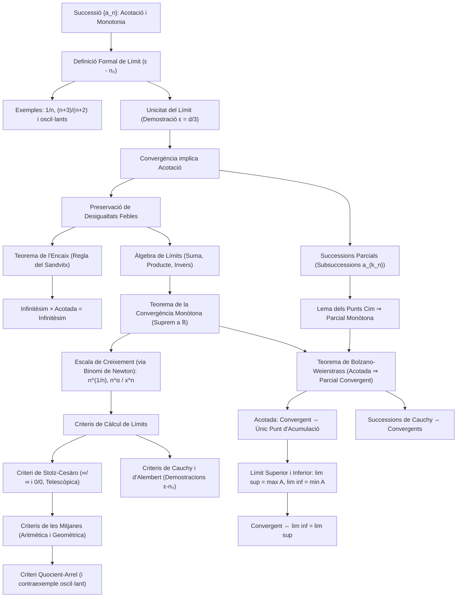

<!-- INSTRUCCIONS D'INTEGRACIÓ a "03. Successions de Nombres Reals.md": 1. Enganxa el bloc A al final de la secció 13 (just després de la demostració de Bolzano-Weierstrass). 2. Substitueix la secció "14. Esquema Resum" actual per les seccions 14, 15 i 16 d'aquest fitxer (blocs B, C i D). --> <!-- ============================ BLOC A ============================ -->

### 6. Caracterització de la Convergència per Punts d'Acumulació

> [!NOTE] Proposició Sigui ${a_n}$ una successió **acotada**. Aleshores: $${a_n} \text{ és convergent} \iff {a_n} \text{ té un únic punt d'acumulació}$$

> [!NOTE] Observació Pel Teorema de Bolzano-Weierstrass, tota successió acotada té almenys un punt d'acumulació. Per tant, el que realment aporta la proposició és la **unicitat**.

#### Demostració

- $(\implies)$ Si $a_n \to a \in \mathbb{R}$, per la preservació del límit per subsuccessions tota parcial $a_{k_n} \to a$. Per tant, l'únic punt d'acumulació és $a$.
- $(\impliedby)$ Ho provem pel contrarecíproc: si ${a_n}$ no convergeix, té més d'un punt d'acumulació. Com que ${a_n}$ és acotada, per Bolzano-Weierstrass té algun punt d'acumulació $a$. Com que ${a_n}$ no convergeix, $a_n \not\to a$, és a dir: $$\exists \varepsilon > 0 \text{ tal que } \forall n_0 ; \exists n > n_0 \text{ amb } |a_n - a| \ge \varepsilon$$ Això permet construir una successió d'índexs $k_1 < k_2 < \dots < k_n < \dots$ tal que $$|a_{k_n} - a| \ge \varepsilon \quad \forall n$$ La parcial ${a_{k_n}}$ és acotada (és una parcial de ${a_n}$); per Bolzano-Weierstrass existeix una parcial ${a_{k_{j_n}}}_n$ convergent, diguem-ne a $b \in \mathbb{R}$. Passant al límit a $|a_{k_{j_n}} - a| \ge \varepsilon$: $$|b - a| \ge \varepsilon \implies b \neq a$$ Així $b$ és un segon punt d'acumulació diferent d'$a$. $\blacksquare$

<!-- ============================ BLOC B ============================ -->

## 14. Límit Superior i Límit Inferior

### 1. Definició

Sigui ${a_n}$ una successió **acotada**, amb $m \le a_n \le M$ per a tot $n$. Per a cada $n \in \mathbb{N}$ definim: $$y_n = \inf {a_n, a_{n+1}, a_{n+2}, \dots}, \qquad z_n = \sup {a_n, a_{n+1}, a_{n+2}, \dots}$$

Propietats:

- $y_n \le z_n$ per a tot $n$.
- ${y_n}$ és **creixent** (en augmentar $n$ l'ínfim es fa sobre un conjunt més petit) i ${z_n}$ és **decreixent** (el suprem es fa sobre un conjunt més petit).
- Ambdues estan acotades entre $m$ i $M$.

Pel Teorema de la Convergència Monòtona, existeixen els límits:

> [!IMPORTANT] Definició de Límit Inferior i Límit Superior $$\liminf_{n \to \infty} a_n = \lim_{n \to \infty} y_n = \sup_n \left( \inf_{k \ge n} a_k \right)$$ $$\limsup_{n \to \infty} a_n = \lim_{n \to \infty} z_n = \inf_n \left( \sup_{k \ge n} a_k \right)$$ Notacions alternatives: $\underline{\lim}, a_n$ i $\overline{\lim}, a_n$.

Si la successió no és acotada, $y_n$ i/o $z_n$ poden valer $\mp\infty$, i les mateixes definicions tenen sentit a $\overline{\mathbb{R}} = \mathbb{R} \cup {\pm\infty}$ (els límits de successions monòtones existeixen sempre a $\overline{\mathbb{R}}$). En particular:

- Si ${a_n}$ **no** està acotada superiorment, $\limsup a_n = +\infty$.
- Si ${a_n}$ **no** està acotada inferiorment, $\liminf a_n = -\infty$.

> [!NOTE] Proposició Per a tota successió ${a_n}$: $$\liminf_{n \to \infty} a_n \le \limsup_{n \to \infty} a_n$$

_Demostració._ Com que $y_n \le z_n$ per a tot $n$, passant al límit quan $n \to \infty$ (preservació de desigualtats febles) s'obté $\lim y_n \le \lim z_n$. $\blacksquare$

### 2. Exemples

> [!TIP] Exemples
> 
> 1. **$a_n = (-1)^n = (-1, 1, -1, 1, \dots)$:** $y_n = \inf_{k \ge n} a_k = -1$ i $z_n = \sup_{k \ge n} a_k = 1$ per a tot $n$. Per tant $\liminf a_n = -1$ i $\limsup a_n = 1$.
> 2. **$b_n = (1, 2, 3, 1, 2, 3, \dots)$:** $y_n = 1$ i $z_n = 3$ per a tot $n$, d'on $\liminf b_n = 1$ i $\limsup b_n = 3$.
> 3. **$c_n = \left(2, \tfrac{1}{2}, 3, \tfrac{1}{3}, 4, \tfrac{1}{4}, \dots\right)$:** la successió no està acotada superiorment, així que $z_n = +\infty$ i $\limsup c_n = +\infty$. Pel que fa a l'ínfim, la cua conté termes $\frac{1}{k}$ arbitràriament petits i tots els termes són positius, per tant $y_n = 0$ per a tot $n$ i $\liminf c_n = 0$.
> 4. **$d_n = -n$:** $z_n = \sup{-n, -n-1, \dots} = -n \to -\infty$ i $y_n = \inf{-n, -n-1, \dots} = -\infty$. Per tant $\limsup d_n = \liminf d_n = -\infty$ (i, de fet, $d_n \to -\infty$).

> [!NOTE] Nota d'esmena Als apunts originals, a l'exemple 3 s'escrivia $y_n = \frac{1}{n}$. Això és incorrecte: l'ínfim de la cua és $0$ (no s'assoleix), no $\frac{1}{n}$. El resultat $\liminf c_n = 0$ és el mateix.

### 3. Caracterització per Conjunts d'Índexs

> [!IMPORTANT] Teorema Sigui ${a_n}$ una successió acotada i siguin $a, b \in \mathbb{R}$. Aleshores:
> 
> 1. $\limsup a_n = a \iff \forall \varepsilon > 0$:
>     - ${n \mid a_n > a + \varepsilon}$ és un conjunt **finit**, i
>     - ${n \mid a_n > a - \varepsilon}$ és un conjunt **infinit**.
> 2. $\liminf a_n = b \iff \forall \varepsilon > 0$:
>     - ${n \mid a_n < b + \varepsilon}$ és un conjunt **infinit**, i
>     - ${n \mid a_n < b - \varepsilon}$ és un conjunt **finit**.

<!-- La demostració de (1) es va fer a la pissarra i no consta als apunts; la de (2) és anàloga. Pendent d'afegir. -->

També es pot expressar amb límits infinits: $$\limsup_{n \to \infty} a_n = +\infty \iff \forall M > 0, ; {n : a_n > M} \text{ és infinit}$$ $$\liminf_{n \to \infty} a_n = -\infty \iff \forall M > 0, ; {n : a_n < -M} \text{ és infinit}$$

A més: $$\limsup_{n \to \infty} a_n = -\infty \implies \lim_{n \to \infty} a_n = \liminf_{n \to \infty} a_n = -\infty$$

### 4. Relació amb els Punts d'Acumulació

Sigui ${a_n}$ una successió acotada superiorment i sigui $$A = {x \in \mathbb{R} \mid x \text{ és punt d'acumulació de } {a_n}}$$ Aleshores, o bé $A = \emptyset$, o bé $A \neq \emptyset$.

#### Cas $A = \emptyset$

> [!NOTE] Proposició Si ${a_n}$ és acotada superiorment i $A = \emptyset$, aleshores $\limsup a_n = -\infty$.

> [!TIP] Exemple $a_n = -n$: no té cap punt d'acumulació i $\limsup a_n = -\infty$.

_Demostració._ Suposem que no és cert que $\limsup a_n = -\infty$. Aleshores existeix $M > 0$ tal que $$\forall n_0, ; \exists n \ge n_0 \text{ amb } a_n \ge -M$$

- Amb $n_0 = 1$: existeix $k_1$ amb $a_{k_1} \ge -M$.
- Amb $n_0 = k_1 + 1$: existeix $k_2 > k_1$ amb $a_{k_2} \ge -M$.
- Reiterant el procés, existeixen $M$ i $k_1 < k_2 < \dots < k_n < \dots$ amb $a_{k_n} \ge -M$.

La parcial ${a_{k_n}}$ està acotada (inferiorment per $-M$ i superiorment perquè ${a_n}$ ho està). Per Bolzano-Weierstrass existeix una parcial amb límit $b$, i per tant $b \in A = \emptyset$. Contradicció. $\blacksquare$

#### Cas $A \neq \emptyset$

En aquest cas $A$ no és buit, és a dir, la successió té com a mínim un punt d'acumulació.

> [!IMPORTANT] Teorema Sigui ${a_n}$ una successió acotada superiorment amb $A \neq \emptyset$ i sigui $A$ el conjunt dels seus punts d'acumulació. Aleshores:
> 
> 1. $\sup(A) = \limsup\limits_{n \to \infty} a_n$
> 2. $\inf(A) = \liminf\limits_{n \to \infty} a_n$

> [!NOTE] Nota d'esmena Als apunts l'apartat (2) s'enuncia amb la sola hipòtesi "acotada superiorment", però així és fals: per a $a_n = -n$ si $n$ és senar i $a_n = 0$ si $n$ és parell, $A = {0}$ però $\liminf a_n = -\infty$. L'apartat (2) requereix que la successió estigui també acotada inferiorment, com a l'enunciat següent.

> [!IMPORTANT] Teorema Sigui ${a_n}$ una successió acotada i $A$ el conjunt dels seus punts d'acumulació. Com que $A$ és acotat (i no buit per Bolzano-Weierstrass), existeixen $\sup A$ i $\inf A$, i es compleix:
> 
> 1. $\limsup\limits_{n \to \infty} a_n = \sup A$
> 2. $\liminf\limits_{n \to \infty} a_n = \inf A$

#### Demostració

Només es fa la prova de (1); la de (2) és anàloga i no es fa a classe. Sigui $L = \limsup a_n = \lim z_n$, on $z_n = \sup{a_n, a_{n+1}, \dots}$ és decreixent i acotada. Veurem:

- **I)** $L \in A$.
- **II)** Per a qualsevol parcial convergent ${a_{k_n}}_n$: $\liminf a_n \le \lim a_{k_n} \le \limsup a_n$.

**Prova de I).** Construïm una parcial ${a_{k_j}}_j$ que convergeix a $L$. Com que $z_n \to L$, per a tot $\varepsilon > 0$ existeix $n_0$ tal que $L - \varepsilon \le z_n < L + \varepsilon$ si $n \ge n_0$.

- Amb $\varepsilon = 1$: existeix $n_1$ tal que $L - 1 \le z_{n_1} < L + 1$. Com que $z_{n_1} = \sup{a_{n_1}, a_{n_1+1}, \dots}$, per la definició de suprem existeix $k_1 \ge n_1$ tal que $$L - 1 - 1 < z_{n_1} - 1 < a_{k_1} \le z_{n_1} < L + 1$$
- Amb $\varepsilon = \frac12$: existeix $n_2 > k_1$ tal que $L - \frac12 \le z_{n_2} < L + \frac12$, i existeix $k_2 \ge n_2 > k_1$ tal que $$L - \tfrac12 - \tfrac12 < z_{n_2} - \tfrac12 < a_{k_2} \le z_{n_2} < L + \tfrac12$$
- Amb $\varepsilon = \frac13$: existeix $n_3 > k_2$ i $k_3 \ge n_3 > k_2$ tals que $$L - \tfrac13 - \tfrac13 < z_{n_3} - \tfrac13 < a_{k_3} \le z_{n_3} < L + \tfrac13$$
- En general, per a cada $j \ge 1$, amb $\varepsilon = \frac1j$ existeix $n_j > k_{j-1}$ i $k_j \ge n_j$ tals que $$L - \frac{2}{j} < a_{k_j} < L + \frac{1}{j}$$

Els índexs són estrictament creixents ($k_j \ge n_j > k_{j-1}$), així que ${a_{k_j}}$ és una parcial. Quan $j \to \infty$ ambdues cotes tendeixen a $L$, i pel Teorema de l'Encaix $a_{k_j} \to L$. Per tant $L \in A$.

**Prova de II).** Sigui $a_{k_n} \to b$ una parcial. Com que $k_n \ge n$, tenim $a_{k_n} \in {a_n, a_{n+1}, \dots}$, i per tant $$y_n = \inf{a_n, a_{n+1}, \dots} \le a_{k_n} \le \sup{a_n, a_{n+1}, \dots} = z_n$$ Passant al límit quan $n \to \infty$: $\liminf a_n \le b \le \limsup a_n$.

**Conclusió: $L$ és el suprem de $A$.** Ja sabem per I) que $L \in A$. Sigui ara $b \in A$; aleshores existeix una parcial $a_{j_n} \to b$, i per II) $b \le L$. Per tant $L = \max A$, és a dir, $L = \sup A$. $\blacksquare$

> [!NOTE] Corol·lari Sigui ${a_n}$ una successió acotada. Són equivalents:
> 
> 1. ${a_n}$ és convergent.
> 2. $\liminf a_n = \limsup a_n$ (i aquest valor comú és $\lim a_n$).
> 3. ${a_n}$ té un únic punt d'acumulació $a$, és a dir, $A = {a}$ i $\max A = \min A = a$.

_Demostració._ (1) $\iff$ (3) és la Proposició de la secció 13.6. (3) $\implies$ (2): pel teorema, $\limsup a_n = \max A = a = \min A = \liminf a_n$. (2) $\implies$ (3): pel teorema, $\max A = \min A$, per tant $A$ té un sol element. $\blacksquare$

<!-- ============================ BLOC C ============================ -->

## 15. Successions de Cauchy

> [!IMPORTANT] Definició de Successió de Cauchy Una successió ${a_n}$ és **de Cauchy** si: $$\forall \varepsilon > 0, ; \exists n_0 \in \mathbb{N} \text{ tal que si } n, m \ge n_0 \implies |a_n - a_m| < \varepsilon$$

> [!IMPORTANT] Teorema Una successió de nombres reals és de Cauchy si i només si és convergent.

#### Demostració

**$(\impliedby)$ Convergent $\implies$ de Cauchy.** Sigui $a_n \to a$ i $\varepsilon > 0$. Existeix $n_0$ tal que $|a_n - a| < \frac{\varepsilon}{2}$ per a tot $n \ge n_0$. Aleshores, per a $n, m \ge n_0$: $$|a_n - a_m| = |(a_n - a) + (a - a_m)| \le |a_n - a| + |a_m - a| < \frac{\varepsilon}{2} + \frac{\varepsilon}{2} = \varepsilon$$

**$(\implies)$ De Cauchy $\implies$ convergent.** Volem provar tres coses:

- a) Si ${a_n}$ és de Cauchy, aleshores és **acotada**.
- b) Si és acotada, existeix una parcial convergent $a_{k_n} \to a$ (Bolzano-Weierstrass).
- c) Si ${a_n}$ és de Cauchy i una parcial $a_{k_n} \to a$, aleshores $a_n \to a$.

_a) Acotació._ Prenem $\varepsilon = 1$: existeix $n_0$ tal que $|a_n - a_m| < 1$ si $n, m \ge n_0$. Per a $n \ge n_0$: $$|a_n| = |(a_n - a_{n_0}) + a_{n_0}| \le |a_n - a_{n_0}| + |a_{n_0}| < 1 + |a_{n_0}|$$ Sigui $M = \max{|a_1|, \dots, |a_{n_0 - 1}|, 1 + |a_{n_0}|}$. Aleshores $|a_n| \le M$ per a tot $n \in \mathbb{N}$.

_b)_ Conseqüència directa de a) i del Teorema de Bolzano-Weierstrass.

_c) Convergència de tota la successió._ Sigui $\varepsilon > 0$. Per ser de Cauchy, existeix $n_1$ tal que $|a_n - a_m| < \frac{\varepsilon}{2}$ si $n, m \ge n_1$. Com que $a_{k_n} \to a$, existeix $n_2$ tal que $|a_{k_n} - a| < \frac{\varepsilon}{2}$ si $n \ge n_2$. Sigui $n_0 = \max{n_1, n_2}$. Per a $n \ge n_0$, com que $k_n \ge n \ge n_1$: $$|a_n - a| \le |a_n - a_{k_n}| + |a_{k_n} - a| < \frac{\varepsilon}{2} + \frac{\varepsilon}{2} = \varepsilon$$ Per tant $a_n \to a$. $\blacksquare$

> [!NOTE] Observació Aquest teorema és una reformulació de la **completesa de $\mathbb{R}$**: permet provar que una successió convergeix sense conèixer-ne el límit, comprovant només que els seus termes s'aproximen entre ells. És l'eina que ja s'ha fet servir a la condició de Cauchy per a sèries i per a integrals impròpies.

<!-- ============================ BLOC D ============================ -->

## 16. Esquema Resum

